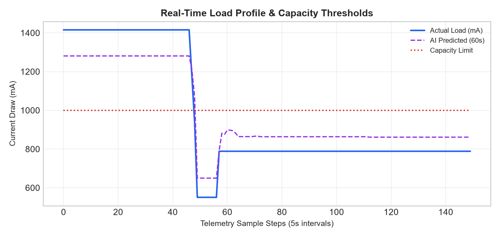
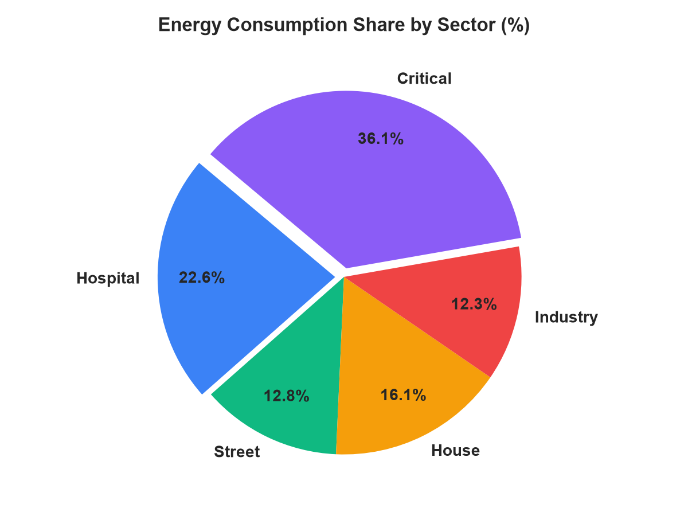
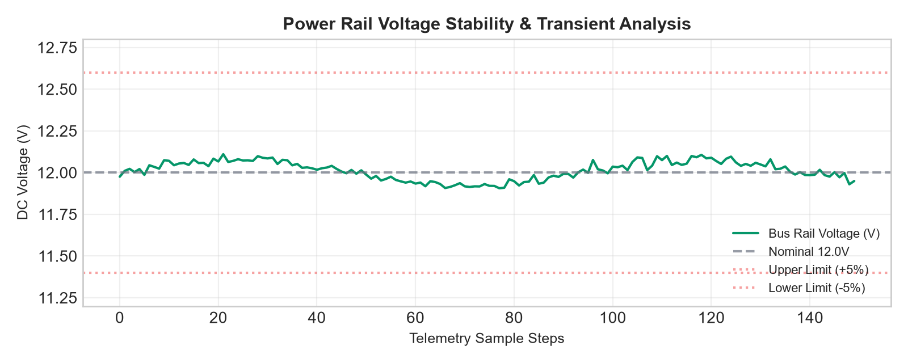
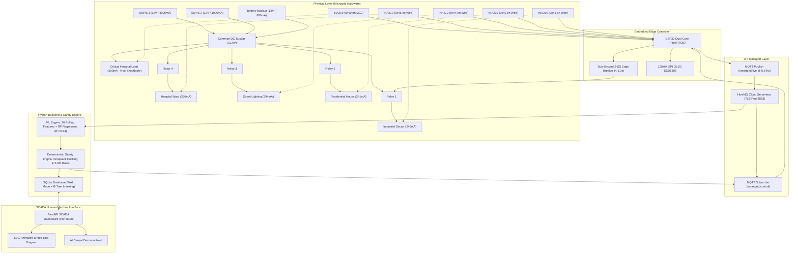

# AI-Enabled Smart Grid for Intelligent Load Management, Forecasting and Fault Diagnosis

[](https://www.python.org/)
[](https://fastapi.tiangolo.com/)
[](https://scikit-learn.org/)
[](https://www.hivemq.com/)
[](https://www.espressif.com/)
[](https://opensource.org/licenses/MIT)
[](https://sqlite.org/)

> **A Cyber-Physical Microgrid Testbed with Edge Sensing, Hybrid Machine Learning Forecasting, Deterministic Safety Interlocks, and Digital Twin SCADA.**  
> *Developed as an Innovative Engineering Design / Academic Research Project at **Vellore Institute of Technology (VIT), Vellore**.*

---

## ⚡ Overview & Problem Statement

Modern power distribution microgrids suffer from three critical vulnerabilities:
1. **Source Capacity Collapse under Surges:** When transitioning from dual utility supplies ($5000\,\text{mA}$) to a single auxiliary supply ($1000\,\text{mA}$) or battery backup ($800\,\text{mA}$), unmanaged branch demand induces undervoltage collapse, blacking out critical life-support loads.
2. **Indiscriminate Protection:** Conventional thermal-magnetic breakers cut off entire distribution feeders simultaneously without differentiating between life-critical and non-essential loads.
3. **The Risk of Direct AI Control in Power Systems:** While AI models excel at non-linear forecasting and anomaly detection, directly wiring stochastic machine learning outputs to mechanical switchgear risks catastrophic failure during prediction outliers.

### The Cyber-Physical Solution:
This system enforces a non-negotiable architectural doctrine:  
$$\textbf{AI Predicts & Diagnoses} \;\longrightarrow\; \textbf{Deterministic Safety Decides} \;\longrightarrow\; \textbf{ESP32 Executes}$$

An **ESP32 dual-core microcontroller** monitors 5 load sectors and 3 generation sources via 5 Texas Instruments INA219 digital sensors over dual isolated $I^2C$ buses, streaming 2.0-second telemetry over TLS-encrypted MQTT. Machine learning regressors forecast lookahead current and power demand ($R^2 = 0.94$), while a deterministic safety engine manages capacity shedding ($\ge 85\%$) and opportunistic knapsack-packed restoration ($\le 84\%$).

---

## 📸 System Visuals & Demonstration

<div align="center">

### Hardware Testbed
<!-- Drop your physical hardware photo into assets/screenshots/hardware_setup.jpg to display here -->

*Physical Prototype: ESP32 DevKit, Dual-I2C INA219 breakout modules, 4-Channel optocoupled relay board, and SPI OLED display.*

<br/>

### SCADA Digital Twin & Single-Line Diagram (SLD)
<!-- Drop your browser dashboard screenshot into assets/screenshots/dashboard_sld.png to display here -->

*Browser-based SCADA interface featuring real-time animated SVG power flows, dynamic capacity gauge, and AI causal decision feed.*

</div>

---

## 📊 Analytical Evaluation & Experimental Results

The prototype was benchmarked across **3,495 logged hardware cycles** and **276 recorded actuation events** stored in a high-concurrency SQLite Write-Ahead Logging (WAL) database:

| Load Profile Analysis | Cumulative Energy Share | Bus Voltage Stability |
| :---: | :---: | :---: |
|  |  |  |
| *Multi-cycle dynamic sector current draws* | *Sector consumption breakdown* | *Voltage retention during source failovers* |

---

## 🏛️ Cyber-Physical Architecture



---

## 🔬 Core Algorithms & Technical Specifications

### 1. Hybrid Physics-Constrained Load Forecasting
* **Model:** Random Forest Regressors fed by an in-memory 35-sample sliding window computing **36 dynamic statistical features** (1-minute and 5-minute rolling averages, discrete rates of change $dI/dt$, and lag vectors $t-1, t-3, t-6, t-30$).
* **Physics Clamping:** Prevents statistical regressors from predicting non-zero phantom power for disconnected circuits:
  $$\hat{P}_{\text{load}} = 0 \quad \text{if} \quad \text{Relay}_{\text{load}} = 0$$
* **Benchmark:** $R^2 = 0.9404$, $\text{RMSE} = 28.4\,\text{mA}$, inference latency = $8.2\,\text{ms}$.

### 2. Opportunistic Knapsack Priority-Packing Restoration
* **Problem:** Restoring shedded loads without exceeding available capacity and triggering secondary brownouts.
* **Algorithm:** Greedy approximation of the 0/1 Bounded Knapsack Problem:
  $$\text{Maximize } \sum_{i \in \text{Off}} P_i \cdot x_i \quad \text{subject to} \quad I_{\text{total}} + \sum_{i \in \text{Off}} (I_{\text{nominal}, i} \cdot x_i) \le 0.84 \times I_{\text{limit}}$$
* Restores healthy loads in descending priority order (`Hospital` $\to$ `Street` $\to$ `House` $\to$ `Industry`). If a high-draw sector would violate the $\le 84\%$ threshold, it greedily bypasses it to evaluate smaller loads.

### 3. Inverse-Priority Automated Shedding
* Triggers immediately when capacity utilization reaches or exceeds **$85.0\%$**.
* Sequentially sheds active loads in ascending priority order (`Industry` $\to$ `House` $\to$ `Street` $\to$ `Hospital`), enforcing a **15-second anti-chattering dwell time** between contactor toggles.

### 4. Welded Contactor & Stuck-Relay Hardware Diagnostics
* Automatically flags welded mechanical relay contacts:
  $$\text{Fault State} = \text{STUCK\_CLOSED} \quad \text{if} \quad (\text{Relay} == 0 \land I_{\text{branch}} > 25.0\,\text{mA})$$
* Branch classifiers identify abnormal undercurrent, overcurrent, and disconnects with **$98.5\%$ diagnostic accuracy**.

---

## 🔌 Hardware Specifications & Pinout Netlist

| Peripheral / Signal | ESP32 GPIO Pin | Description / Interface |
| :--- | :--- | :--- |
| **Primary $I^2C$ SDA** | `GPIO 27` | Primary Bus `Wire` (Hospital `0x45`, Street `0x44`, House `0x40`, Industry `0x41`) |
| **Primary $I^2C$ SCL** | `GPIO 33` | Primary Bus Clock line with $4.7\,\text{k}\Omega$ pullups |
| **Secondary $I^2C$ SDA** | `GPIO 25` | Isolated Bus `I2C2` (Critical Load `0x40`) |
| **Secondary $I^2C$ SCL** | `GPIO 32` | Isolated Bus Clock line (Hardware fault isolation) |
| **Relay: House** | `GPIO 4` | Active-LOW Relay Optocoupler Channel 2 |
| **Relay: Industry** | `GPIO 26` | Active-LOW Relay Optocoupler Channel 1 |
| **Relay: Street Light** | `GPIO 13` | Active-LOW Relay Optocoupler Channel 3 |
| **Relay: Hospital** | `GPIO 14` | Active-LOW Relay Optocoupler Channel 4 |
| **Source Sense: SMPS 1** | `GPIO 34` | Optical sense input ($5000\,\text{mA}$ rail present) |
| **Source Sense: SMPS 2** | `GPIO 35` | Optical sense input ($1000\,\text{mA}$ rail present) |
| **Source Sense: Battery** | `GPIO 39` | Optical sense input ($800\,\text{mA}$ battery rail present) |
| **OLED SPI MOSI / CLK** | `GPIO 23` / `18` | 128×64 SSD1306 SPI Master Out / Clock |
| **OLED DC / CS / RESET** | `GPIO 21` / `19` / `22` | Control lines for hardware OLED status display |

---

## 📂 Repository Directory Layout

```text
smartgrid_ai/
├── run_smart_grid_suite.py       # Master system launcher (Web SCADA + MQTT + AI)
├── .env.example                  # Sanitized environment configuration template
├── requirements.txt              # Python runtime dependencies
├── LICENSE                       # MIT Open-Source License
├── README.md                     # Comprehensive technical documentation
│
├── src/                          # Application source code
│   ├── smart_grid_ai.py          # Real-time closed-loop AI controller runner
│   ├── core/
│   │   ├── config.py             # Global constants, pin maps & 2-SD limits
│   │   ├── database.py           # SQLite Write-Ahead Logging (WAL) manager
│   │   └── mqtt_client.py        # TLS-encrypted resilient MQTT wrapper
│   ├── dashboard/
│   │   └── grid_dashboard.py     # FastAPI server, WebSockets & SVG Digital Twin
│   └── services/
│       ├── ml_engine.py          # 36-feature pipeline, RF models & diagnostics
│       ├── mock_esp32.py         # Virtual ESP32 hardware simulator for offline demos
│       ├── safety_engine.py      # Deterministic 2-SD edge tripping & knapsack packing
│       ├── telegram_service.py   # Smartphone push alerts & simulator fallback
│       └── grid_analytics.py     # IEEE reliability & energy accounting engine
│
├── data/
│   └── raw/                      # Experimental datasets & physical telemetry logs
│       ├── README.md             # Dataset documentation & schemas
│       ├── master_grid_dataset.csv
│       ├── fault_grid_dataset_labeled.csv
│       ├── fault_grid_dataset.csv
│       ├── uniform_grid_dataset.csv
│       └── esp_grid_telemetry.xlsx
│
├── docs/                         # Academic documentation, manifests & reports
│   ├── SMART_GRID_AI_FINAL_PROJECT_REPORT.md
│   ├── SMART_GRID_AI_FINAL_PROJECT_REPORT.docx
│   ├── SYSTEM_INVENTORY_AND_CONTRACTS.md
│   ├── TEAM_HANDOVER_MANUAL.md
│   ├── DATA_AUDIT_REPORT.md
│   ├── MODEL_AUDIT_REPORT.md
│   └── MODEL_BENCHMARK_MATRIX.json
│
├── firmware/                     # Embedded C++ Arduino firmware
│   └── smartgrid_closed_loop_esp32/
│       └── smartgrid_closed_loop_esp32.ino
│
├── models/                       # 11 Serialized Scikit-Learn models (.pkl) & headers
│   ├── load_forecasting_current_model.pkl
│   ├── load_forecasting_power_model.pkl
│   ├── fault_detection_model.pkl
│   ├── fault_severity_model.pkl
│   └── model_<sector>.pkl
│
├── results/                      # Generated charts, analytics PDFs & summaries
│   ├── chart_energy_pie.png
│   ├── chart_load_profile.png
│   ├── chart_voltage_stability.png
│   └── smart_grid_analytics_report.pdf
│
├── scripts/                      # Standalone audit and model training tools
│   ├── data_audit.py
│   ├── model_audit.py
│   ├── train_local_models.py
│   └── grid_alerts.py
│
└── tests/                        # Automated unit and integration test suites
    ├── test_safety_engine.py
    ├── test_ml_pipeline.py
    └── test_e2e_integration.py
```

---

## 🚀 Quickstart Guide

### 1. Clone the Repository
```bash
git clone https://github.com/saptarshidas578/smartgrid_ai.git
cd smartgrid_ai
```

### 2. Set Up Virtual Environment & Dependencies
```bash
python -m venv venv

# Windows
venv\Scripts\activate

# Linux / macOS
source venv/bin/activate

pip install -r requirements.txt
```

### 3. Configure Environment Variables
Copy the configuration template and enter your MQTT broker credentials:
```bash
cp .env.example .env
```

### 4. Run Automated Test Verification
Ensure all safety, ML, and database subsystems pass:
```bash
python tests/test_safety_engine.py
python tests/test_ml_pipeline.py
python tests/test_e2e_integration.py
```

---

## 💻 Running the System

### Option A: Software-Only Demonstration (Virtual Mock Mode)
Run the entire platform without physical hardware. The background simulator generates fluctuating current draws, triggers automated shedding, and streams to the dashboard:
```bash
python run_smart_grid_suite.py --mock
```
1. Open your browser to **`http://localhost:8000`**.
2. Watch the animated SVG Single-Line Diagram, live capacity gauges, and AI causal decision feed.
3. Access worldwide via the automatically provisioned Cloudflare Zero Trust tunnel URL printed in your console.

### Option B: Real Physical Hardware Operation
1. Flash `firmware/smartgrid_closed_loop_esp32/smartgrid_closed_loop_esp32.ino` to your ESP32 via Arduino IDE.
2. Power on the ESP32 and connect it to your local Wi-Fi hotspot.
3. Run the live suite:
```bash
python run_smart_grid_suite.py
```
*The dashboard will transition from `OFFLINE` to `ONLINE` upon receiving the first telemetry packet.*

---

## 📜 Academic Attribution

* **Project:** AI-Enabled Smart Grid for Intelligent Load Management, Forecasting and Fault Diagnosis
* **Author:** Saptarshi Das
* **Institution:** Vellore Institute of Technology (VIT), Vellore
* **Department:** Electrical & Electronics Engineering / Computer Science & Engineering
* **Course:** Innovative Engineering Design & Cyber-Physical Systems (Semester III / IV)

---

## 📄 License
This project is licensed under the **MIT License** — see the [LICENSE](LICENSE) file for details.
