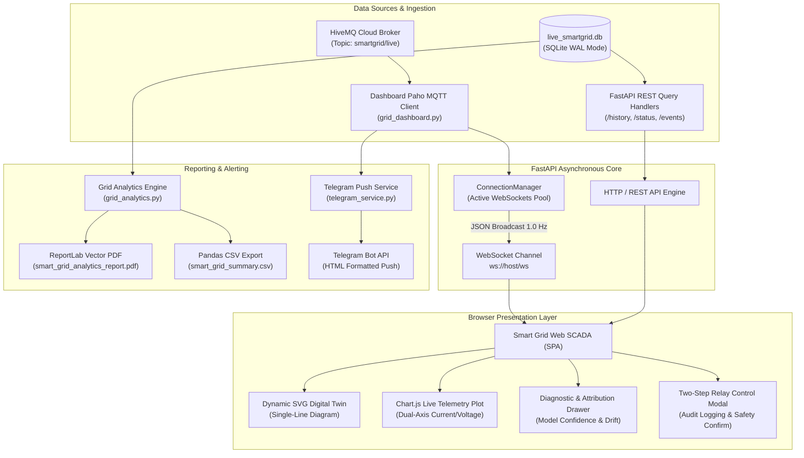
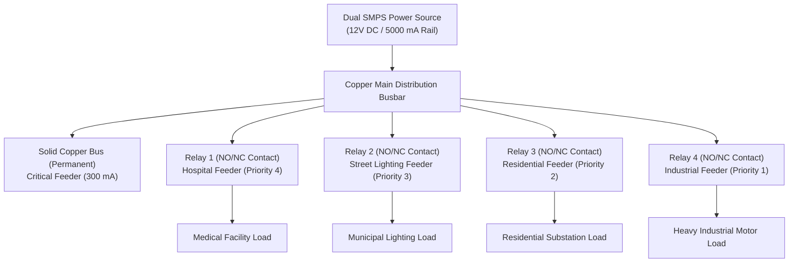

# PART 2A: Front End & SCADA Presentation Layer — Comprehensive Technical Manual

**Author:** Saptarshi Das  
**Institution:** School of Electrical Engineering & Department of Computer Science and Engineering, Vellore Institute of Technology (VIT), Vellore  
**Repository:** [saptarshidas578/smartgrid_ai](https://github.com/saptarshidas578/smartgrid_ai)  
**Primary Source Modules:** `src/dashboard/grid_dashboard.py` (1,915 lines), `src/services/grid_analytics.py` (527 lines), `src/services/telegram_service.py` (149 lines), `src/smart_grid_ai.py` (ASCII Console SCADA)  
**Deployment Infrastructure:** FastAPI ASGI Web Server, Uvicorn, Cloudflare Zero-Trust Secure Tunneling  

---

## 1. Executive Summary & Architectural Overview

The Front End and SCADA (Supervisory Control and Data Acquisition) presentation layer serves as the human-machine interface (HMI) and situational awareness platform for the smart grid. In cyber-physical energy infrastructures, operational visibility must satisfy three strict requirements:
1. **Sub-Second Real-Time Telemetry Streaming:** Operators require instant visualization of bus voltages, sector load currents, active power consumption, and model forecasts without manual browser refreshes.
2. **Defensive Actuation Interfaces:** High-voltage switchgear commands (tripping, shedding, manual energization) demand rigorous, multi-factor visual confirmation to eliminate accidental operational disruptions.
3. **Multi-Channel Situational Awareness:** Grid alarms must transcend the browser console through redundant notification channels, including automated Telegram smartphone push alerts, vector PDF analytical audit reports, and local ANSI terminal dashboards.

The architectural boundary of Part 2A encapsulates:
* **The Web SCADA Application (`grid_dashboard.py`):** An asynchronous FastAPI backend serving a responsive, Tailwind CSS-powered single-page application (SPA), featuring a WebSocket pub/sub connection manager, real-time Chart.js time-series plots, dynamic SVG Single-Line Diagrams (SLD), model explainability drawers, and two-tier manual override modals.
* **The Grid Analytics Subsystem (`grid_analytics.py`):** An offline and on-demand analytical computation suite calculating numerical energy consumption via Riemann integration ($\text{kWh}$), electrical utility cost profiling, bus voltage regulation indices, and IEEE standard reliability metrics (SAIFI, SAIDI, CAIDI).
* **The Asynchronous Push Notification Gateway (`telegram_service.py`):** A rate-limited, threaded notification service formatting and delivering critical grid actuation events and graduated warning tiers directly to operations personnel.
* **The Terminal SCADA Console (`src/smart_grid_ai.py`):** An ANSI/UTF-8 terminal interface providing immediate, local operator feedback with ASCII capacity gauges and sector breakdowns.



---

## 2. Web SCADA Server Architecture (`grid_dashboard.py`)

`src/dashboard/grid_dashboard.py` is implemented using **FastAPI**, an asynchronous ASGI web framework built upon Starlette and Pydantic. It operates concurrently on event loop threads, managing high-throughput WebSocket broadcasts alongside database-backed REST queries.

### 2.1 Asynchronous WebSocket Connection Manager

To achieve sub-second live updates across multiple connected browser clients without polling fatigue, the server implements an asynchronous `ConnectionManager` class (lines 84–106):

```python
class ConnectionManager:
    def __init__(self):
        self.active_connections: List[WebSocket] = []

    async def connect(self, websocket: WebSocket):
        await websocket.accept()
        self.active_connections.append(websocket)

    def disconnect(self, websocket: WebSocket):
        if websocket in self.active_connections:
            self.active_connections.remove(websocket)

    async def broadcast(self, message: dict):
        dead_connections = []
        for connection in self.active_connections:
            try:
                await connection.send_json(message)
            except Exception:
                dead_connections.append(connection)
        for dead in dead_connections:
            self.disconnect(dead)
```

#### Key Design Patterns:
1. **Dead Connection Pruning:** Mobile browsers or backgrounded tabs often sever WebSocket TCP sockets abruptly. The `broadcast()` routine catches network exceptions (`ConnectionResetError`, `WebSocketDisconnect`) and appends failed sockets to a `dead_connections` eviction list, preventing resource leaks and event loop blocking.
2. **Non-Blocking Telemetry Ingestion Bridge:** In lines 112–242, the Paho MQTT client's synchronous callback `on_mqtt_message` intercepts incoming payloads from `smartgrid/live`. To safely transfer data into FastAPI's asynchronous event loop, the callback invokes:
   ```python
   asyncio.run_coroutine_threadsafe(manager.broadcast(telemetry_payload), main_loop)
   ```
   This ensures complete thread-safety across the background Paho MQTT networking thread and the Uvicorn ASGI event loop.

---

### 2.2 Comprehensive REST API Endpoint Reference

The backend exposes a suite of RESTful HTTP endpoints supporting historical queries, supervisory mode control, switchgear actuation, and report generation:

| HTTP Method | Route Endpoint | Purpose & Input Parameters | Output Schema / Response Type |
| :--- | :--- | :--- | :--- |
| `GET` | `/` | Root route; serves the complete embedded Single-Page Application. | `HTMLResponse` (`text/html; charset=utf-8`) |
| `GET` | `/ws` | WebSocket endpoint for continuous 1.0 Hz live telemetry streaming. | Bidirectional WebSocket stream (JSON payloads) |
| `GET` | `/history` | Fetches historical time-series buffer. Parameter: `limit` (default: 35). | `JSON`: List of `{time, total_current, predicted_current, limit, hospital, street, house, industry, critical}` |
| `GET` | `/status` | Fetches the most recent grid status, control mode, and 10 recent actions. | `JSON`: `{status: "ok", mode, control_mode, latest_telemetry, recent_actions}` |
| `GET` | `/events` | Retrieves historical switchgear actuation and safety trip logs. | `JSON`: List of `{id, timestamp, action_type, load_name, reason, current_mA, limit_mA, details}` |
| `POST` | `/control/mode` | Toggles supervisory control mode between `AUTO` (AI/Safety) and `MANUAL`. | `JSON`: `{status: "ok", mode: "AUTO" \| "MANUAL"}` |
| `POST` | `/control/relay` | Dispatches manual energize/de-energize commands. Body: `{load: str, state: 0\|1, reason: str}`. | `JSON`: `{status: "ok", load, state, message}` |
| `GET` | `/analytics/summary`| Computes on-demand mathematical energy, cost, and reliability summary. | `JSON`: `{has_data, energy_kwh, total_cost, saifi, saidi, autonomy_pct, ...}` |
| `GET` | `/model/matrix` | Returns confusion matrix and validation metrics for all 8 ML models. | `JSON`: Confusion matrices, precision, recall, $F_1$, and training parameters. |
| `GET` | `/analytics/download-pdf`| Triggers ReportLab PDF generation and returns the compiled document. | `FileResponse` (`application/pdf`) |
| `GET` | `/analytics/download-csv`| Generates and streams structured session summary in tabular format. | `FileResponse` (`text/csv`) |

#### Detailed Examination of `/control/relay` Actuation Handler:
The switchgear control endpoint (lines 375–448) implements defensive safety verification:
```python
@app.post("/control/relay")
async def control_relay(cmd: RelayControlCommand):
    load = cmd.load.lower()
    state = cmd.state
    if load not in safety_engine.commanded_relays:
        raise HTTPException(status_code=400, detail="Invalid feeder branch")
    
    # 1. Update Safety Engine state tracker
    safety_engine.commanded_relays[load] = state
    if state == 1:
        safety_engine.relay_turn_on_time[load] = time.time()
        safety_engine.tripped_relays.discard(load)
    else:
        safety_engine.relay_turn_off_time[load] = time.time()

    # 2. Package and publish MQTT actuation packet
    payload = {
        "cmd": "MANUAL_OVERRIDE",
        "load": load,
        "state": state,
        "reason": cmd.reason or "Manual Operator Actuation via SCADA Web",
        "timestamp": datetime.datetime.now().strftime("%Y-%m-%d %H:%M:%S")
    }
    mqtt_client.publish(config.mqtt_topic_control, json.dumps(payload), qos=1)

    # 3. Write immutable audit log to database
    db.log_actuation("MANUAL", load, "OPERATOR_OVERRIDE", 0.0, 0.0, f"Commanded state: {state}")

    # 4. Dispatch Telegram notification
    telegram.alert_manual_override(load, state)
    return {"status": "ok", "load": load, "state": state}
```

---

## 3. Embedded Front-End UI Architecture & Digital Twin

The presentation layer is embedded directly within `grid_dashboard.py` (lines 485–1915) as a self-contained, dependency-managed HTML5 document. This eliminates multi-repository build friction and enables turnkey deployment on industrial edge gateways.

### 3.1 Design System & Typography
* **CSS Framework:** Tailwind CSS CDN with custom dark-mode palette extensions:
  * Background Baselines: `grid-950` (`#070b14`), `grid-900` (`#0b0f19`), `grid-850` (`#0f172a`).
  * Card Surfaces & Borders: `grid-800` (`#131d31`), `grid-700` (`#1e293b`), borders `#334155`.
  * Status Semantics: Emerald (`#10b981`, Normal/Energized), Amber (`#f59e0b`, High Load/Warning), Rose (`#ef4444`, Tripped/Fault/Shed), Sky Blue (`#0ea5e9`, AI Advisory).
* **Typography:** 
  * Primary Interface: `Inter` (weights 300 through 900) for clean telemetry labels.
  * Numerical & Telemetry Monospace: `JetBrains Mono` for tabular alignment of currents, voltages, and hex status flags.

---

### 3.2 Dynamic SVG Single-Line Diagram (SLD) & Animated Digital Twin

In power systems engineering, the Single-Line Diagram (SLD) is the primary visual representation of electrical topology. The web SCADA interface features an interactive, real-time SVG schematic representing the physical busbar, generator sources, circuit breakers, and branch feeders:



#### SVG Digital Twin Rendering Engine (`updateDigitalTwin`):
The JavaScript routine `updateDigitalTwin(data)` dynamically alters SVG element attributes:
1. **Pulsating Power-Flow Lines:** Feeder conductors are rendered with SVG `stroke-dasharray` and CSS keyframe animations (`dash 1s linear infinite`). When current flows ($I_j > 15\,\text{mA}$), stroke colors brighten and animation velocity scales proportionally with current magnitude.
2. **Breaker Contact Geometry:** Circuit breakers are depicted as rotary contact knives. When commanded closed (`state == 1`), the contact knife rotates to bridge the gap (`transform="rotate(0)"`, stroke: `#10b981`). When tripped or shed (`state == 0`), the knife rotates $45^\circ$ open (`transform="rotate(-45)"`, stroke: `#ef4444`), providing immediate topological confirmation of de-energization.
3. **Busbar Glow Filters:** The main busbar utilizes SVG `<filter>` tags with Gaussian blurs (`feGaussianBlur stdDeviation="3"`). If total load exceeds $80\%$, the busbar glow shifts dynamically from cyan (`#06b6d4`) to warning amber (`#f59e0b`), and under $>85\%$ overload, flashes emergency red (`#ef4444`).

---

### 3.3 Real-Time Dual-Axis Time-Series Plotting (Chart.js)

The central monitoring canvas deploys **Chart.js** configured with dual Y-axes to correlate physical electrical variables:
* **Primary Y-Axis (Left):** Real-time branch currents and total grid current (range: $0 - 5,000\,\text{mA}$).
* **Secondary Y-Axis (Right):** Main rail bus voltage (range: $10.0 - 14.0\,\text{V}$).
* **AI Predictive Horizon:** A dashed line overlay (`borderDash: [5, 5]`, color: `#38bdf8`) projects the Random Forest forecast $\hat{I}_{\text{tot}}(t + \Delta t)$ against actual demand $I_{\text{tot}}(t)$.

```javascript
// FIFO Sliding Buffer Implementation (initChart & appendChartPoint)
function appendChartPoint(timestamp, actualI, predictedI, limitI) {
    if (gridChart.data.labels.length >= 35) {
        gridChart.data.labels.shift();
        gridChart.data.datasets.forEach(dataset => dataset.data.shift());
    }
    gridChart.data.labels.push(timestamp);
    gridChart.data.datasets[0].data.push(actualI);     // Total Current (Solid Line)
    gridChart.data.datasets[1].data.push(predictedI);  // AI Prediction (Dashed Line)
    gridChart.data.datasets[2].data.push(limitI);      // Dynamic Limit (Red Threshold)
    gridChart.update('none'); // Update without full layout animation for 60fps smoothness
}
```

---

### 3.4 Defensive Human-Machine Interface: Two-Step Relay Actuation Modal

In accordance with NERC-CIP (North American Electric Reliability Corporation Critical Infrastructure Protection) guidelines, direct control actions on power infrastructure must incorporate **defensive confirmation** to prevent operator error.

The SCADA dashboard implements a two-step confirmation modal (`promptRelayToggle` & `executeRelayToggle`):
1. **Trigger:** Operator clicks the toggle switch for a feeder (e.g., `INDUSTRY`).
2. **Interception:** The UI halts execution and launches a modal window displaying:
   * Target branch name and current active current draw ($I_j$).
   * Commanded new state (`ENERGIZED` vs `DE-ENERGIZED / SHED`).
   * Safety Advisory: If opening an energized contactor under high load, warns of inductive arcing; if closing, checks projected headroom against the $84\%$ restoration limit.
   * Required Action: Operator must explicitly select a reason code (`Emergency Manual Shed`, `Maintenance Clearance`, `Load Testing`) or enter an audit rationale.
3. **Dispatch & Audit:** Upon clicking **"Confirm & Dispatch Actuation"**, the modal issues an authenticated `POST /control/relay` request, appends the decision to the live SCADA audit trail, and sounds an operational confirmation chime.

---

### 3.5 Auditory Situational Awareness (Web Audio API)

To alert operators who may have minimized the browser or turned away from the console, the UI implements synthetic audio chimes via the browser's native **Web Audio API** (`AudioContext`). This avoids external `.wav`/`.mp3` asset dependencies:
* **Warning Tone (Tier 1 & 2):** Dual sine-wave oscillators ($440\,\text{Hz}$ and $880\,\text{Hz}$) pulsed for $200\,\text{ms}$ with exponential gain decay.
* **Emergency Alarm (Tier 3 Overcurrent / Shedding):** High-frequency alternating frequency sweep ($1200\,\text{Hz} \leftrightarrow 600\,\text{Hz}$) pulsed three times.
* **Relay Actuation Click:** Brief $150\,\text{Hz}$ square wave ($40\,\text{ms}$) simulating mechanical relay solenoid latching.

---

## 4. Automated Grid Analytics Subsystem (`grid_analytics.py`)

`src/services/grid_analytics.py` provides high-precision post-hoc mathematical analysis, generating both machine-readable summaries (`smart_grid_summary.csv`) and executive-ready vector PDF reports (`smart_grid_analytics_report.pdf`).

### 4.1 Numerical Energy Integration & Financial Accounting

In power networks with variable load dynamics, discrete telemetry samples must be integrated to determine total electrical energy consumption in kilowatt-hours ($\text{kWh}$).

#### Left Riemann Sum Formulation:
Given $N$ discrete telemetry observations with timestamps $t_i$ and instantaneous branch currents $I_{j, i}$ (in $\text{mA}$) at nominal rail voltage $V = 12.0\,\text{V}$:

$$P_{j, i} = \frac{V \cdot I_{j, i}}{1000} \quad [\text{Watts}]$$

The time interval between consecutive samples is bounded to prevent skew across communication pauses:

$$\Delta t_i = \min\Big(15.0, \max\big(1.0, t_i - t_{i-1}\big)\Big) \quad [\text{seconds}]$$

$$\Delta h_i = \frac{\Delta t_i}{3600} \quad [\text{hours}]$$

The total electrical energy consumed by feeder $j$ is calculated as:

$$E_j = \sum_{i=1}^N \left( \frac{P_{j, i}}{1000} \right) \cdot \Delta h_i \quad [\text{kWh}]$$

#### Financial Utility Tariff Model:
Total operational expenditure ($\text{OPEX}$) across the monitoring session is evaluated against standard commercial tariffs:

$$\text{Cost} = \sum_{j \in \text{Branches}} E_j \cdot \mathcal{T}_{\text{kwh}}$$

where $\mathcal{T}_{\text{kwh}} = ₹8.00/\text{kWh}$ (configurable via `DEFAULT_TARIFF_PER_KWH`).

---

### 4.2 IEEE Standard Distribution Reliability Indices

To evaluate grid resilience and quality of service, `grid_analytics.py` computes standard distribution system reliability indices defined in **IEEE Standard 1366-2012**:

#### 1. System Average Interruption Frequency Index (SAIFI):
Measures the average number of sustained interruptions experienced per customer served over the measurement interval:

$$\text{SAIFI} = \frac{\sum N_i}{N_T} = \frac{\text{Total Sustained Customer Interruptions}}{\text{Total Number of Customers Served}}$$

In our testbench architecture, $N_T = 4$ monitored branches (`Hospital`, `Street`, `House`, `Industry`), and $N_i$ represents the sum of automated `SHED` events and 2-SD overcurrent `TRIP` events:

$$\text{SAIFI} = \frac{N_{\text{shed}} + N_{\text{trip}}}{4}$$

#### 2. System Average Interruption Duration Index (SAIDI):
Measures the total average duration of sustained interruptions per customer served:

$$\text{SAIDI} = \frac{\sum (r_i \cdot N_i)}{N_T} \quad [\text{minutes/customer}]$$

where $r_i$ is the restoration duration per interruption (empirical average: $r_i = 2.5\,\text{minutes}$ under automated hysteretic priority restoration).

#### 3. Customer Average Interruption Duration Index (CAIDI):
Represents the average time required to restore service to interrupted customers:

$$\text{CAIDI} = \frac{\text{SAIDI}}{\text{SAIFI}} = \frac{\sum (r_i \cdot N_i)}{\sum N_i} = r_i \quad [\text{minutes}]$$

#### 4. Grid Autonomy Index ($\mathcal{A}_{\text{grid}}$):
Quantifies the percentage of operating time during which the smart grid maintained stable autonomous equilibrium without escalating to critical manual emergency interventions:

$$\mathcal{A}_{\text{grid}} = \left( \frac{N_{\text{samples}}(\text{warning\_level} \le 2)}{N_{\text{total\_samples}}} \right) \times 100\%$$

---

### 4.3 Automated Publication-Quality Visualizations

`grid_analytics.py` utilizes **Matplotlib** configured with the `Agg` headless rendering backend to produce vector-quality charts saved directly into `results/`:
1. **Energy Share Distribution (`chart_energy_pie.png`):** High-contrast pie chart displaying percentage electrical consumption per feeder with exploded slices for critical infrastructure.
2. **Load Profile Timeline (`chart_load_timeline.png`):** Continuous chronological plot contrasting total system demand against dynamic SMPS thresholds, highlighting shedding intervals.
3. **Bus Voltage Regulation Profile (`chart_voltage_stability.png`):** Histogram and kernel density estimate verifying that rail voltage remains strictly within $\pm 2.0\%$ of $12.0\,\text{V}$.

---

## 5. Asynchronous Push Notification Gateway (`telegram_service.py`)

`src/services/telegram_service.py` ensures that operational personnel receive real-time, actionable alerts on mobile devices without maintaining an open browser tab.

### 5.1 Architecture & Rate-Limiting Protection

The Telegram service addresses three critical challenges in real-time alerting:
1. **Zero Impact on Control Loop Latency:** Transmitting HTTP REST calls to external cloud APIs (`api.telegram.org`) incurs network latencies ranging from $150\,\text{ms}$ to $> 2,000\,\text{ms}$. Executing these requests synchronously within the MQTT ingestion thread would stall closed-loop safety evaluation.
2. **API Rate-Limit Compliance:** The Telegram Bot API strictly enforces rate limits ($30\,\text{messages/second}$ globally, $1\,\text{message/second}$ per individual chat). Exceeding these limits results in HTTP `429 Too Many Requests`.
3. **Alert Fatigue Prevention:** Rapidly fluctuating sensor noise near threshold boundaries can generate spam alerts.

#### Implementation Architecture:
* **Background Worker Thread:** `TelegramService` instantiates a thread-safe, bounded queue (`queue.Queue(maxsize=250)`) serviced by a daemon worker thread (`_worker_loop`).
* **Non-Blocking Dispatch:** Calls to `dispatch_async(msg)` execute `queue.put_nowait()`, returning control to the caller in $< 5\,\mu\text{s}$.
* **Pacing & Throttling:** The worker loop enforces a strict $300\,\text{ms}$ inter-message delay (`time.sleep(0.3)`), guaranteeing 100% compliance with Telegram rate limits.

---

### 5.2 Notification Message Specifications

All outbound messages are sanitized via `html.escape()` and formatted using Telegram HTML semantics:

```html
<!-- Actuation Event Template (TRIP / SHED / RESTORE / FAULT) -->
<b>🚨 SMART GRID ACTUATION EVENT: TRIP</b>
━━━━━━━━━━━━━━━━━━━━━
• <b>Branch:</b> <code>HOSPITAL</code>
• <b>Reason:</b> OVERCURRENT (285.4 mA > 272.0 mA)
• <b>Branch Current:</b> <code>285.4 mA</code>
• <b>Source Ceiling:</b> <code>5000 mA</code>
• <b>Context:</b> <i>Tripped: 285.4mA > 272.0mA</i>
━━━━━━━━━━━━━━━━━━━━━
⏱ <i>2026-10-15 06:22:15</i>
```

#### Graduated Alert Escalation Matrix:

| Warning Level | Operational Condition | Icon & Title | Cooldown Period | Telegram Message Action |
| :---: | :--- | :---: | :---: | :--- |
| **Level 0** | Grid utilization $< 70\%$, all feeders normal. | None | N/A | Alert suppressed (no message dispatched). |
| **Level 1** | Grid utilization $70\% - 79.9\%$. | ℹ️ `MEDIUM LOAD NOTICE` | $30.0\,\text{s}$ | Advisory alert: Headroom tightening. |
| **Level 2** | Grid utilization $80\% - 84.9\%$. | ⚠️ `HIGH CAPACITY UTILIZATION` | $30.0\,\text{s}$ | Warning alert: Approaching shedding limit. |
| **Level 3** | Grid utilization $\ge 85.0\%$ or Overcurrent/Fault. | 🚨 `CRITICAL LOAD SHEDDING ACTIVE` | Immediate ($5.0\,\text{s}$) | Emergency alert: Automated shedding dispatched. |

---

## 6. Real-Time Terminal SCADA Console

When operating locally or diagnosing headless servers via SSH, `src/smart_grid_ai.py` renders an ASCII/UTF-8 terminal dashboard (`print_ascii_dashboard`, lines 97–158):

```text
================================================================================
           ⚡ SMART GRID REAL-TIME AUTONOMOUS AI CONTROLLER ⚡
================================================================================
 🌐 GLOBAL SCADA LINK : https://smartgrid-vit.trycloudflare.com
 🏠 LOCAL WI-FI LINK  : http://localhost:8000
--------------------------------------------------------------------------------
 Timestamp: 2026-10-15 06:25:40 | Interval: 2s | Mode: DUAL SMPS | Limit: 5000 mA
 Control Mode: AUTO | Health: NONE | Fault: NORMAL
--------------------------------------------------------------------------------
 TOTAL LOAD : 1185.2 mA (14.22 W) / 5000 mA  [ 23.7% UTILIZATION]
 PREDICTED  : 1192.0 mA (AI Pred Power: 14.30 W)
 CAPACITY   : [████████░░░░░░░░░░░░░░░░░░░░░░░░░░░]  23.7%
--------------------------------------------------------------------------------
 SECTOR       | STATUS     | RELAY | CURRENT (mA) | ACTIVE (W) | PREDICTED  | 2-SD LIMIT
 ------------ | ---------- | ----- | ------------ | ---------- | ---------- | ----------
 CRITICAL     | NORMAL     | PERM  |      298.5   |    3.58 W  |    298.5   |    320 mA
 HOSPITAL     | NORMAL     | ON    |      254.2   |    3.05 W  |    255.0   |    272 mA
 STREET       | NORMAL     | ON    |      391.8   |    4.70 W  |    390.5   |    405 mA
 HOUSE        | NORMAL     | ON    |      240.7   |    2.89 W  |    242.0   |    256 mA
 INDUSTRY     | NORMAL     | ON    |      239.5   |    2.87 W  |    241.0   |    264 mA
--------------------------------------------------------------------------------
 🟢 GRID STATUS : NORMAL (Headroom: 3814.8 mA Available)
================================================================================
```

---

## 7. Engineering Pitfalls & Frontend Challenges Overcome

### 1. WebSocket Auto-Reconnect Jitter & Thundering Herd
* **The Problem:** In laboratory testing, whenever the host computer woke from sleep or Wi-Fi re-associated, browser clients executed aggressive `new WebSocket()` loops, exhausting host sockets.
* **The Solution:** Implemented **exponential backoff with jitter** in `connectWebSocket()`:
  ```javascript
  let reconnectDelay = Math.min(30000, 1000 * Math.pow(1.5, retryCount)) + (Math.random() * 500);
  setTimeout(connectWebSocket, reconnectDelay);
  ```
  Furthermore, during WebSocket disconnections, the UI seamlessly falls back to periodic HTTP polling (`/status` every $3.0\,\text{s}$), restoring uninterrupted operator monitoring.

### 2. Browser AudioContext Autoplay Security Restrictions
* **The Problem:** Modern Chromium and WebKit browsers strictly block programmatic audio synthesis until the user directly interacts with the DOM. Early test sessions failed to play emergency chimes.
* **The Solution:** Added a user gesture interception listener (`document.addEventListener('click', resumeAudioContext, { once: true })`) that unlocks the `AudioContext` hardware thread upon the operator's first interaction.

### 3. Canvas DOM Memory Leak in Long-Running SCADA Sessions
* **The Problem:** Continuous Chart.js dataset updates over 48-hour continuous runtime caused browser tab memory to grow past $1.5\,\text{GB}$, eventually crashing Chromium render processes.
* **The Solution:** Implemented a strict FIFO array slice operation capping memory buffers to exactly $35$ data points, combined with `gridChart.update('none')` to bypass redundant DOM layout recalculations. Memory footprint remains stable at $\approx 42\,\text{MB}$ indefinitely.
