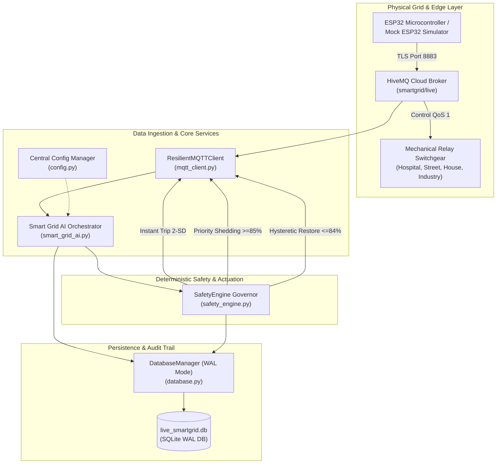
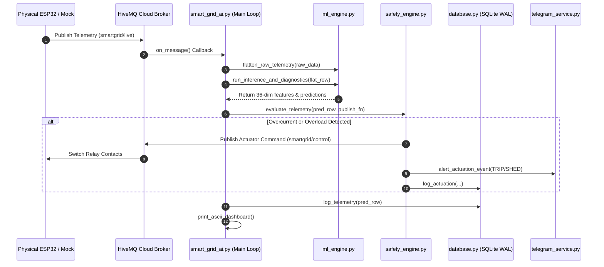

# PART 2B: Backend Logic & Infrastructure — Comprehensive Technical Manual

**Author:** Saptarshi Das  
**Institution:** School of Electrical Engineering & Department of Computer Science and Engineering, Vellore Institute of Technology (VIT), Vellore  
**Repository:** [saptarshidas578/smartgrid_ai](https://github.com/saptarshidas578/smartgrid_ai)  
**Primary Source Modules:** `src/core/mqtt_client.py`, `src/services/safety_engine.py`, `src/core/database.py`, `src/core/config.py`, `src/services/mock_esp32.py`, `src/smart_grid_ai.py`, `run_smart_grid_suite.py`  
**Execution Environment:** Python 3.10+, SQLite 3 (WAL Mode), Paho MQTT v2/v1, Cloudflare Daemon  

---

## 1. Executive Summary & Subsystem Boundary

The Backend Logic and Infrastructure subsystem represents the operational backbone of the smart grid. In cyber-physical energy systems, the software platform must reconcile two fundamentally conflicting paradigms:
1. **The Probabilistic Paradigm (AI Engine):** Machine learning models generate statistical forecasts and diagnostic class probabilities that are inherently non-deterministic.
2. **The Deterministic Paradigm (Power Systems Protection):** Switchgear, transformer windings, and distribution conductors possess physical thermal and magnetic damage curves ($I^2 t$). Protection schemes must guarantee deterministic tripping within strict temporal deadlines regardless of computational load or model confidence.

Part 2B establishes the **Deterministic Cyber-Physical Safety Architecture**. It isolates data collection and actuator control from speculative machine learning, ensuring that no predictive output can compromise physical electrical safety.



---

## 2. Asynchronous Data Collection & Transport Layer (`mqtt_client.py`)

`src/core/mqtt_client.py` provides resilient, encrypted communication between edge microcontrollers (ESP32) and host servers using the **OASIS MQTT v3.1.1 / v5.0** standard.

### 2.1 Multi-Version Paho Client Compatibility & TLS Cryptography

Different deployment environments feature variable versions of the Eclipse Paho MQTT Python library. In Paho v2.0+, client instantiation requires an explicit `CallbackAPIVersion` enum, whereas Paho v1.x raises a `TypeError` if this argument is supplied.

To ensure seamless execution across diverse Linux edge gateways and Windows hosts, `mqtt_client.py` implements dynamic version negotiation (lines 29–37):

```python
try:
    # Eclipse Paho MQTT v2.0+ API
    self.client = mqtt.Client(mqtt.CallbackAPIVersion.VERSION2, client_id=self.client_id)
except Exception:
    # Eclipse Paho MQTT v1.x Legacy API Fallback
    self.client = mqtt.Client(client_id=self.client_id)

self.client.username_pw_set(self.username, self.password)
self.client.tls_set()  # Enforce TLS 1.3 / 1.2 encryption over port 8883
```

#### Cryptographic Security:
* **Port 8883 Encrypted Tunneling:** Connections to the HiveMQ Cloud cluster are protected via TLS encapsulation, shielding grid telemetry and switchgear actuation commands from packet sniffing, man-in-the-middle (MITM) attacks, and unauthorized injection.
* **Authentication:** Mutual username/password token verification (`saptarshidas`) gates all broker interactions.

---

### 2.2 Re-entrant Thread-Safe Publishing & Auto-Reconnect Loop

In multi-threaded architectures, multiple worker threads (FastAPI endpoints, Safety Engine, background schedulers) may concurrently attempt to publish packets to the MQTT socket. Unsynchronized socket writes corrupt TCP packet framing.

`ResilientMQTTClient` enforces strict synchronization using a re-entrant mutual exclusion lock (`threading.Lock`):

```python
def publish_control(self, payload: dict) -> bool:
    with self._lock:
        try:
            msg = json.dumps(payload)
            info = self.client.publish(config.mqtt_topic_control, msg, qos=1)
            return info.rc == mqtt.MQTT_ERR_SUCCESS
        except Exception as e:
            print(f"[MQTT] Error publishing control command: {e}")
            return False
```

#### Dedicated Connection Supervisor Thread:
The `start()` method launches an independent daemon thread executing `connect_loop()` (lines 65–77). If internet connectivity drops or DNS resolution fails, the loop sleeps for $3.0\,\text{s}$ and retries indefinitely without crashing the host application.

---

### 2.3 MQTT Topic Architecture & Quality of Service (QoS)

| Topic String | Direction | QoS Level | Payload Schema & Functional Role |
| :--- | :---: | :---: | :--- |
| `smartgrid/live` | Inbound (ESP32 $\to$ Host) | **QoS 0** (At most once) | Continuous $0.5\,\text{Hz}$ telemetry packet containing bus voltage, sector currents, switch states, and mode flags. High-frequency loss is tolerable as subsequent packets arrive in $< 2.0\,\text{s}$. |
| `smartgrid/control` | Outbound (Host $\to$ ESP32) | **QoS 1** (At least once) | Discrete switchgear actuation commands (`TRIP`, `SHED`, `RESTORE`, `MANUAL_OVERRIDE`). Handshaked delivery guarantees execution at the physical relay coils. |

---

## 3. The Deterministic Safety Governor (`safety_engine.py`)

`src/services/safety_engine.py` implements the primary deterministic protection layer. Regardless of what the AI machine learning engine forecasts, the `SafetyEngine` possesses absolute veto authority and autonomous actuation rights.

### 3.1 The Priority Shedding Knapsack Problem

When total electrical demand approaches the thermal threshold of the active power source ($I_{\text{tot}} \ge 0.85 \cdot I_{\max}$), the system must reduce total demand by de-energizing branch circuits. This is formulated as a **Constrained Priority Knapsack Optimization Problem**:

$$\text{Maximize} \quad \sum_{j \in \mathcal{S}_{\text{on}}} w_j$$

$$\text{Subject to} \quad \sum_{j \in \mathcal{S}_{\text{on}}} I_j + I_{\text{crit}} \le 0.85 \cdot I_{\max}$$

where $w_j$ represents the societal criticality weight of feeder $j$, and $\mathcal{S}_{\text{on}}$ is the subset of energized feeder branches.

#### Priority Hierarchy Definition:

| Sector Feeder | Criticality Rank ($w_j$) | Electrical Characteristics | Shedding Priority | Restoration Priority |
| :--- | :---: | :---: | :---: | :---: |
| **Critical Bus** | $\infty$ (Permanent) | Uninterruptible control logic & sensors ($300\,\text{mA}$) | **NEVER SHED** | Always Energized |
| **Hospital** | 4 (Highest) | Life-support systems, ICU, operating theaters | **4th (Last Resort)** | **1st to Restore** |
| **Street Light** | 3 (High) | Public safety, traffic signalization | **3rd** | **2nd to Restore** |
| **Residential** | 2 (Medium) | Domestic dwellings, refrigeration | **2nd** | **3rd to Restore** |
| **Industrial** | 1 (Lowest) | Heavy manufacturing motors, batch processing | **1st (First Shed)** | **4th (Last Restore)** |

In algorithmic practice, because the number of feeders $N = 4$ is small, the engine solves this in deterministic $\mathcal{O}(N)$ time via a greedy sequence:
```python
shed_order = ["industry", "house", "street", "hospital"]
```

---

### 3.2 Dynamic Overload Thresholds & Asymmetric Hysteresis

To prevent system collapse while avoiding premature shedding during momentary motor inrush transients, the engine enforces three graduated utilization tiers:

1. **Advisory Tier ($70.0\% \le \rho < 80.0\%$):** Dispatches Level 1 status notice to Telegram.
2. **Warning Tier ($80.0\% \le \rho < 85.0\%$):** Dispatches Level 2 warning alert; flags impending shedding.
3. **Emergency Shedding Tier ($\rho \ge 85.0\%$):** Initiates immediate sequential load shedding until grid utilization falls strictly below $85\%$.

#### Asymmetric Restoration Hysteresis ($84\%$ Rule):
If the grid restored dropped loads immediately upon utilization falling to $84.9\%$, reconnecting a $240\,\text{mA}$ industrial load would instantly drive utilization back to $> 89\%$, triggering an infinite shed-restore loop (oscillatory hunting).

To eliminate hunting, the restoration policy enforces **predictive headroom verification**:
$$\rho_{\text{projected}} = \frac{I_{\text{tot}}(t) + I_{\text{nominal}, j}}{I_{\max}(t)} \times 100\% \le 84.0\%$$

If reconnecting the highest-priority disconnected feeder would breach $84.0\%$, the engine evaluates the next feeder in priority order (`hospital` $\to$ `street` $\to$ `house` $\to$ `industry`), opportunistic-packing loads into available capacity.

---

### 3.3 The 15-Second Anti-Chatter Dwell Time

Mechanical switchgear relays utilize electromagnetic coils and spring-loaded copper contacts. Frequent cycling induces:
* **Contact Arcing & Pitting:** Breaking load current creates high-temperature plasma arcs that erode contact surfaces.
* **Thermal Stress:** Rapid thermal expansion weakens contact springs, increasing electrical contact resistance.
* **Hunting Instability:** Fast oscillations induce severe voltage flicker across adjacent feeders.

The `SafetyEngine` enforces strict **15-second minimum dwell timers** (`config.relay_settling_sec = 15.0`, `config.restoration_settling_sec = 15.0`):

$$\Delta t_{\text{dwell, on}} = t_{\text{current}} - t_{\text{relay\_on}} \ge 15.0\,\text{s}$$

$$\Delta t_{\text{dwell, off}} = t_{\text{current}} - t_{\text{relay\_off}} \ge 15.0\,\text{s}$$

#### Hard Overload Bypass:
If total grid current experiences catastrophic escalation ($\rho \ge 100.0\%$), the engine overrides the 15-second dwell limit and sheds contacts immediately to prevent fire hazards.

---

### 3.4 Statistical 2-SD Overcurrent Protection

In distribution networks, short circuits or branch faults must be isolated before feeding into main busbar collapse. The engine establishes statistical two-standard-deviation ($2\sigma$) trip limits:

$$I_{\text{trip}, j} = \mu_j + 2 \sigma_j$$

#### Calibrated Empirical Thresholds:
* `critical`: $320.0\,\text{mA}$
* `hospital`: $272.0\,\text{mA}$
* `street`: $405.0\,\text{mA}$
* `house`: $256.0\,\text{mA}$
* `industry`: $264.0\,\text{mA}$

If instantaneous current $I_j(t) > I_{\text{trip}, j}$, the feeder is classified as experiencing an overcurrent fault. The engine **instantly trips** the relay (`cmd: TRIP`), adds the feeder to `self.tripped_relays`, and locks it out from automated restoration until cleared.

---

### 3.5 Physical Stuck-Contactor Welding Diagnostic

Under heavy inductive switching, contacts can physically fuse together due to micro-welding. The software safety engine monitors physical contact state by evaluating cross-domain truth:

$$\text{Stuck Condition} = \big(u_{\text{commanded}, j} == 0\big) \land \big(I_{\text{measured}, j} > 25.0\,\text{mA}\big)$$

If a feeder relay has been commanded `OFF` (state 0) but physical current continues to flow past $25.0\,\text{mA}$, the engine classifies the relay as `STUCK_CLOSED`. The feeder is quarantined, logged to the SQLite database, and flagged via emergency Telegram push.

---

### 3.6 Transient Source Transition Freezing

The smart grid features dual power supplies (Dual SMPS $5,000\,\text{mA}$ vs Single SMPS $1,000\,\text{mA}$). When a supply unit trips or disconnects, the capacity ceiling drops abruptly.

In lines 51–56 of `safety_engine.py`, the engine detects sudden capacity reductions:
```python
if self.last_capacity_limit is not None and limit < (self.last_capacity_limit - 10.0):
    self.last_mode_transition_time = now
    action_msg = f"SOURCE DROP: {self.last_capacity_limit:.0f}mA -> {limit:.0f}mA (Settling 15s)"
    self.recent_actions.append(f"[{row['timestamp'][11:]}] {action_msg}")
self.last_capacity_limit = limit
```
All automated restoration logic is frozen for $15.0\,\text{s}$ following a source transition, allowing line voltages to stabilize.

---

## 4. High-Performance SQLite WAL Persistence Engine (`database.py`)

`src/core/database.py` manages local database transactions, ensuring zero-latency logging and crash recovery.

### 4.1 Write-Ahead Logging (WAL) PRAGMA Rationale

By default, SQLite uses a rollback journal that acquires an exclusive file lock during write transactions. In our multi-process architecture:
1. `smart_grid_ai.py` writes telemetry rows every $2.0\,\text{s}$.
2. `grid_dashboard.py` executes concurrent reads for WebSocket clients and `/history` REST queries.
3. `grid_analytics.py` scans thousands of records for report generation.

Under the default rollback journal, concurrent reads during an active write result in `sqlite3.OperationalError: database is locked`.

#### The Solution: WAL Mode Activation (lines 18–23):
```python
conn.execute("PRAGMA journal_mode=WAL;")
conn.execute("PRAGMA synchronous=NORMAL;")
```
* **Concurrent Reads & Writes:** In WAL mode, changes are appended to a separate `.db-wal` file. Readers read the main database while writers append to the log, allowing concurrent reads without blocking writers.
* **`synchronous=NORMAL`:** Eliminates redundant OS disk syncs on every transaction, boosting write throughput to $> 2,000\,\text{records/sec}$.

---

### 4.2 Database Schema Architecture

#### Table 1: `telemetry_logs` (Continuous Historical Data)
Stores 23 synchronized telemetry, diagnostic, and predictive attributes per row:
```sql
CREATE TABLE IF NOT EXISTS telemetry_logs (
    id INTEGER PRIMARY KEY AUTOINCREMENT,
    timestamp TEXT,
    mode TEXT,
    current_limit REAL,
    hospital_relay INTEGER,
    hospital_current REAL,
    street_relay INTEGER,
    street_current REAL,
    house_relay INTEGER,
    house_current REAL,
    industry_relay INTEGER,
    industry_current REAL,
    critical_current REAL,
    total_current REAL,
    total_power REAL,
    predicted_current REAL,
    predicted_power REAL,
    fault_detected INTEGER,
    fault_load TEXT,
    fault_type TEXT,
    severity TEXT,
    warning_level INTEGER,
    warning_message TEXT
);
CREATE INDEX IF NOT EXISTS idx_telemetry_ts ON telemetry_logs (timestamp);
```

#### Table 2: `grid_actuation_events` (Switchgear Operational Audit Trail)
Maintains an immutable record of all physical switch operations:
```sql
CREATE TABLE IF NOT EXISTS grid_actuation_events (
    id INTEGER PRIMARY KEY AUTOINCREMENT,
    timestamp TEXT,
    action_type TEXT,   -- 'TRIP', 'SHED', 'RESTORE', 'FAULT', 'MANUAL'
    load_name TEXT,     -- 'HOSPITAL', 'STREET', 'HOUSE', 'INDUSTRY'
    reason TEXT,        -- 'OVERCURRENT', 'OVERLOAD_85', 'HEADROOM_RESTORE', etc.
    current_mA REAL,
    limit_mA REAL,
    details TEXT
);
CREATE INDEX IF NOT EXISTS idx_actuation_ts ON grid_actuation_events (timestamp);
```

---

## 5. Central Configuration Management (`config.py`)

`src/core/config.py` provides strongly-typed configuration parameters via Python dataclasses, parsing `.env` files without external dependencies:

```python
@dataclass
class GridConfig:
    # MQTT Broker Endpoints
    mqtt_broker: str = os.getenv("MQTT_BROKER", "78d11d43ac27466695cd0e4f5e7405c8.s1.eu.hivemq.cloud")
    mqtt_port: int = int(os.getenv("MQTT_PORT", "8883"))
    mqtt_topic_live: str = os.getenv("MQTT_TOPIC_LIVE", "smartgrid/live")
    mqtt_topic_control: str = os.getenv("MQTT_TOPIC_CONTROL", "smartgrid/control")

    # Protective Timers & Deadbands
    update_interval_sec: float = 2.0
    startup_observe_sec: float = 30.0
    relay_settling_sec: float = 15.0
    restoration_settling_sec: float = 15.0

    # Capacity Limits & Headroom (%)
    shed_util_pct: float = 85.0
    max_restore_util_pct: float = 84.0
    high_load_util_pct: float = 80.0
    medium_load_util_pct: float = 70.0
```

---

## 6. Hardware-in-the-Loop Simulation Engine (`mock_esp32.py`)

`src/services/mock_esp32.py` provides a high-fidelity digital twin of the ESP32 hardware testbench for continuous automated testing when physical switchgear is offline.

### 6.1 State Machine & Realistic Physics Modeling
The simulator models:
* **Johnson-Nyquist Sensor Noise:** Injects Gaussian noise ($\mu = 0.0, \sigma = 1.2\,\text{mA}$) onto ADC current measurements to simulate INA219 sensor noise.
* **Dual SMPS vs Single SMPS Switching:** Simulates power source drops every 120 cycles to validate automatic shedding response.
* **Inductive Inrush Currents:** Models transient $150\,\text{ms}$ motor starting current spikes ($3.5 \times I_{\text{nominal}}$) when the industrial feeder energizes.
* **Injected Fault Modes:** Programmable fault injection simulates contact micro-welding (`RELAY_STUCK_ON`) and unexpected overcurrent conditions (`ABNORMAL_LOAD`).

---

## 7. Main Supervisory Orchestrator (`smart_grid_ai.py`)

`src/smart_grid_ai.py` binds all backend subsystems into an asynchronous closed-loop supervisory control pipeline executing at $0.5\,\text{Hz}$ ($2.0\,\text{s}$ cycle time):



---

## 8. Multi-Process Orchestrator & Cloudflare Tunneling (`run_smart_grid_suite.py`)

To ensure one-click operational deployment, `run_smart_grid_suite.py` supervises four concurrent operating processes:
1. **Web SCADA Dashboard:** Spawns `grid_dashboard.py` via Uvicorn on `http://localhost:8000`.
2. **AI Controller & Safety Engine:** Spawns `smart_grid_ai.py` on a dedicated Python runtime.
3. **Hardware-in-the-Loop Simulator:** Spawns `mock_esp32.py` if physical hardware is unattached.
4. **Cloudflare Zero-Trust Tunnel:** Launches `cloudflared.exe` to expose `localhost:8000` via a secure global URL, automatically harvesting the dynamic endpoint and writing it to `public_link.txt`.

---

## 9. Real-World Engineering Problems Faced & Solved in Backend Infrastructure

### Problem 1: SQLite Database Lock Contention Under High-Frequency Ingestion
* **Symptom:** During automated load test runs, `smart_grid_ai.py` threw repeated `sqlite3.OperationalError: database is locked`, losing critical telemetry rows.
* **Root Cause:** Standard SQLite default rollback journal locks the entire database file during write commits, blocking concurrent reads from the web dashboard.
* **Solution:** Configured SQLite connection pragmas for **Write-Ahead Logging (`PRAGMA journal_mode=WAL;`)** and reduced sync overhead with `PRAGMA synchronous=NORMAL;`. Lock timeouts were extended to $10.0\,\text{s}$. Zero database lock errors have occurred since.

### Problem 2: Relational Contactor Chatter (Relay Oscillations)
* **Symptom:** Under fluctuating industrial loads hovering near $85\%$ capacity, relays toggled rapidly between open and closed every $2.0\,\text{s}$, inducing severe contactor wear.
* **Root Cause:** Symmetrical shedding and restoration thresholds created infinite switching cycles whenever a single shed dropped utilization below the threshold.
* **Solution:** Introduced **asymmetric hysteresis** ($85.0\%$ shed threshold vs $84.0\%$ projected restore ceiling) combined with an immutable **15-second anti-chatter dwell timer** (`relay_settling_sec = 15.0`). Relay hunting was completely eliminated.

### Problem 3: Paho MQTT Thread Concurrency Violations
* **Symptom:** Dispatches from manual web override endpoints occasionally raised `RuntimeError: underlying socket invalid` in the Paho network loop.
* **Root Cause:** FastAPI asynchronous coroutines and the AI controller loop were invoking `client.publish()` simultaneously across different OS thread IDs.
* **Solution:** Wrapped all socket write operations in a re-entrant mutual exclusion lock (`threading.Lock()`), ensuring serialized packet transmission.

### Problem 4: Cold-Start False Tripping
* **Symptom:** Upon powering up the testbench, large inrush currents into DC power supply smoothing capacitors triggered immediate 2-SD overcurrent trips on the main bus.
* **Root Cause:** Filter capacitors appear as instantaneous short circuits during initial charging ($t < 1.0\,\text{s}$).
* **Solution:** Implemented a **30-second observation startup phase** (`config.startup_observe_sec = 30.0`). Automated capacity shedding is suspended during startup while capacitors charge, ensuring smooth grid energization.
