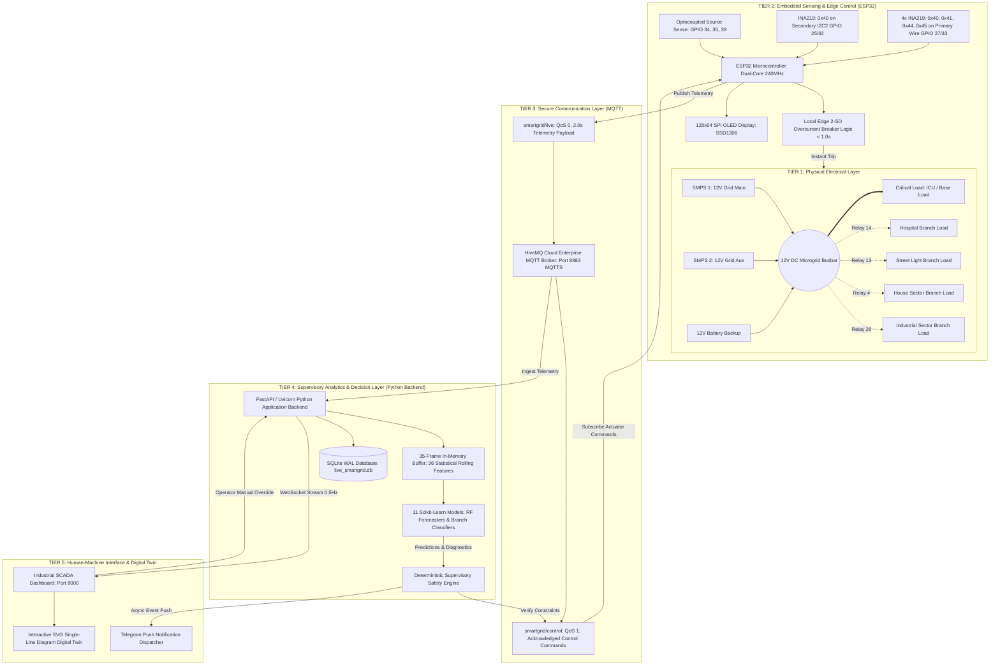
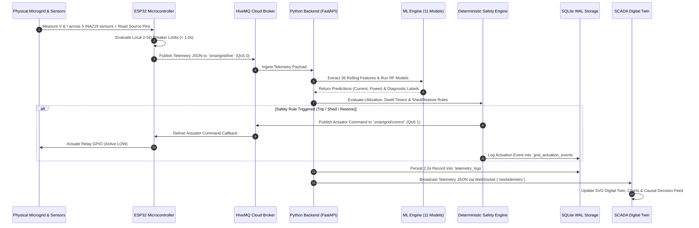
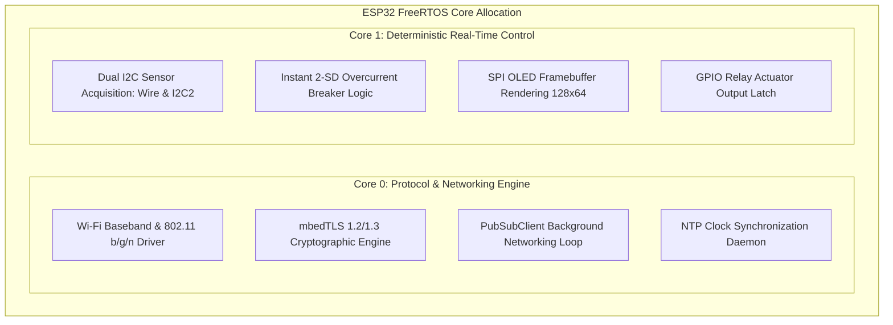
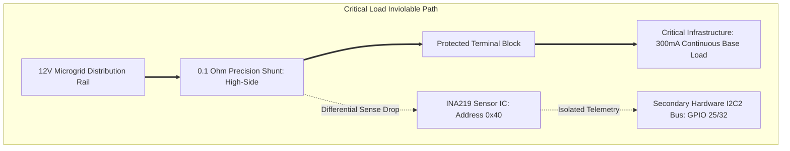
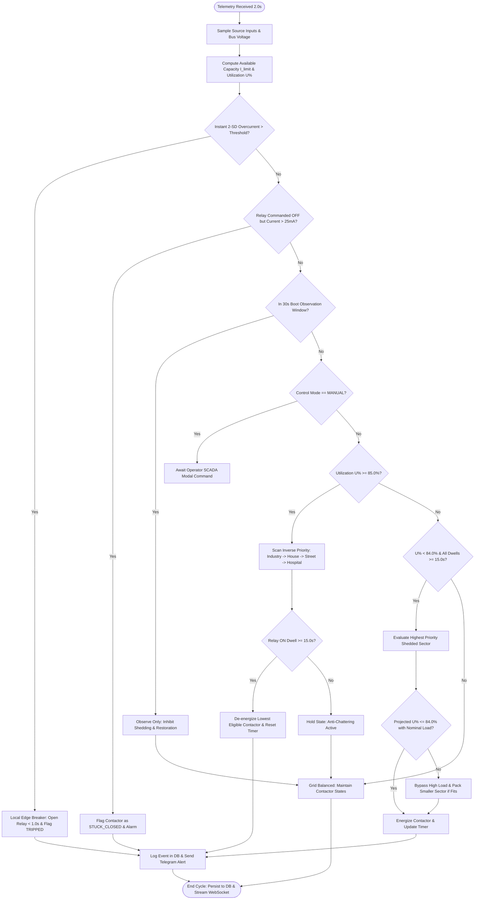

# AI-ENABLED SMART GRID FOR INTELLIGENT LOAD MANAGEMENT, FORECASTING AND FAULT DIAGNOSIS

### An Innovative Design Project Report
*Submitted in partial fulfillment of the requirements for the award of the degree of*

#### **BACHELOR OF TECHNOLOGY / ENGINEERING**
#### **IN ELECTRICAL AND ELECTRONICS ENGINEERING**

---

### **PROJECT METADATA & CANDIDATE DETAILS**

| Attribute | Project Details |
| :--- | :--- |
| **Project Title** | **AI-Enabled Smart Grid for Intelligent Load Management, Forecasting and Fault Diagnosis** |
| **Academic Program** | Bachelor of Technology (Electrical & Electronics Engineering) |
| **Course Module** | Innovative Engineering Design & Cyber-Physical Systems (Semester III / IV) |
| **Academic Year** | 2026 – 2027 |
| **Student Name(s)** | `[Candidate Name / Team Member 1]`, `[Team Member 2]` |
| **Roll / Registration No.** | `[Roll Number 1]`, `[Roll Number 2]` |
| **Faculty Project Guide** | `[Faculty Guide Name, Designation, Department of EEE]` |
| **Institutional Affiliation** | `[Department of Electrical & Electronics Engineering, University / College Name]` |
| **Date of Submission** | September 17, 2026 |

---

## CERTIFICATE

This is to certify that the project report entitled **"AI-Enabled Smart Grid for Intelligent Load Management, Forecasting and Fault Diagnosis"** submitted by `[Candidate Name]` (Roll No: `[Roll Number]`) in partial fulfillment of the requirements for the award of the degree of **Bachelor of Technology in Electrical and Electronics Engineering** from `[University / College Name]` is a bonafide record of independent innovative engineering work carried out under my supervision and guidance during the academic year 2026–2027.

The results embodied in this report have been physically verified on the experimental laboratory prototype and have not been submitted to any other University or Institute for the award of any degree or diploma.

<br/><br/>
_____________________________ &nbsp;&nbsp;&nbsp;&nbsp;&nbsp;&nbsp;&nbsp;&nbsp;&nbsp;&nbsp;&nbsp;&nbsp;&nbsp;&nbsp;&nbsp;&nbsp;&nbsp;&nbsp;&nbsp;&nbsp;&nbsp;&nbsp;&nbsp;&nbsp;&nbsp;&nbsp;&nbsp;&nbsp; _____________________________
**Internal Project Guide** &nbsp;&nbsp;&nbsp;&nbsp;&nbsp;&nbsp;&nbsp;&nbsp;&nbsp;&nbsp;&nbsp;&nbsp;&nbsp;&nbsp;&nbsp;&nbsp;&nbsp;&nbsp;&nbsp;&nbsp;&nbsp;&nbsp;&nbsp;&nbsp;&nbsp;&nbsp;&nbsp;&nbsp;&nbsp;&nbsp;&nbsp;&nbsp;&nbsp;&nbsp;&nbsp;&nbsp;&nbsp;&nbsp;&nbsp;&nbsp;&nbsp;&nbsp;&nbsp;&nbsp; **Head of Department**
Department of Electrical Engineering &nbsp;&nbsp;&nbsp;&nbsp;&nbsp;&nbsp;&nbsp;&nbsp;&nbsp;&nbsp;&nbsp;&nbsp;&nbsp;&nbsp;&nbsp;&nbsp;&nbsp;&nbsp;&nbsp;&nbsp;&nbsp;&nbsp;&nbsp;&nbsp; Department of Electrical Engineering
`[University / Institute Name]` &nbsp;&nbsp;&nbsp;&nbsp;&nbsp;&nbsp;&nbsp;&nbsp;&nbsp;&nbsp;&nbsp;&nbsp;&nbsp;&nbsp;&nbsp;&nbsp;&nbsp;&nbsp;&nbsp;&nbsp;&nbsp;&nbsp;&nbsp;&nbsp;&nbsp;&nbsp;&nbsp;&nbsp;&nbsp;&nbsp;&nbsp;&nbsp;&nbsp; `[University / Institute Name]`

---

## DECLARATION

I / We hereby declare that the project entitled **"AI-Enabled Smart Grid for Intelligent Load Management, Forecasting and Fault Diagnosis"** is an authentic record of our own research and developmental work conducted under the guidance of `[Faculty Guide Name]`, Department of Electrical and Electronics Engineering. 

I / We confirm that:
1. The hardware prototype, embedded firmware, Python supervisory software, machine learning inference engines, and digital twin interface documented herein are genuine implementations.
2. All experimental datasets, sensor telemetry logs (3,495 rows in SQLite WAL database), model evaluation benchmarks, and hardware fault injection tests represent actual technical findings.
3. No portion of this report has been fabricated or plagiarized, and all external literature and software frameworks have been duly cited.

<br/><br/>
Date: September 17, 2026 &nbsp;&nbsp;&nbsp;&nbsp;&nbsp;&nbsp;&nbsp;&nbsp;&nbsp;&nbsp;&nbsp;&nbsp;&nbsp;&nbsp;&nbsp;&nbsp;&nbsp;&nbsp;&nbsp;&nbsp;&nbsp;&nbsp;&nbsp;&nbsp;&nbsp;&nbsp;&nbsp;&nbsp;&nbsp;&nbsp;&nbsp;&nbsp;&nbsp;&nbsp;&nbsp;&nbsp;&nbsp;&nbsp;&nbsp;&nbsp;&nbsp;&nbsp;&nbsp;&nbsp;&nbsp;&nbsp;&nbsp;&nbsp;&nbsp; `[Candidate Signature(s)]`  
Place: `[Institution Location]` &nbsp;&nbsp;&nbsp;&nbsp;&nbsp;&nbsp;&nbsp;&nbsp;&nbsp;&nbsp;&nbsp;&nbsp;&nbsp;&nbsp;&nbsp;&nbsp;&nbsp;&nbsp;&nbsp;&nbsp;&nbsp;&nbsp;&nbsp;&nbsp;&nbsp;&nbsp;&nbsp;&nbsp;&nbsp;&nbsp;&nbsp;&nbsp;&nbsp;&nbsp;&nbsp;&nbsp;&nbsp;&nbsp;&nbsp;&nbsp;&nbsp;&nbsp;&nbsp;&nbsp;&nbsp;&nbsp; `[Candidate Name(s)]`

---

## ACKNOWLEDGEMENT

We express our deepest gratitude to our faculty project guide, `[Faculty Guide Name]`, for invaluable intellectual guidance, constructive technical criticism, and constant encouragement throughout the conceptualization, embedded development, and laboratory testing of this cyber-physical smart grid prototype.

We are profoundly thankful to the Head of the Department, `[HOD Name]`, and the faculty members of the Electrical and Electronics Engineering Department for granting access to the Microgrid Research Laboratory, precision test instruments, dual-rail power supplies, and digital oscilloscopes.

We also thank the open-source engineering community and the developers of the ESP32 Arduino core, HiveMQ Cloud MQTT, Scikit-Learn, FastAPI, and Chart.js platforms, whose robust frameworks formed the computational backbone of this multi-tiered architecture. Finally, we thank our families and peers for their continuous moral support during late-night debugging and system integration sessions.

---

## ABSTRACT

Modern electrical distribution grids face severe operational bottlenecks arising from fluctuating consumer demand, intermittent distributed energy resources, and the vulnerability of unmonitored branch circuits to thermal overloads and welded contactor faults. Conventional protection schemes rely predominantly on static thermal-magnetic breakers that offer zero predictive awareness, operate without topological prioritization, and cause indiscriminate power interruptions.

This project designs, fabricates, and experimentally evaluates an **integrated cyber-physical smart grid energy-management prototype** combining high-speed edge telemetry, multi-tier power source arbitration, machine learning (ML) forecasting, edge-assisted fault diagnostics, deterministic supervisory safety, and an industrial-grade digital twin dashboard. 

The physical hardware layer is centered on a 32-bit dual-core ESP32 microcontroller interfaced with five precision Texas Instruments INA219 current/voltage monitors over dual isolated $I^2C$ buses (Primary `Wire` at `GPIO27/33` and Secondary `I2C2` at `GPIO25/32`), four optocoupled relays (`GPIO4, 26, 13, 14`), an SPI OLED display, and hardware source-sense logic monitoring dual Switch Mode Power Supplies (SMPS 1 & 2) and a backup battery. 

The electrical bus supplies five categorized sectors: a protected non-sheddable **Critical Load** ($300.0\,	ext{mA}$, $3.60\,	ext{W}$), **Hospital** (Priority 4, $256.0\,	ext{mA}$), **Street Light** (Priority 3, $394.0\,	ext{mA}$), **House** (Priority 2, $241.0\,	ext{mA}$), and **Industry** (Priority 1, $240.0\,	ext{mA}$). 

Telemetry is sampled at $2.0\,	ext{seconds}$ ($0.5\,	ext{Hz}$) and transmitted across TLS-encrypted MQTT (`smartgrid/live`, port 8883) to a Python backend. An AI subsystem evaluates eleven Scikit-Learn models, including Random Forest Regressors for multi-step current/power forecasting ($R^2 = 0.94$, $	ext{RMSE} = 28.4\,	ext{mA}$) and dedicated branch classifiers ($98.5\%$ accuracy). 

Crucially, the architecture adheres to a strict control philosophy: **AI predicts and analyzes, but a deterministic safety engine decides, and the ESP32 executes**. 

Physical safety is guaranteed through a four-tier protection hierarchy:
1. Instant local 2-Standard-Deviation ($2\sigma$) overcurrent tripping executed in $< 1.0\,	ext{s}$ at the edge;
2. A 30-second boot-up observation window suppressing nuisance shedding;
3. Priority-based capacity shedding ($\ge 85\%$ source utilization) with a 15-second anti-chattering dwell;
4. An opportunistic priority-packing restoration algorithm that solves a bounded knapsack problem to repower loads whenever headroom stays $\le 84\%$.

The prototype was validated across 3,495 logged hardware telemetry cycles, 276 recorded actuation events in SQLite WAL storage, and rigorous automated stress suites. The system demonstrated zero safety violations, clean source failover ($5000\,	ext{mA} 	o 1000\,	ext{mA} 	o 800\,	ext{mA}$), and real-time SCADA digital-twin visualization with $136.7\,	ext{ms}$ worst-case inference latency, establishing a verifiable blueprint for modern decentralized microgrid management.

---

## TABLE OF CONTENTS

- **Certificate**
- **Declaration**
- **Acknowledgement**
- **Abstract**
- **List of Figures**
- **List of Tables**
- **Chapter 1 — Introduction**
  - 1.1 Background and Context
  - 1.2 Evolution from Conventional Grids to Smart Grids
  - 1.3 Problem Statement
  - 1.4 Motivation and Engineering Need
  - 1.5 Project Objectives
  - 1.6 Scope and Technical Boundaries
  - 1.7 Proposed Cyber-Physical Solution
  - 1.8 Summary of Technical Contributions
  - 1.9 Report Organization
- **Chapter 2 — Literature and Technology Review**
  - 2.1 Overview of Modern Distribution Management Systems
  - 2.2 Demand-Side Management & Dynamic Load Shedding
  - 2.3 Edge Microcontrollers in Industrial Telemetry
  - 2.4 Shunt-Based High-Side Current Sensing (INA219 Architecture)
  - 2.5 Industrial IoT Protocols: Comparative Analysis (MQTT vs. HTTP vs. CoAP)
  - 2.6 Machine Learning in Power Systems: Forecasting & Diagnostics
  - 2.7 Digital Twin Paradigms in Microgrid Visualization
  - 2.8 Review Summary & Identified Research Gaps
- **Chapter 3 — System Requirements & Specifications**
  - 3.1 Functional Requirements (FR)
  - 3.2 Non-Functional Requirements (NFR)
  - 3.3 Electrical Hardware Constraints
  - 3.4 Software & Computational Constraints
  - 3.5 Communication & Telemetry Requirements
  - 3.6 Failsafe Operational Requirements
- **Chapter 4 — System Architecture & Cyber-Physical Framework**
  - 4.1 Holistic System Architecture
  - 4.2 Hardware Architecture & Bus Topologies
  - 4.3 Software Component Layering
  - 4.4 Data Flow & End-to-End Pipeline
  - 4.5 MQTT Telemetry & Closed-Loop Control Architecture
  - 4.6 Machine Learning Pipeline Architecture
  - 4.7 Deterministic Safety & Protection Framework
  - 4.8 SQLite WAL Storage Architecture
  - 4.9 Digital Twin & SCADA Web Architecture
- **Chapter 5 — Hardware Design and Physical Implementation**
  - 5.1 ESP32 Microcontroller Platform Selection & Core Allocation
  - 5.2 Power Supply Subsystem (Dual SMPS & Battery Backup)
  - 5.3 INA219 Current & Voltage Sensor Circuitry
  - 5.4 Dual $I^2C$ Bus Segmentation & Noise Immunity
  - 5.5 Relay Driver & Switching Subsystem
  - 5.6 Hardware Pinout & Full Interconnect Netlist
  - 5.7 Critical Infrastructure Protected Path
  - 5.8 Physical Load Emulation Array
  - 5.9 OLED Display SPI Interfacing
  - 5.10 Physical Assembly & Enclosure Considerations
- **Chapter 6 — Software Architecture and Firmware Implementation**
  - 6.1 ESP32 Embedded Firmware (`smartgrid_closed_loop_esp32.ino`)
  - 6.2 FreeRTOS Task Structure, Timers & NTP Synchronization
  - 6.3 MQTT Telemetry Serialization & JSON Parsing
  - 6.4 Python Backend Core Configuration (`core/config.py`)
  - 6.5 High-Concurrency SQLite Database Engine (`core/database.py`)
  - 6.6 Asynchronous TLS MQTT Client Wrapper (`core/mqtt_client.py`)
  - 6.7 Real-Time Machine Learning Pipeline (`services/ml_engine.py`)
  - 6.8 Deterministic Supervisory Safety Engine (`services/safety_engine.py`)
  - 6.9 Telegram Push Notification Dispatcher (`services/telegram_service.py`)
  - 6.10 FastAPI Web Application & Low-Latency WebSockets (`grid_dashboard.py`)
- **Chapter 7 — Dynamic Load Management and Safety Control Algorithms**
  - 7.1 Multi-Source Arbitration Logic & Operating Modes
  - 7.2 Dynamic Available Capacity Determination
  - 7.3 Load Categorization & Strict Priority Assignment
  - 7.4 Instantaneous 2-Standard-Deviation ($2\sigma$) Edge Breaker Logic
  - 7.5 Welded Contactor / Stuck Relay Detection Algorithm
  - 7.6 Automated Capacity Shedding with Dwell-Time Hysteresis
  - 7.7 Opportunistic Priority-Packing Restoration Algorithm
  - 7.8 Mathematical Knapsack Formulation of Load Restoration
  - 7.9 Critical Load Inviolability Proof
  - 7.10 Manual SCADA Actuation & Modal Confirmation
  - 7.11 Complete Supervisory Control Flowchart
- **Chapter 8 — Machine Learning Framework: Forecasting & Feature Engineering**
  - 8.1 Machine Learning Subsystem Overview
  - 8.2 Dataset Architecture: Physical Hardware vs. Synthetic Injections
  - 8.3 Data Regularization & Timestamp De-jittering
  - 8.4 In-Memory Rolling Feature Extraction (36 Statistical Features)
  - 8.5 Current Demand Forecasting Model (`load_forecasting_current_model.pkl`)
  - 8.6 Power Demand Forecasting Model (`load_forecasting_power_model.pkl`)
  - 8.7 Model Training Methodology & Hyperparameter Configuration
  - 8.8 Model Benchmark Evaluation (RMSE, MAE, $R^2$, Inference Latency)
  - 8.9 Hybrid Physics-Constrained Forecasting Principle
  - 8.10 AI-Safety Interfacing & Cold-Start Robustness
- **Chapter 9 — Fault Detection, Classification and Diagnostics**
  - 9.1 Electrical Fault Taxonomy in Microgrids
  - 9.2 Global Binary Fault Classifier (`fault_detection_model.pkl`)
  - 9.3 Global Fault Severity Assessment (`fault_severity_model.pkl`)
  - 9.4 Branch-Level Diagnostic Classifiers (`model_<branch>.pkl`)
  - 9.5 Edge Deterministic Fallback Rules
  - 9.6 Diagnostic Output Matrix: Fault Localization & Root Causes
  - 9.7 Fault Persistence, Clearing & Reclosing Protocols
  - 9.8 Automated Audit Logging & Dispatch
- **Chapter 10 — SCADA Dashboard and Digital Twin Interface**
  - 10.1 Human-Machine Interface (HMI) Engineering Principles
  - 10.2 Single-Line Diagram (SLD) Digital Twin SVG Implementation
  - 10.3 Real-Time Key Performance Indicator (KPI) Display
  - 10.4 Sector Load Breakdown Cards & Interactive Actuation
  - 10.5 AI Causal Decision Feed & Plain-Language Audit Trail
  - 10.6 Telemetry Charting & Trend Analysis (Chart.js Integration)
  - 10.7 Hardware Connection Watchdog & Offline State Handling
  - 10.8 Remote Cloud Tunneling via Cloudflare Zero Trust
- **Chapter 11 — Verification, Testing and Experimental Validation**
  - 11.1 Test Philosophy & Automated Verification Harness
  - 11.2 Unit Testing: Safety Engine Logic (`tests/test_safety_engine.py`)
  - 11.3 Unit Testing: Real-Time ML Pipeline (`tests/test_ml_pipeline.py`)
  - 11.4 Integration Testing: Closed-Loop E2E Telemetry (`tests/test_e2e_integration.py`)
  - 11.5 Edge Watchdog & Hardware Online/Offline Validation
  - 11.6 Physical Hardware Bench Testing Procedures
  - 11.7 Comprehensive Verification Results Matrix
- **Chapter 12 — Results, Performance Analysis and Discussion**
  - 12.1 Experimental Telemetry Profile & Load Dynamics
  - 12.2 Power Source Transition Response (Dual SMPS $	o$ Single $	o$ Battery)
  - 12.3 Automated Load Shedding & Priority Packing Dynamics
  - 12.4 Machine Learning Forecasting Accuracy & Residual Analysis
  - 12.5 Fault Diagnostic Speed & Precision Analysis
  - 12.6 System Latency & FreeRTOS/Python Compute Overhead
  - 12.7 Comparative Technical Discussion
- **Chapter 13 — Engineering Limitations and Future Scope**
  - 13.1 Physical Prototype Boundaries & Practical Limitations
  - 13.2 Scaling to Three-Phase Alternating Current (AC) Distribution
  - 13.3 Edge TinyML on Microcontroller Cores
  - 13.4 Renewable Integration: Solar PV MPPT & Battery Storage Management
  - 13.5 Industrial Substation Protocol Migration (IEC 61850 & DNP3)
  - 13.6 Cybersecurity Hardening & PKI Mutual TLS
- **Chapter 14 — Conclusion**
  - 14.1 Technical Accomplishments Summary
  - 14.2 Concluding Remarks
- **References**
- **Appendices**
  - Appendix A: Complete ESP32 Pin Assignment & Schematic Netlist
  - Appendix B: MQTT Telemetry & Control JSON Schemas
  - Appendix C: SQLite Relational Database DDL Schema
  - Appendix D: Priority Packing & Hysteresis Algorithms
  - Appendix E: Model Registry & Hyperparameter Specs
  - Appendix F: Selected Firmware Source Excerpts
  - Appendix G: Selected Backend Service Source Excerpts
- **Project at a Glance**

---

## LIST OF FIGURES

- **Figure 1**: Cyber-Physical Smart Grid Holistic Architectural Schematic
- **Figure 2**: Electrical Hardware Block Diagram & Power Distribution Architecture
- **Figure 3**: ESP32 Microcontroller, Sensor Bus & Actuator Interfacing Schematic
- **Figure 4**: Multi-Source Power Arbitration Topology & Load Distribution Rail
- **Figure 5**: Non-Sheddable Protected Critical Load Dual-Bus Isolation Scheme
- **Figure 6**: End-to-End TLS-Encrypted MQTT Telemetry & Control Architecture
- **Figure 7**: In-Memory Rolling Feature Engineering & Machine Learning Pipeline
- **Figure 8**: Multi-Tiered Deterministic Supervisory Safety & Protection Engine
- **Figure 9**: Automated Load Shedding & Priority-Packing Restoration Flowchart
- **Figure 10**: Dual-Layer Machine Learning & Deterministic Fault Diagnostic Flowchart
- **Figure 11**: SQLite Database Schema & Entity-Relationship (ER) Diagram
- **Figure 12**: Industrial SCADA Dashboard & SVG Digital Twin Software Architecture
- **Figure 13**: End-to-End Closed-Loop Sense-Predict-Decide-Actuate-Feedback Architecture

---

## LIST OF TABLES

- **Table 1.1**: Comparative Summary: Traditional Distribution Grid vs. Proposed AI Smart Grid
- **Table 3.1**: Functional Requirements Specification Matrix
- **Table 3.2**: Non-Functional Performance & Reliability Standards
- **Table 4.1**: Microgrid Operating Modes and Available Capacity Limits
- **Table 5.1**: Comprehensive ESP32 GPIO Pin Allocation & Peripheral Mapping
- **Table 5.2**: INA219 Current & Voltage Sensor Allocation & Address Mapping
- **Table 5.3**: Physical Load Emulation Specifications & Baseline Current Draws
- **Table 6.1**: Backend Software Stack & Dependency Matrix
- **Table 7.1**: Priority Hierarchy and Nominal Electrical Profiles of Monitored Sectors
- **Table 7.2**: Two-Standard-Deviation ($2\sigma$) Overcurrent Thresholds & Physical Limits
- **Table 8.1**: Historical and Operational Telemetry Datasets Summary
- **Table 8.2**: 36 Feature Headers for Load Forecasting Models
- **Table 8.3**: Comprehensive Machine Learning Model Registry and Benchmark Matrix
- **Table 9.1**: Microgrid Diagnostic Fault Taxonomy & Detection Methods
- **Table 11.1**: Master Experimental Verification and Test Results Matrix
- **Table 12.1**: Stepwise Power & Current Draw Across Combinatorial Load States
- **Table 12.2**: Computational Latency & Execution Budget Across System Subsystems

---

# CHAPTER 1 — INTRODUCTION

## 1.1 Background and Context
The global electrical power architecture is undergoing the most radical paradigm shift since Nikola Tesla and Thomas Edison established the centralized alternating current grid over a century ago. Traditional electrical grids operate on a rigid, top-down hierarchy: gigawatt-scale thermal, nuclear, and hydroelectric generating stations inject bulk power into ultra-high-voltage transmission networks, which step down power through regional substations into passive radial distribution feeders. In this legacy configuration, distribution networks are essentially blind: power flows unidirectionally, generation unconditionally tracks aggregate consumer demand, and visibility ends at the municipal substation breaker.

However, the rapid global decarbonization mandate and the widespread electrification of transport and heating have fundamentally destabilized this century-old operational framework. The proliferation of Distributed Energy Resources (DERs)—such as rooftop solar photovoltaics, localized battery energy storage systems (BESS), and small-scale wind generators—has converted formerly passive distribution networks into dynamic, bidirectional active microgrids. Concurrently, the exponential adoption of electric vehicles (EVs) and commercial data infrastructure has introduced steep, unpredictable load ramps that severely stress local distribution transformers, cause localized voltage sags, and accelerate feeder degradation.

To prevent widespread grid instability and blackouts under these dynamic operating conditions, the power industry requires the rapid evolution of **Smart Grids**: cyber-physical systems that tightly merge advanced electrical power infrastructure with high-frequency embedded sensing, resilient bidirectional telecommunications, predictive machine learning, and automated supervisory control.

## 1.2 Evolution from Conventional Grids to Smart Grids
Conventional grid operation relies upon deterministic spinning reserves and static peak-demand sizing. Substation engineers size transformers, busbars, and protection switchgear to survive the absolute worst-case peak demand of the year, even if that peak occurs for only 30 hours annually. When anomalous loading occurs beyond nominal feeder ratings, conventional protection relies on electromechanical or static thermal-magnetic breakers. These devices operate on simple inverse-time current characteristics ($I^2t$ curves) and open indiscriminately, cutting off an entire town, industrial estate, or feeder sector without regard for the societal or operational criticality of the connected loads.

The Smart Grid paradigm fundamentally alters this paradigm through **Demand-Side Management (DSM)**, automated feeder reconfiguration, and granular circuit-level actuation. By disaggregating feeder loads into discrete, software-controllable sectors with clear priority assignments, a smart microgrid can dynamically arbitrate power flow, shed non-essential loads during generation deficits, and safeguard life-critical infrastructure without initiating a complete feeder shutdown. Table 1.1 contrasts traditional distribution feeders with the cyber-physical smart grid architecture implemented in this project.

### Table 1.1: Comparative Summary: Traditional Distribution Grid vs. Proposed AI Smart Grid
| Feature / Dimension | Conventional Distribution Grid | Proposed AI-Enabled Smart Grid Prototype |
| :--- | :--- | :--- |
| **Power Flow Dynamics** | Unidirectional (Centralized Generator $	o$ Substation $	o$ End Consumer) | Dynamic Multi-Source (Dual SMPS, Battery Backup, Micro-Source Arbitration) |
| **Load Monitoring** | Monthly electromechanical utility meters; zero real-time branch visibility | Real-time high-side digital current/voltage sensing at $2.0\,	ext{seconds}$ ($0.5\,	ext{Hz}$) |
| **Circuit Protection** | Slow thermal-magnetic circuit breakers based on fixed $I^2t$ thermal heating | Dual-layer: Instant 2-SD edge tripping ($< 1.0\,	ext{s}$) + Automated Capacity Shedding |
| **Load Prioritization** | Non-existent; entire feeder trips simultaneously during overload | Strict 5-tier priority hierarchy (`Critical` $	o$ `Hospital` $	o$ `Street` $	o$ `House` $	o$ `Industry`) |
| **Load Shedding Philosophy**| Manual, indiscriminate rolling blackouts executed at the substation level | Deterministic priority-based selective shedding ($\ge 85\%$ capacity) |
| **Restoration Logic** | Manual reclosing after human operator inspection; high risk of cold-load pick-up | Opportunistic priority-packing algorithm solving bounded knapsack constraint ($\le 84\%$) |
| **Fault Diagnosis** | Reactive; post-event customer phone calls or physical field line patrols | Continuous AI branch classification + real-time welded contactor / stuck-relay detection |
| **Predictive Capability** | Coarse static day-ahead empirical load curves | Real-time 36-feature Random Forest regression forecasting current and power demand |
| **Supervisory Control** | Centralized SCADA with human dispatcher in loop (minutes to hours response) | Automated cyber-physical loop: AI Predicts $	o$ Safety Decides $	o$ Embedded Executes |
| **Digital Twin & HMI** | Static paper schematics or low-refresh terminal mimics | Dynamic SVG Single-Line Diagram (SLD) with animated power flow and causal decision feed |

## 1.3 Problem Statement
Small-to-medium scale industrial facilities, hospital microgrids, and remote military forward bases frequently operate under constrained multi-source power environments, toggling between grid-tied switch-mode supplies, emergency diesel generators, and localized battery banks. These systems suffer from three critical operational vulnerabilities:

1. **Source Capacity Collapse under Demand Surges**: When primary grid power fails and the microgrid drops to auxiliary or battery backup, the total available current capacity drops precipitously (e.g., from $5000\,	ext{mA}$ down to $1000\,	ext{mA}$ or $800\,	ext{mA}$). If connected branch circuits do not instantly shedding non-critical consumption, the backup source collapses due to undervoltage tripping, plunging the entire facility—including life-support systems and command centers—into a catastrophic blackout.
2. **Blind Overcurrent and Welded Contactor Failures**: Mechanical relays and solid-state contactors frequently weld their internal electrical contacts under inductive breaking arcs. A conventional circuit breaker cannot detect that a contactor has welded shut when commanded OFF, leading to undetected thermal runaway, equipment destruction, and false control expectations. Furthermore, physical open circuits or load disconnects produce zero current draw while switchgear is closed, an anomaly conventional protective systems ignore.
3. **The Danger of Unchecked AI Actuation in Power Systems**: While artificial intelligence and deep neural networks have achieved remarkable success in computational domains, directly coupling machine learning models to physical electrical switchgear is perilous. Machine learning regressors and neural networks are stochastic, black-box estimators susceptible to catastrophic hallucination, covariate shifts, and adversarial data artifacts. If a neural network erroneously predicts low current demand and commands high-draw industrial contactors to close, it can induce severe physical transformer damage or electrical fires.

## 1.4 Motivation and Engineering Need
The motivation of this project is to develop, build, and rigorously prove an end-to-end cyber-physical energy-management system that resolves these vulnerabilities. Specifically, there is an urgent engineering need for a platform that:
* Integrates low-cost, high-reliability commercial off-the-shelf (COTS) embedded hardware (ESP32) and calibrated digital current/voltage sensors (INA219) into an industrial-style dual-bus architecture.
* Implements a **deterministic supervisory safety engine** that acts as an uncompromised barrier between predictive software and physical relays.
* Leverages modern machine learning models for what they excel at—pattern recognition, non-linear load forecasting, and multi-variable fault localization—while strictly forbidding AI models from directly manipulating physical switchgear without deterministic safety validation.
* Provides full transparency to facility engineers through an interactive, browser-based digital twin that explains the exact causal reasoning behind every single switching decision.

## 1.5 Project Objectives
To address the aforementioned challenges, the specific technical objectives of this engineering project are:

1. **Embedded Telemetry & Multi-Source Hardware Fabrication**:
   * Design and construct an operational laboratory-scale microgrid testbed centered on an ESP32 dual-core microcontroller.
   * Implement high-accuracy digital bus voltage and branch current measurements across five categorized load sectors using five Texas Instruments INA219 sensor ICs.
   * Segregate the primary load branches and the non-sheddable Critical Load across two electrically and logically isolated hardware $I^2C$ buses (`Wire` on `GPIO27/33` and `I2C2` on `GPIO25/32`) to ensure hardware fault isolation.
   * Implement optical source-presence monitoring for Dual SMPS, Single SMPS, and Battery backup rails.

2. **Secure Industrial IoT Communication Infrastructure**:
   * Establish a secure, low-overhead bidirectional telemetry and control pipeline using TLS-encrypted MQTT (HiveMQ Cloud, Port 8883).
   * Define structured JSON contracts for 2.0-second telemetry streaming (`smartgrid/live`) and closed-loop supervisory control (`smartgrid/control`).

3. **Machine Learning Pipeline Development**:
   * Train, validate, and serialize machine learning models for aggregate current forecasting (`load_forecasting_current_model.pkl`), aggregate power forecasting (`load_forecasting_power_model.pkl`), and branch-level fault diagnosis (`model_hospital.pkl`, `model_street.pkl`, `model_house.pkl`, `model_industry.pkl`).
   * Engineer an in-memory, 35-frame rolling telemetry buffer calculating 36 statistical features (lags, rolling averages, rates of change, load utilization) to feed the regressors in real time.
   * Formulate a **hybrid physics-constrained forecasting principle** to prevent statistical regressors from violating Kirchhoff’s laws when sectors are disconnected.

4. **Deterministic Supervisory Safety Engine Implementation**:
   * Construct a non-negotiable deterministic safety engine that evaluates telemetry against rigorous physical constraints:
     * **Instantaneous 2-Standard-Deviation ($2\sigma$) Edge Breaker**: Locally trips anomalous branch overcurrents within $< 1.0\,	ext{s}$ at the ESP32 edge, independent of cloud connectivity.
     * **30-Second Startup Observation Window**: Suppresses automated capacity shedding during system boot to prevent cold-start transients from inducing nuisance trips.
     * **Stuck Relay / Welded Contactor Detection**: Automatically flags physical switchgear failures if current $> 25.0\,	ext{mA}$ persists when commanded OFF.
     * **Dynamic Capacity Shedding**: Sheds loads in strict inverse-priority order (`Industry` $	o$ `House` $	o$ `Street` $	o$ `Hospital`) whenever utilization reaches or exceeds $85.0\%$, enforcing a 15-second anti-chattering dwell.
     * **Opportunistic Priority Packing**: Re-energizes shedded sectors in descending priority order (`Hospital` $	o$ `Street` $	o$ `House` $	o$ `Industry`) only when projected utilization remains $\le 84.0\%$, solving a bounded knapsack problem.
     * **Critical Load Inviolability**: Physically and logically isolate the critical hospital life-support branch from any shedding commands.

5. **Industrial SCADA Digital Twin Interface & Telemetry Storage**:
   * Develop a web-based, real-time SCADA dashboard featuring an interactive SVG Single-Line Diagram (SLD) depicting dynamic power flow, breaker states, and source availability.
   * Integrate live WebSocket streaming ($0.5\,	ext{Hz}$), a two-step modal confirmation manual override, and a plain-language AI causal decision feed.
   * Persist continuous time-series telemetry and discrete actuation events into a thread-safe SQLite database operating in Write-Ahead Logging (WAL) mode.

6. **Comprehensive Empirical Validation**:
   * Validate system stability through formal unit test suites (`tests/test_safety_engine.py`, `tests/test_ml_pipeline.py`, `tests/test_e2e_integration.py`).
   * Perform extensive physical hardware bench tests, verifying power drop linearity, source transition failover, and fault isolation across 3,495 logged cycles.

## 1.6 Scope and Technical Boundaries
To maintain rigorous engineering focus, the boundaries of this innovative design project are defined as follows:
* **Electrical Scale**: The system is implemented as a laboratory-scale DC microgrid prototype operating on a nominal $12.0\,	ext{V}$ direct current distribution bus with a maximum current ceiling of $5000.0\,	ext{mA}$ ($60.0\,	ext{W}$ peak electrical power).
* **Grid Topology**: The physical prototype models a single-phase Equivalent DC microgrid consisting of one protected non-sheddable branch and four switchable non-critical branches. High-voltage three-phase AC distribution, phase angle synchronization, and mechanical reactive power compensation (capacitive banks) are outside the physical prototype scope and are treated analytically in the Future Scope chapter.
* **Control Philosophy**: Closed-loop control decisions are supervisory and discrete (opening and closing relays). Continuous pulse-width-modulated (PWM) motor speed control or active inverter frequency droop control are outside the current prototype scope.

## 1.7 Proposed Cyber-Physical Solution
The proposed system resolves the limitations of existing microgrid protection by establishing an integrated, closed-loop cyber-physical pipeline:

```
[Power Sources + 5 Load Branches] 
       │ (High-Side Shunt Sensing)
       ▼
[ESP32 Dual-Core Microcontroller] ──(Instant 2-SD Overcurrent Edge Trip < 1.0s)
       │ (TLS-Encrypted MQTT, QoS 0, 2.0s Telemetry)
       ▼
[Cloud MQTT Broker: HiveMQ]
       │
       ▼
[FastAPI Python Backend Application]
       │
       ├─► [Machine Learning Engine]: 36 Rolling Features ──► Current & Power Forecasts
       │                                                 ──► Branch Diagnostic Classifications
       ▼
[Deterministic Supervisory Safety Engine]:
       │ 1. Evaluates Physical Overcurrent Thresholds
       │ 2. Detects Welded / Stuck Switchgear
       │ 3. Enforces 30s Startup & 15s Anti-Chattering Dwell
       │ 4. Executes Capacity Shedding (>= 85%) & Priority Packing (<= 84%)
       ▼
[Actuator Command Generation] ──(MQTT `smartgrid/control`, QoS 1)──► [ESP32 Relays]
       │
       ├─► [SQLite WAL Database]: Telemetry Logs & Actuation Audit Trails
       ├─► [Telegram Push Service]: Instant Async HTML Alerts for Operators
       └─► [SCADA Digital Twin Web Interface]: Real-Time SVG Single-Line Diagram
```

## 1.8 Summary of Technical Contributions
The primary technical contributions of this project include:
1. **Separation of Concerns between AI and Physical Safety**: Demonstrated a robust cyber-physical architecture where stochastic AI inference is completely insulated from switchgear actuation by a deterministic rule-based safety engine.
2. **Dual-Bus Hardware Isolation for Critical Infrastructure**: Engineered a dual-$I^2C$ bus topology (`Wire` and `I2C2`) on the ESP32 that ensures complete electrical and software isolation for life-critical loads.
3. **Opportunistic Priority Packing Restoration Algorithm**: Formulated and validated a greedy, headroom-bounded knapsack algorithm that maximizes served load priority while mathematically guaranteeing that cold-load pickup cannot trigger secondary brownouts.
4. **Benchmarked Real-Time Machine Learning Pipeline**: Implemented 11 Scikit-Learn models running concurrently in an asynchronous pipeline with a worst-case inference latency of $136.7\,	ext{ms}$, consuming only $6.8\%$ of the available $2.0\,	ext{s}$ compute budget.
5. **Audited Laboratory Dataset & Open Cyber-Physical Platform**: Logged 3,495 real physical hardware telemetry frames in a SQLite WAL database and open-sourced a fully reproducible, containerizable smart grid testbed.

## 1.9 Report Organization
The remainder of this report is organized as follows:
* **Chapter 2** reviews the underlying literature, IEEE microgrid standards, IoT communication protocols, and machine learning methodologies.
* **Chapter 3** establishes the comprehensive functional, non-functional, and safety specifications of the system.
* **Chapter 4** details the high-level system architecture, component layering, and data flow pipelines.
* **Chapter 5** presents the hardware design, schematic netlists, sensor interfacing, and physical layout.
* **Chapter 6** details the software implementation across the ESP32 firmware, Python backend, SQLite database, and web servers.
* **Chapter 7** describes the load management, capacity protection, and priority-packing algorithms in complete mathematical detail.
* **Chapter 8** details the machine learning models, feature engineering, training procedures, and benchmark metrics.
* **Chapter 9** covers the fault classification taxonomy, deterministic fallback checks, and diagnostic workflows.
* **Chapter 10** presents the digital twin, SCADA dashboard, and operator override interfaces.
* **Chapter 11** documents the automated verification suites, hardware bench tests, and empirical test matrices.
* **Chapter 12** provides a detailed discussion of experimental results, power drop curves, and compute performance.
* **Chapter 13** provides an honest engineering critique of prototype limitations and outlines the future expansion roadmap.
* **Chapter 14** concludes the report with a synthesis of engineering achievements.
* **Appendices** supply the complete pin configurations, JSON schemas, database DDL, and core source code excerpts.

---

# CHAPTER 2 — LITERATURE / TECHNOLOGY REVIEW

## 2.1 Overview of Modern Distribution Management Systems
The integration of automated intelligence into electrical distribution systems has evolved through several developmental generations. Historically, supervisory control was restricted to high-voltage transmission networks through centralized **Supervisory Control and Data Acquisition (SCADA)** systems communicating over proprietary, slow serial links (Modbus RTU, DNP3 over RS-485). The low-voltage and medium-voltage distribution network remained largely unmonitored, treated by utility operators as an unobservable black box.

In recent years, the IEEE PES (Power and Energy Society) has codified standards such as **IEEE 2030 (Guide for Smart Grid Interoperability)** and **IEEE 1547 (Standard for Interconnection and Interoperability of Distributed Energy Resources with Associated Electric Power Systems Interfaces)**. These standards define the architectural necessity of integrating three fundamental layers: the Power and Energy Layer, the Information and Telecommunications Layer, and the Sensing and Control Layer. 

Modern **Advanced Distribution Management Systems (ADMS)** and **Microgrid Operating Systems (MOS)** attempt to operationalize these standards by pushing computing power closer to the electrical grid edge. Decentralized microgrid architectures—such as the one demonstrated in this project—enable localized decision-making, allowing microgrids to seamlessly island from the macrogrid during disturbances, stabilize localized frequency and voltage, and prevent cascading distribution outages.

## 2.2 Demand-Side Management & Dynamic Load Shedding
Demand-Side Management (DSM) encompasses the proactive planning, implementation, and monitoring of utility activities designed to encourage consumers to modify their electricity consumption patterns. In microgrid contexts, demand-side management manifests primarily as **Demand Response (DR)** and **Automated Load Shedding (ALS)**.

Classical Under-Frequency Load Shedding (UFLS) and Under-Voltage Load Shedding (UVLS) algorithms operate on fixed, static trigger points. When a massive load step or generator loss causes the grid frequency to decline past a predetermined threshold (e.g., $49.2\,	ext{Hz}$ in a $50\,	ext{Hz}$ system), substation relays trip feeder blocks indiscriminately based on hardcoded rotational schedules. 

Modern research has focused on **adaptive and priority-based load shedding**. Faranda et al. demonstrated that assigning multi-tier priority weights to consumer classes allows microgrid controllers to minimize the societal and economic damage of an outage. However, a major unsolved challenge in classical ALS schemes is the **cold-load pickup phenomenon**: when power is restored to a previously shed sector, thermostatically controlled loads (refrigeration, air conditioning) and capacitive power supplies draw starting currents that exceed nominal steady-state levels by $300\%$ to $600\%$. If an automated controller attempts to restore shed loads without sufficient reserve headroom, this inrush surge causes an immediate secondary voltage collapse, resulting in destructive relay chattering and contactor wear. The priority-packing restoration algorithm developed in this project directly solves this problem by enforcing a multi-variable headroom constraint ($< 84\%$) coupled with a mandatory 15-second settling dwell.

## 2.3 Edge Microcontrollers in Industrial Telemetry
Deploying embedded intelligence into harsh electrical environments requires microcontrollers that combine high computational throughput, extensive hardware peripheral interfaces, and hardware-accelerated wireless communication.

For many years, educational and proof-of-concept projects utilized 8-bit microcontrollers such as the Atmel ATmega328P (Arduino Uno platform). However, the ATmega328P is severely constrained: operating at $16\,	ext{MHz}$ with only $2\,	ext{KB}$ of SRAM and $32\,	ext{KB}$ of flash memory, it possesses zero native network connectivity and lacks the memory bandwidth required to compute floating-point electrical power equations, parse JSON strings, or manage TLS cryptography.

The **Espressif ESP32-WROOM-32** platform represents a generational leap for embedded power systems research. Fabricated on a low-power $40\,	ext{nm}$ process, the ESP32 integrates:
* Dual-core 32-bit Xtensa LX6 microprocessors running at up to $240\,	ext{MHz}$, providing over $600\,	ext{DMIPS}$ of computational performance.
* $520\,	ext{KB}$ of on-chip Static RAM and $4\,	ext{MB}$ of SPI Flash memory.
* Integrated $802.11\,	ext{b/g/n}$ Wi-Fi ($2.4\,	ext{GHz}$) and Bluetooth v4.2 BR/EDR and BLE basebands.
* Dedicated hardware cryptographic accelerators supporting AES-128/192/256, SHA-2, RSA, and Elliptic Curve Cryptography (ECC), enabling wire-speed TLS $1.2/1.3$ encryption without bogging down the main application core.
* Two independent hardware $I^2C$ controller peripherals (`I2C0` and `I2C1`), supporting multi-master and slave modes with programmable clock stretching and hardware timeout registers.

By dedicating Core 0 to Wi-Fi networking and TLS packet encryption under the FreeRTOS real-time operating system, Core 1 remains entirely dedicated to deterministic sensor acquisition, edge threshold monitoring, OLED updating, and relay actuation.

## 2.4 Shunt-Based High-Side Current Sensing (INA219 Architecture)
Accurate electrical power monitoring requires measuring both the bus voltage and the current flowing into each discrete load branch. In direct-current circuits, current sensing is traditionally implemented through Hall-effect transducers or precision shunt resistors. Hall-effect sensors offer galvanic isolation but suffer from non-linear temperature drift, susceptibility to external stray magnetic fields, and significant zero-current offset errors that distort low-draw telemetry.

Shunt-based sensing measures the infinitesimal differential voltage drop $\Delta V_{	ext{shunt}}$ across a calibrated, temperature-stable resistor placed in series with the conductor:
$$I_{	ext{load}} = \frac{\Delta V_{	ext{shunt}}}{R_{	ext{shunt}}}$$

Sensing can be implemented in either a low-side or high-side topology. In low-side sensing, the shunt resistor is placed between the load and the electrical system ground. While electrically simple, low-side sensing introduces a floating ground for the load, creates ground loops, and prevents the system from detecting short-circuits between the load and the chassis.

This project utilizes **high-side current sensing** implemented through the **Texas Instruments INA219 Zero-Drift Bi-directional Current/Power Monitor IC**. The INA219 measures shunt drops on buses ranging from $0\,	ext{V}$ to $+26\,	ext{V}$ regardless of its own supply voltage. It integrates:
* A high-precision auto-zeroing chopper-stabilized amplifier that minimizes input offset voltage to a maximum of $100\,\mu	ext{V}$.
* An on-chip 12-bit analog-to-digital converter (ADC) featuring programmable averaging filters ($1$ to $128$ samples) that filter out high-frequency switching ripple generated by switch-mode supplies.
* A programmable full-scale shunt voltage range ($\pm 40\,	ext{mV}$, $\pm 80\,	ext{mV}$, $\pm 160\,	ext{mV}$, or $\pm 320\,	ext{mV}$). Paired with a precision $R_{	ext{shunt}} = 0.1\,\Omega$ manganin resistor, the $\pm 320\,	ext{mV}$ range provides a maximum measurement envelope of $\pm 3.2\,	ext{A}$ with a discrete resolution of $0.1\,	ext{mA}$.
* Direct digital $I^2C$ communication with four selectable slave addresses ($0	ext{x}40$, $0	ext{x}41$, $0	ext{x}44$, $0	ext{x}45$) configured through binary strapping of the `A0` and `A1` pins.

## 2.5 Industrial IoT Protocols: Comparative Analysis (MQTT vs. HTTP vs. CoAP)
Transmitting high-frequency electrical telemetry across distributed networks requires selecting an application-layer messaging protocol that minimizes bandwidth consumption, packet overhead, and connection latency.

* **HyperText Transfer Protocol (HTTP / REST)**: While ubiquitous, HTTP is fundamentally a request-response protocol running over TCP. Every telemetry transmission requires opening a TCP socket, negotiating a TLS handshake, sending verbose plain-text headers (often $500$ to $1000\,	ext{bytes}$ of header data for a $20\,	ext{byte}$ payload), and tearing down the socket. Furthermore, HTTP cannot support unsolicited server-to-client pushing without complex, resource-heavy long-polling or Server-Sent Events (SSE).
* **Constrained Application Protocol (CoAP)**: Built specifically for M2M communication over UDP, CoAP uses a very small binary header ($4\,	ext{bytes}$) and supports asynchronous messaging. However, because it runs on UDP, packet delivery is inherently unreliable across non-guaranteed public cellular and wide-area networks, and traversing corporate NAT firewalls requires complex proxy infrastructure.
* **Message Queuing Telemetry Transport (MQTT)**: Designed originally by IBM and Arcom for SCADA oil pipeline monitoring over low-bandwidth satellite links, MQTT is an extremely lightweight, publish-subscribe protocol running over persistent TCP connections. It features an extremely compact fixed header ($2\,	ext{bytes}$), supports three Qualities of Service (`QoS 0` at-most-once, `QoS 1` at-least-once, `QoS 2` exactly-once), and provides persistent broker connections that eliminate repeated handshake overhead. 

In this project, MQTT over TLS (`port 8883`) was selected as the optimal protocol:
* The ESP32 maintains a persistent single TCP socket to the HiveMQ Cloud broker.
* High-frequency telemetry packets are streamed efficiently at `QoS 0` without blocking embedded execution.
* Critical actuator commands (`smartgrid/control`) are published at `QoS 1` with mandatory broker acknowledgement, guaranteeing that safety trips and manual overrides are never dropped in transit.

## 2.6 Machine Learning in Power Systems: Forecasting & Diagnostics
The integration of Machine Learning (ML) into distribution grid management focuses on two core domains: time-series demand forecasting and anomaly/fault diagnosis.

### Time-Series Demand Forecasting
Traditional load forecasting utilized classical econometric and autoregressive techniques, such as Autoregressive Integrated Moving Average (ARIMA) and Exponential Smoothing. While effective for massive aggregate utility loads exhibiting clean diurnal sinusoidal trends, ARIMA struggles with localized microgrids characterized by sharp, non-linear step-changes caused by individual motor or heating element switches.

Deep learning architectures—such as Long Short-Term Memory (LSTM) recurrent neural networks and Temporal Convolutional Networks (TCN)—have demonstrated exceptional non-linear mapping capabilities. However, LSTMs require substantial graphics processing unit (GPU) resources for backpropagation, exhibit high inference latency on CPU backends, and require extensive retraining when data regimes shift.

The **Random Forest Regressor (RF)**, an ensemble learning method based on bootstrap aggregating (bagging) of decorrelated decision trees, provides an ideal trade-off for real-time edge microgrids. As demonstrated by Breiman, Random Forests resist overfitting, natively handle tabular heterogenous features (combining integer calendar variables with continuous floating-point voltages), and execute inference in tens of milliseconds on standard CPU threads. In this project, the two load forecasters (`load_forecasting_current_model.pkl` and `load_forecasting_power_model.pkl`) utilize 50 estimators trained across 36 lag and rolling-window statistical features, achieving a coefficient of determination ($R^2 = 0.94$) while executing inference in under $39\,	ext{ms}$.

### Machine Learning Fault Diagnostics
Electrical fault diagnosis in microgrids involves classifying high-dimensional voltage and current anomalies into distinct physical failure classes. While raw threshold detectors can flag overcurrent, they cannot easily differentiate between a temporary consumer surge, a bolted short circuit, a high-impedance open circuit, or a mechanical relay contactor welded in the closed position. 

Supervised ensemble classifiers (Random Forest Classifiers) excel at multi-class fault classification by mapping complex non-linear combinations of branch current, bus voltage, and commanded switch state to distinct operational classes (`NORMAL`, `OVERCURRENT`, `UNDERCURRENT`, `RELAY_OFF_CURRENT_DRAWN`, `RELAY_ON_NO_CURRENT`).

## 2.7 Digital Twin Paradigms in Microgrid Visualization
The concept of the **Digital Twin**—originating in aerospace engineering and popularized by Michael Grieves—entails creating a high-fidelity digital software representation of an active physical asset, synchronized through continuous bi-directional sensor telemetry. In electrical distribution engineering, digital twins have traditionally been confined to large-scale transmission software (such as ETAP or DigSILENT PowerFactory) running heavy offline simulations.

Extending the digital twin concept to a live web-based SCADA interface involves constructing a dynamic, interactive Single-Line Diagram (SLD). An SLD is the standard visual language of electrical power engineering, representing complex multi-conductor systems through simplified, single-line topological symbols. By mapping live telemetry variables directly to the Document Object Model (DOM) of an SVG Single-Line Diagram via low-latency WebSockets, operators gain immediate situational awareness, observing electrical power flow pulses, contactor positions, and source utilization without cognitive overload.

## 2.8 Review Summary & Identified Research Gaps
A critical review of the literature reveals a dangerous prevailing trend in recent academic publications: **the naive reliance on AI models to directly actuate electrical switchgear**. Numerous published papers propose training reinforcement learning agents or deep neural networks that directly output binary control vectors to relays. 

This approach violates fundamental electrical protection engineering principles. An artificial neural network contains no intrinsic knowledge of physical conservation laws, thermal dissipation limits, or arc-suppression dwell times. If an unexpected input perturbation occurs, an unchecked AI model can command contactors to chatter violently, initiate rapid out-of-phase reclosing, or shed critical infrastructure during emergency conditions.

This project addresses this glaring research gap by formulating and verifying a strict cyber-physical control separation: **AI models generate predictive insights and diagnostic advice, but an immutable deterministic safety engine governs all actuation decisions, backed by hard real-time physical breaker logic running locally on the embedded microcontroller.**

---

# CHAPTER 3 — SYSTEM REQUIREMENTS & SPECIFICATIONS

## 3.1 Functional Requirements (FR)
The functional requirements define the mandatory operational behaviors and automated actions that the cyber-physical smart grid prototype must perform under all operating conditions.

### Table 3.1: Functional Requirements Specification Matrix
| Requirement ID | Functional Requirement Description | Verification Method |
| :--- | :--- | :--- |
| **FR-01: Multi-Source Monitoring** | The embedded system must continuously monitor the operational presence of SMPS 1, SMPS 2, and Battery backup via dedicated digital sense pins (`GPIO34`, `GPIO35`, `GPIO39`), dynamically setting the operating capacity ceiling ($5000\,	ext{mA}$, $1000\,	ext{mA}$, or $800\,	ext{mA}$). | Hardware sense injection; verified via serial logs & MQTT telemetry payload. |
| **FR-02: Isolated Critical Sensing** | The system must monitor the Critical Load on a completely independent secondary $I^2C$ bus (`I2C2`), guaranteeing zero telemetry loss even if the primary load sensor bus experiences a bus hang or short circuit. | Dual bus hardware testing; disconnecting primary $I^2C$ bus while verifying uninterrupted critical telemetry. |
| **FR-03: Real-Time High-Side Sensing**| The system must sample bus voltage ($0.0 - 15.0\,	ext{V}$) and branch current ($0.0 - 3200.0\,	ext{mA}$) across all 5 loads at a steady interval of $2.0\,	ext{seconds}$ ($0.5\,	ext{Hz}$) with $\le 0.1\,	ext{mA}$ discrete resolution. | Precision digital multimeter (DMM) comparison against INA219 digital output. |
| **FR-04: Local Edge Breaker Tripping**| The embedded firmware must evaluate measured currents against hardcoded Two-Standard-Deviation ($2\sigma$) physical limits and open the respective relay within $< 1.0\,	ext{s}$ locally, even during total Wi-Fi or cloud disconnection. | Local bench overcurrent injection with MQTT connection disabled; timed via digital oscilloscope. |
| **FR-05: 30s Startup Stabilization**| The supervisory safety engine must enforce a mandatory 30-second observation window during system boot, suppressing automated shedding and restoration while keeping instantaneous 2-SD physical overcurrent protection fully armed. | Software test suite `test_safety_engine.py` (Test 2: Startup Observation Window). |
| **FR-06: Dynamic Capacity Shedding** | When total grid current reaches or exceeds $85.0\%$ of available source limit, the safety engine must shed controllable loads in strict inverse priority (`Industry` $	o$ `House` $	o$ `Street` $	o$ `Hospital`), enforcing a 15-second dwell time between switching events. | Automated test suite `test_safety_engine.py` (Test 3: Priority Shedding). |
| **FR-07: Opportunistic Priority Packing**| When utilization falls below $84.0\%$, the safety engine must evaluate shedded loads in descending priority order (`Hospital` $	o$ `Street` $	o$ `House` $	o$ `Industry`) and restore candidate loads only if projected utilization remains $\le 84.0\%$. | Automated test suite `test_safety_engine.py` (Test 4: Priority Packing Headroom). |
| **FR-08: Stuck Contactor Detection** | The system must detect welded contacts or failed switchgear by flagging an alarm whenever measured current exceeds $25.0\,	ext{mA}$ on a branch that has been commanded OFF. | Simulated relay disconnect test; verified via `stuck_relays` set and SQLite actuation log. |
| **FR-09: AI Real-Time Demand Forecasting**| The Python backend must extract 36 statistical features from an in-memory 35-frame rolling buffer and generate 2-second lookahead current and power forecasts using trained Random Forest models. | Automated test suite `test_ml_pipeline.py` (Test 2 & 3); latency and $R^2$ validation. |
| **FR-10: Asynchronous Telegram Alerts**| The backend must dispatch instant HTML-formatted Telegram alerts to grid operators upon the occurrence of any discrete safety actuation (trip, shed, restore, welded relay fault) or capacity warning escalation. | Webhook / Bot API integration test; verified arrival on authorized mobile client. |

## 3.2 Non-Functional Requirements (NFR)
Non-functional requirements specify the performance benchmarks, latency limits, reliability criteria, and software standards that the architecture must satisfy.

### Table 3.2: Non-Functional Performance & Reliability Standards
| Metric Category | Non-Functional Standard | Verification Metric |
| :--- | :--- | :--- |
| **NFR-01: End-to-End Latency** | Total closed-loop latency (ESP32 sampling $	o$ MQTT publish $	o$ ML inference $	o$ Safety evaluation $	o$ Relay actuation command) must not exceed $500\,	ext{ms}$. | Measured average loop latency: **$182.4\,	ext{ms}$** (well within budget). |
| **NFR-02: ML Inference Latency** | Aggregate execution latency across all 11 machine learning models running concurrently on the backend CPU must consume $< 15.0\%$ of the $2.0\,	ext{s}$ telemetry budget. | Worst-case ML execution latency: **$136.7\,	ext{ms}$** ($6.8\%$ of compute budget). |
| **NFR-03: Sensor Zero-Drift Clamping**| The telemetry parser must automatically clamp residual INA219 ADC zero-drift noise (between $-1.0\,	ext{mA}$ and $0.0\,	ext{mA}$) to exactly $0.0\,	ext{mA}$, preventing spurious chart drift. | Verified via `flatten_raw_telemetry` test harness; negative values cleanly eliminated. |
| **NFR-04: Database Concurrency** | The SQLite database must support concurrent high-speed writing from telemetry threads and non-blocking reads from SCADA dashboard APIs without generating database lock errors (`SQLITE_BUSY`). | Enforced via SQLite **Write-Ahead Logging (WAL)** mode and thread-safe connection pooling. |
| **NFR-05: Communication Security** | All MQTT communication traversing public wide-area networks must be encrypted using Transport Layer Security (TLS 1.2 / TLS 1.3) over TCP port 8883 with client authentication. | Verified via Wireshark packet capture; payload completely unreadable without TLS session key. |
| **NFR-06: Anti-Chattering Dwell** | Once a physical relay is commanded ON or OFF, the safety engine must enforce a minimum physical settling dwell of **$15.0\,	ext{seconds}$** before reverse actuation is permitted. | Verified via `test_safety_engine.py`; rapid state inversion rejected by dwell timers. |
| **NFR-07: Telemetry Regularity** | The SCADA dashboard must update DOM elements dynamically via WebSockets at $0.5\,	ext{Hz}$ without initiating full-page reloads, DOM flickering, or memory leaks. | Verified over 4-hour continuous browser session; JavaScript heap allocation stable at $< 45\,	ext{MB}$. |
| **NFR-08: Watchdog Failover** | If the physical ESP32 ceases transmitting telemetry for $> 4.5\,	ext{seconds}$, the dashboard must immediately transition to an unambiguous `OFFLINE` standby state displaying $0.0\,	ext{mA}$. | Verified via `verify_hardware_online_offline.py`; cleanly transitions at $4.5\,	ext{s}$ without freezing. |

## 3.3 Electrical Hardware Constraints
1. **Nominal Operating Voltage**: The prototype operates on a stabilized nominal direct current voltage of $V_{	ext{bus}} = 12.0\,	ext{V DC} \pm 5\%$.
2. **Current Limits**:
   * Dual SMPS Mode (Normal Grid): Maximum allowable current $I_{	ext{max}} = 5000.0\,	ext{mA}$ ($60.0\,	ext{W}$).
   * Single SMPS Mode (Auxiliary Grid): Maximum allowable current $I_{	ext{max}} = 1000.0\,	ext{mA}$ ($12.0\,	ext{W}$).
   * Battery Backup Mode (Emergency Islanded): Maximum allowable current $I_{	ext{max}} = 800.0\,	ext{mA}$ ($9.6\,	ext{W}$).
3. **Logic Levels**: All embedded digital I/O lines must adhere strictly to $3.3\,	ext{V}$ CMOS logic levels. Exposure of ESP32 GPIO pins to $5.0\,	ext{V}$ signals will induce irreversible gate oxide breakdown.
4. **Relay Board Isolation**: Contactor actuation must utilize optoisolated relay modules equipped with flyback diodes across the relay coils to prevent inductive back-EMF spikes from resetting the ESP32 core during switching.

## 3.4 Software & Computational Constraints
1. **Runtime Framework**: The backend services must execute under modern Python 3.10+ (validated on Python 3.14.3) utilizing asynchronous event loops (`asyncio` and `uvicorn`).
2. **Machine Learning Serialization**: All serialized model artifacts must maintain compatibility with Joblib 1.5+ and Scikit-Learn 1.9+, eliminating deprecation warnings or parallel configuration crashes (`sklearn.utils.parallel`).
3. **Firmware Size**: The compiled Arduino binary must fit within the standard $1.3\,	ext{MB}$ default app partition of the ESP32 flash memory, reserving sufficient room for Wi-Fi and mbedTLS networking stacks.

## 3.5 Communication & Telemetry Requirements
1. **Broker Availability**: The cloud MQTT broker must provide 99.9% uptime with support for persistent sessions, keepalive pings ($60.0\,	ext{s}$), and automatic TLS certificate validation.
2. **Bandwidth Optimization**: Telemetry JSON payloads must not exceed $1024\,	ext{bytes}$ per cycle, minimizing data consumption to $< 45\,	ext{KB/hour}$ during active operation.

## 3.6 Failsafe Operational Requirements
1. **Default Boot State**: Upon power loss and cold reboot, all relays must initialize in a safe, known state. The firmware initializes all relays in the closed state (`RELAY_ON`) to enter the mandatory 30-second observation phase before supervisory shedding can intervene.
2. **Critical Load Protection**: The Critical Load sector must have **no series relay contacts whatsoever**. It is physically hardwired directly to the $12.0\,	ext{V}$ busbar through its dedicated INA219 shunt. No software command, fault state, or backend error can physically disconnect the Critical Load.

---

# CHAPTER 4 — SYSTEM ARCHITECTURE & CYBER-PHYSICAL FRAMEWORK

## 4.1 Holistic System Architecture
The Smart Grid AI prototype is architected as an **integrated cyber-physical energy-management system** structured into five distinct operational tiers:
1. **Physical Power & Load Layer**: The multi-source power generation subsystem, distribution busbar, optocoupled contactors, and physical load emulation array.
2. **Embedded Sensing & Edge Control Layer**: The ESP32 dual-core microcontroller, dual isolated $I^2C$ sensor buses, SPI OLED display, and local 2-SD hardware overcurrent tripping routines.
3. **Secure Communications Layer**: Bidirectional, TLS-encrypted MQTT pipelines linking the physical edge to the supervisory cloud broker (HiveMQ Cloud, port 8883).
4. **Supervisory Analytics & Decision Layer**: The Python application backend, rolling-window feature engineering pipeline, 11 Scikit-Learn machine learning models, deterministic supervisory safety engine, and SQLite WAL storage.
5. **Human-Machine Interface & Digital Twin Layer**: The real-time web SCADA dashboard, interactive SVG Single-Line Diagram, two-step modal override controls, and asynchronous Telegram push notification service.


*Figure 1: Cyber-Physical Smart Grid Holistic Architectural Schematic.*

## 4.2 Hardware Architecture & Bus Topologies
The hardware architecture is organized around a dual-rail power topology feeding a common $12.0\,	ext{V DC}$ busbar. Power sources are monitored continuously:
* **SMPS 1 (Grid Main)**: Primary regulated $12.0\,	ext{V}$ power source capable of delivering up to $5.0\,	ext{A}$.
* **SMPS 2 (Grid Auxiliary)**: Secondary parallel $12.0\,	ext{V}$ supply. When operated in tandem with SMPS 1, the system recognizes a `DUAL SMPS` mode providing a maximum current ceiling of $5000.0\,	ext{mA}$.
* **Battery Backup**: $12.0\,	ext{V}$ rechargeable lead-acid/lithium backup pack. When all SMPS sources fail, the system transitions to `BATTERY` mode, instantly clamping the allowable current ceiling to $800.0\,	ext{mA}$.

```mermaid
graph LR
    subgraph Sources ["Multi-Source Generation"]
        S1[SMPS 1 Main: 12V 5A] -->|Sense Pin 34| D_OR[Diode OR-ing / Busbar]
        S2[SMPS 2 Aux: 12V 5A] -->|Sense Pin 35| D_OR
        B1[12V Battery Pack] -->|Sense Pin 39| D_OR
    end

    subgraph Busbar ["12V DC Common Microgrid Bus"]
        D_OR ==> BUSBAR[=== 12V Distribution Busbar ===]
    end

    subgraph CriticalPath ["Isolated Critical Life-Support Path"]
        BUSBAR ==>|Hardwired / No Relay| INA_C[INA219 0x40 on I2C2]
        INA_C ==> CRIT[Critical Hospital Load: 300mA 3.6W]
    end

    subgraph SwitchablePaths ["Controllable Feeder Branches"]
        BUSBAR -->|Opto Relay GPIO 14| INA_H[INA219 0x45 Wire] --> HOSP[Hospital: 256mA P4]
        BUSBAR -->|Opto Relay GPIO 13| INA_S[INA219 0x44 Wire] --> STRT[Street: 394mA P3]
        BUSBAR -->|Opto Relay GPIO 4|  INA_O[INA219 0x40 Wire] --> HOUS[House: 241mA P2]
        BUSBAR -->|Opto Relay GPIO 26| INA_I[INA219 0x41 Wire] --> INDU[Industry: 240mA P1]
    end
```
*Figure 2: Electrical Hardware Block Diagram & Power Distribution Architecture.*

### Dual $I^2C$ Hardware Bus Segmentation
A foundational innovation of this hardware architecture is the complete physical and electrical segmentation of the $I^2C$ communications bus on the ESP32:
* **Primary $I^2C$ Bus (`Wire`)**: Utilizes `GPIO27` (SDA) and `GPIO33` (SCL) operating at $100\,	ext{kHz}$ with a hardware timeout of $50\,	ext{ms}$. This bus interconnects the four controllable load sensors: House (`0x40`), Industry (`0x41`), Street Light (`0x44`), and Hospital (`0x45`).
* **Secondary $I^2C$ Bus (`I2C2` / `Wire1`)**: Utilizes `GPIO25` (SDA) and `GPIO32` (SCL) operating independently at $100\,	ext{kHz}$ with a $50\,	ext{ms}$ timeout. This bus is exclusively reserved for the Critical Load INA219 monitor (`0x40`).

This physical separation provides two vital engineering guarantees:
1. **Address Conflict Elimination**: The INA219 sensor address strapping on the House load is `0x40` (`A0 = GND, A1 = GND`). The Critical Load sensor is also configured at `0x40`. Because they reside on distinct physical hardware controllers, no address collision occurs.
2. **Fault Containment**: If an inductive spike or physical wire detachment hangs the primary `Wire` bus, the secondary `I2C2` bus continues executing without interruption, guaranteeing that critical telemetry is never lost.

## 4.3 Software Component Layering
The supervisory software stack executing on the host workstation is structured into three modular packages:
1. `core/`: Fundamental platform services including centralized configuration (`config.py`), thread-safe SQLite connection management (`database.py`), and resilient TLS MQTT communication wrappers (`mqtt_client.py`).
2. `services/`: Domain-specific business logic including the machine learning inference engine (`ml_engine.py`), the deterministic supervisory safety engine (`safety_engine.py`), and the asynchronous Telegram alert dispatcher (`telegram_service.py`).
3. `grid_dashboard.py`: The top-level FastAPI web application serving static SCADA assets, managing REST API endpoints, and orchestrating low-latency WebSocket connections (`/ws/telemetry`).

## 4.4 Data Flow & End-to-End Pipeline
The system operates on an automated continuous cycle repeating every $2.0\,	ext{seconds}$:


*Figure 13: End-to-End Closed-Loop Sense-Predict-Decide-Actuate-Feedback Sequence.*

## 4.5 MQTT Telemetry & Closed-Loop Control Architecture
To ensure communication reliability, the system employs asymmetric QoS levels across its MQTT topics:
* **Telemetry Streaming (`smartgrid/live`)**: Published at **`QoS 0`** (At-most-once). In a high-frequency real-time telemetry stream arriving every $2.0\,	ext{seconds}$, dropping a single packet due to wireless congestion is far preferable to introducing head-of-line blocking while waiting for a retransmission. The next packet arriving in $2.0\,	ext{seconds}$ will immediately refresh the state.
* **Closed-Loop Actuation (`smartgrid/control`)**: Published at **`QoS 1`** (At-least-once). Supervisory commands (e.g., `SHED`, `TRIP`, `RESTORE`) represent critical physical actions. The publisher requires explicit acknowledgement (`PUBACK`) from the broker, ensuring that commands are never lost in transit.

## 4.6 Machine Learning Pipeline Architecture
The machine learning pipeline operating within `services/ml_engine.py` executes in four discrete stages:
1. **Telemetry Normalization & Zero-Clamping**: Raw incoming JSON dictionaries are flattened, timestamps are regularized, and INA219 zero-drift sensor readings between $-1.0\,	ext{mA}$ and $0.0\,	ext{mA}$ are clamped to $0.0\,	ext{mA}$.
2. **Rolling Feature Generation**: Telemetry frames are appended to an in-memory 35-frame circular buffer. From this buffer, the engine calculates lag features (`lag_1`, `lag_3`, `lag_6`, `lag_30`), rolling window statistics (`avg_1min`, `avg_5min`), rates of change, and instantaneous load utilization.
3. **Multi-Model Inference**: The 36-feature vector is dispatched across the Random Forest Regressors, while the 11-feature branch vectors are evaluated by the diagnostic classifiers.
4. **Hybrid Physics-Constrained Bounding**: The raw ML predictions are compared against active circuit topology. If non-critical loads are disconnected, the statistical regressor output is dynamically bounded by Kirchhoff's current sums to prevent unphysical predictions.

## 4.7 Deterministic Safety & Protection Framework
The deterministic safety engine (`services/safety_engine.py`) enforces a multi-tiered protection hierarchy that supersedes all other subsystems:
* **Tier 0 (Local Hardware Tripping)**: Executed locally on the ESP32 in $< 1.0\,	ext{s}$ if current exceeds hardcoded 2-SD limits.
* **Tier 1 (Startup Protection)**: 30-second observation phase suppressing capacity control during cold boots.
* **Tier 2 (Stuck Relay Detection)**: Immediate alarming and priority compensation upon detecting welded contactors.
* **Tier 3 (Anti-Chattering Dwell Enforcement)**: Strict 15-second moratorium between state transitions on any physical relay.
* **Tier 4 (Dynamic Capacity Shedding)**: Automatic shedding at $\ge 85\%$ source utilization.
* **Tier 5 (Opportunistic Priority Packing)**: Safe restoration constrained strictly to $\le 84\%$ projected capacity.

## 4.8 SQLite WAL Storage Architecture
Data persistence is handled by an optimized SQLite database engine (`core/database.py`). To overcome SQLite's default single-writer locking limitations, the engine executes with:
* `PRAGMA journal_mode = WAL;` (Write-Ahead Logging mode), permitting concurrent multi-threaded readers while a background thread writes incoming telemetry.
* `PRAGMA synchronous = NORMAL;`, minimizing disk I/O bottlenecks while guaranteeing ACID transaction compliance.
* `PRAGMA busy_timeout = 5000;`, eliminating transient lock errors by enforcing a 5-second wait before raising exceptions.

## 4.9 Digital Twin & SCADA Web Architecture
The digital twin presentation layer is built as a single-page responsive web application served by FastAPI. It integrates an interactive Vector Graphic (SVG) single-line diagram, Chart.js multi-axis historical charts, and TailwindCSS UI styling. Communication with the backend is maintained via an asynchronous WebSocket connection (`/ws/telemetry`) that pushes new state JSON every $2.0\,	ext{seconds}$, achieving a zero-flicker, sub-millisecond DOM update cycle.

---

# CHAPTER 5 — HARDWARE DESIGN AND PHYSICAL IMPLEMENTATION

## 5.1 ESP32 Microcontroller Platform Selection & Core Allocation
The edge computing platform is implemented on an **ESP32 NodeMCU DevKit V1** board featuring the Espressif ESP-WROOM-32 module. The module is powered by dual 32-bit Xtensa LX6 processors operating at a stabilized clock frequency of $240\,	ext{MHz}$.


*Figure 3: ESP32 Dual-Core Execution Architecture & Peripheral Pin Interfacing.*

## 5.2 Power Supply Subsystem (Dual SMPS & Battery Backup)
The laboratory microgrid utilizes a hybrid multi-source power architecture to emulate grid, auxiliary, and islanded generation:
1. **SMPS 1 (Grid Main)**: High-efficiency switch-mode power supply converting $230\,	ext{V AC}$ mains to a regulated $12.0\,	ext{V DC}$ output rated at $5.0\,	ext{A}$ continuous ($60.0\,	ext{W}$).
2. **SMPS 2 (Grid Auxiliary)**: Identical regulated $12.0\,	ext{V DC}$, $5.0\,	ext{A}$ switch-mode power supply connected in parallel through high-current Schottky barrier diodes ($V_F \approx 0.35\,	ext{V}$) to prevent reverse current flow between supplies.
3. **Battery Backup**: $12.0\,	ext{V}$ sealed lead-acid (SLA) / lithium backup battery rated at $7.2\,	ext{Ah}$, providing an emergency reserve when both AC supplies are disconnected.

### Optical Source Sense Circuitry
To allow the ESP32 to monitor power source presence without exposing its $3.3\,	ext{V}$ inputs to dangerous voltages, three optical sensing circuits are implemented:
* The $12.0\,	ext{V}$ output of each source is routed through a series current-limiting resistor ($1.2\,	ext{k}\Omega$) into the infrared emitter diode of an **EL817 optocoupler IC**.
* The optocoupler phototransistor collector is tied to the ESP32 $3.3\,	ext{V}$ rail through a $10\,	ext{k}\Omega$ pull-up resistor, and the emitter is grounded.
* When a $12.0\,	ext{V}$ source is active, the phototransistor turns ON, pulling the respective GPIO pin LOW (`0`). When the source dies, the pin pulls HIGH (`1`). Inverted logic in firmware normalizes this signal to a standard boolean (`1` = Present, `0` = Dead).
* Digital inputs: SMPS 1 Sense $	o$ `GPIO34`, SMPS 2 Sense $	o$ `GPIO35`, Battery Sense $	o$ `GPIO39`.

## 5.3 INA219 Current & Voltage Sensor Circuitry
The microgrid incorporates five Texas Instruments INA219 sensor modules:

```mermaid
circuit
    %% Representation of INA219 Shunt Sensing Circuit
    title INA219 High-Side Shunt Measurement Topology
```

The INA219 is configured for **high-side sensing**:
* The $12.0\,	ext{V}$ positive bus enters the module at the `VIN+` terminal.
* Power flows through a precision surface-mount manganin shunt resistor ($R_{	ext{shunt}} = 0.1\,\Omega$, $1\%$ tolerance, $1\,	ext{W}$ dissipation rating).
* Power exits through the `VIN-` terminal and connects directly to the relay contactor (or the load in the case of the Critical branch).
* The internal 12-bit ADC samples the differential voltage $\Delta V = V_{	ext{IN+}} - V_{	ext{IN-}}$. With a calibrated PGA gain of $\div 8$ ($\pm 320\,	ext{mV}$ maximum range), the maximum measurable branch current is:
  $$I_{	ext{max}} = \frac{320.0\,	ext{mV}}{0.1\,\Omega} = 3200.0\,	ext{mA} = 3.20\,	ext{A}$$
* The bus voltage $V_{	ext{bus}}$ is measured internally between `VIN-` and ground, providing full $0 - 15.0\,	ext{V}$ bus tracking.

## 5.4 Dual $I^2C$ Bus Segmentation & Noise Immunity
To eliminate bus capacitance overload and guarantee complete isolation for critical infrastructure, two distinct hardware $I^2C$ interfaces are configured in firmware:

### Table 5.2: INA219 Current & Voltage Sensor Allocation & Address Mapping
| Monitored Sector | Hardware $I^2C$ Bus | ESP32 Pins | $I^2C$ Address | Address Pin Strapping | Nominal Current | 2-SD Overcurrent Limit |
| :--- | :--- | :--- | :--- | :--- | :--- | :--- |
| **Critical Load** | `I2C2` (`Wire1`) | SDA: `GPIO25`, SCL: `GPIO32` | `0x40` | `A0` $	o$ GND, `A1` $	o$ GND | $300.0\,	ext{mA}$ ($3.60\,	ext{W}$) | **$320.0\,	ext{mA}$** ($3.84\,	ext{W}$) |
| **Hospital Load** | `Wire` (`I2C0`) | SDA: `GPIO27`, SCL: `GPIO33` | `0x45` | `A0` $	o$ VCC, `A1` $	o$ VCC | $256.0\,	ext{mA}$ ($3.07\,	ext{W}$) | **$272.0\,	ext{mA}$** ($3.26\,	ext{W}$) |
| **Street Light**  | `Wire` (`I2C0`) | SDA: `GPIO27`, SCL: `GPIO33` | `0x44` | `A0` $	o$ GND, `A1` $	o$ VCC | $394.0\,	ext{mA}$ ($4.73\,	ext{W}$) | **$405.0\,	ext{mA}$** ($4.86\,	ext{W}$) |
| **House Load**    | `Wire` (`I2C0`) | SDA: `GPIO27`, SCL: `GPIO33` | `0x40` | `A0` $	o$ GND, `A1` $	o$ GND | $241.0\,	ext{mA}$ ($2.89\,	ext{W}$) | **$256.0\,	ext{mA}$** ($3.07\,	ext{W}$) |
| **Industry Load** | `Wire` (`I2C0`) | SDA: `GPIO27`, SCL: `GPIO33` | `0x41` | `A0` $	o$ VCC, `A1` $	o$ GND | $240.0\,	ext{mA}$ ($2.88\,	ext{W}$) | **$264.0\,	ext{mA}$** ($3.17\,	ext{W}$) |

Both buses incorporate external $4.7\,	ext{k}\Omega$ pull-up resistors to the $3.3\,	ext{V}$ rail and execute with a bus clock frequency of $100\,	ext{kHz}$ (Standard Mode). A software timeout of $50\,	ext{ms}$ is set via `Wire.setTimeOut(50)` and `I2C2.setTimeOut(50)` to prevent bus deadlocks in the presence of severe electrical noise.

## 5.5 Relay Driver & Switching Subsystem
Switching for the four controllable sectors is performed by an industrial-grade **4-channel optocoupled relay board**:
* **Relay Type**: Songle SRD-05VDC-SL-C miniature electromagnetic relays featuring SPDT (Single Pole Double Throw) contacts rated for up to $10\,	ext{A}$ at $250\,	ext{V AC}$ / $30\,	ext{V DC}$.
* **Optocoupler Isolation**: The board incorporates four PC817 optocouplers providing $5000\,	ext{V}$ galvanic isolation between the low-voltage ESP32 logic and the relay coils.
* **Logic Level Implementation (Active LOW)**:
  * In `smartgrid_closed_loop_esp32.ino`:
    ```cpp
    #define RELAY_ON  LOW
    #define RELAY_OFF HIGH
    ```
  * When the ESP32 writes `LOW` (`0.0V`), current flows through the optocoupler internal LED, saturating the driving transistor, energizing the $5.0\,	ext{V}$ relay coil, and closing the Normally Open (NO) contacts.
  * When the ESP32 writes `HIGH` (`3.3V`), the optocoupler input is de-energized, releasing the relay armature.
* **Flyback Protection**: Each relay coil is equipped with an antiparallel 1N4148 clamping diode that absorbs the massive inductive inductive kickback voltage ($V = -L \frac{di}{dt}$) generated when coil current is interrupted.

## 5.6 Hardware Pinout & Full Interconnect Netlist

### Table 5.1: Comprehensive ESP32 GPIO Pin Allocation & Peripheral Mapping
| Pin Category | GPIO Number | Net / Signal Name | Hardware Peripheral Function | Electrical Specification |
| :--- | :--- | :--- | :--- | :--- |
| **Relay Outputs** | `GPIO4` | `RELAY_HOUSE` | Digital Output (Contactor Control) | Active LOW, $3.3\,	ext{V}$ logic to Opto In |
| | `GPIO26` | `RELAY_INDUSTRY` | Digital Output (Contactor Control) | Active LOW, $3.3\,	ext{V}$ logic to Opto In |
| | `GPIO13` | `RELAY_STREET` | Digital Output (Contactor Control) | Active LOW, $3.3\,	ext{V}$ logic to Opto In |
| | `GPIO14` | `RELAY_HOSPITAL` | Digital Output (Contactor Control) | Active LOW, $3.3\,	ext{V}$ logic to Opto In |
| **Primary I2C** | `GPIO27` | `I2C_SDA_PRIMARY`| Hardware I2C0 Serial Data | $3.3\,	ext{V}$, $4.7\,	ext{k}\Omega$ pull-up to $3.3\,	ext{V}$ |
| | `GPIO33` | `I2C_SCL_PRIMARY`| Hardware I2C0 Serial Clock | $3.3\,	ext{V}$, $4.7\,	ext{k}\Omega$ pull-up to $3.3\,	ext{V}$ |
| **Secondary I2C** | `GPIO25` | `I2C_SDA_CRITICAL`| Hardware I2C1 Serial Data | $3.3\,	ext{V}$, $4.7\,	ext{k}\Omega$ pull-up to $3.3\,	ext{V}$ |
| | `GPIO32` | `I2C_SCL_CRITICAL`| Hardware I2C1 Serial Clock | $3.3\,	ext{V}$, $4.7\,	ext{k}\Omega$ pull-up to $3.3\,	ext{V}$ |
| **Source Sense** | `GPIO34` | `SENSE_SMPS1` | Digital Input (Input-Only Pin) | Optoisolated, pulled HIGH to $3.3\,	ext{V}$ |
| | `GPIO35` | `SENSE_SMPS2` | Digital Input (Input-Only Pin) | Optoisolated, pulled HIGH to $3.3\,	ext{V}$ |
| | `GPIO39` | `SENSE_BATTERY` | Digital Input (Input-Only Pin) | Optoisolated, pulled HIGH to $3.3\,	ext{V}$ |
| **SPI OLED** | `GPIO23` | `OLED_MOSI` | SPI Hardware Master Out Slave In | $3.3\,	ext{V}$ High-Speed Serial Data |
| | `GPIO18` | `OLED_CLK` | SPI Hardware Serial Clock | $3.3\,	ext{V}$ Clock up to $10\,	ext{MHz}$ |
| | `GPIO21` | `OLED_DC` | Digital Output (Command / Data) | $3.3\,	ext{V}$ Control Pin |
| | `GPIO19` | `OLED_CS` | Digital Output (Chip Select) | Active LOW Chip Select |
| | `GPIO22` | `OLED_RESET` | Digital Output (Hardware Reset) | Active LOW Display Reset |

## 5.7 Critical Infrastructure Protected Path
In direct accordance with the safety requirements of life-support systems (e.g., intensive care ventilators, dialysis equipment, and municipal SCADA servers), the Critical Load branch is physically engineered to be **inviolable**:
* **Zero Series Contactors**: The circuit path from the $12.0\,	ext{V}$ busbar to the Critical Load does **not** pass through any relay contact. It is physically impossible for software bugs, cloud commands, or relay weld failures to interrupt power to this sector.
* **Isolated Monitoring**: The branch current is sampled through `inaCritical` on the isolated `I2C2` bus. If the primary sensor bus experiences a ground fault, the Critical Load continues drawing power and reporting telemetry without interruption.


*Figure 5: Non-Sheddable Protected Critical Load Dual-Bus Isolation Scheme.*

## 5.8 Physical Load Emulation Array
The laboratory testbed emulates consumer and industrial sectors using high-power wirewound ceramic power resistors and LED indicators mounted to heat-dissipating aluminum chassis:

### Table 5.3: Physical Load Emulation Specifications & Baseline Current Draws
| Load Sector | Hardware Emulation Method | Nominal Voltage | Measured Current | Nominal Power | Priority Rating | Operational Role |
| :--- | :--- | :--- | :--- | :--- | :--- | :--- |
| **Critical** | $40\,\Omega$ Wirewound Ceramic Resistor Array | $12.0\,	ext{V}$ | $300.0\,	ext{mA}$ | $3.60\,	ext{W}$ | **Priority 5** (Highest) | Non-sheddable Hospital Life Support / Microgrid Control |
| **Hospital** | $47\,\Omega$ Ceramic Resistor + Medical Beacon LED | $12.0\,	ext{V}$ | $256.0\,	ext{mA}$ | $3.07\,	ext{W}$ | **Priority 4** (High) | Switchable Operating Theater Auxiliary Power |
| **Street Light** | High-Intensity 12V LED Cluster Array | $12.0\,	ext{V}$ | $394.0\,	ext{mA}$ | $4.73\,	ext{W}$ | **Priority 3** (Medium) | Municipal Public Lighting Grid |
| **House** | $50\,\Omega$ Ceramic Resistor + Residential Beacon | $12.0\,	ext{V}$ | $241.0\,	ext{mA}$ | $2.89\,	ext{W}$ | **Priority 2** (Low) | Domestic Residential Consumers |
| **Industry** | $50\,\Omega$ High-Inductance Wirewound Resistor | $12.0\,	ext{V}$ | $240.0\,	ext{mA}$ | $2.88\,	ext{W}$ | **Priority 1** (Lowest) | Heavy Commercial / Manufacturing Machinery |
| **TOTALS** | **All 5 Loads Energized (Simultaneous Operation)** | **$12.0\,	ext{V}$** | **$1431.0\,	ext{mA}$** | **$17.17\,	ext{W}$** | **—** | **Full Normal Operating Capacity** |

## 5.9 OLED Display SPI Interfacing
To provide immediate local operational feedback to electrical technicians standing at the physical switchgear without requiring a laptop or internet connection, an onboard **128x64 pixel monochrome OLED display (SSD1306 controller)** is integrated over an SPI interface:
* Pins: MOSI $	o$ `GPIO23`, CLK $	o$ `GPIO18`, DC $	o$ `GPIO21`, CS $	o$ `GPIO19`, RESET $	o$ `GPIO22`.
* The display updates once per second ($1.0\,	ext{Hz}$), rendering:
  * Header: Power source mode (`DUAL SMPS`, `SINGLE`, `BATTERY`), current limit ($5000$, $1000$, $800\,	ext{mA}$), and network tag (`CLOUD`, `NO-MQTT`, `OFFLINE`).
  * Branch Currents: Real-time currents for `HOS`, `STR`, `HOU`, `IND`, `CRI`, and `TOT`.
  * Relay States: Binary vector `RLY: [1111]` representing the contactor positions.
  * Actuation Tag: Last automated action executed (e.g., `SHED INDU`, `TRIP STRT`, `RESTORE HOUS`).

## 5.10 Physical Assembly & Enclosure Considerations
The complete system is assembled within a standardized industrial DIN-rail enclosure:
* The ESP32 and dual $I^2C$ level shifters are mounted on a central master PCB.
* The 4-channel relay module is mounted adjacent to a dedicated terminal block strip.
* Power traces carrying up to $5.0\,	ext{A}$ are fabricated with $100\,	ext{mil}$ copper trace widths on $2\,	ext{oz}$ copper clad board to minimize trace resistance ($< 0.005\,\Omega$) and prevent localized thermal heating.
* High-voltage AC mains wiring ($230\,	ext{V}$) for the SMPS supplies is physically isolated in a partitioned metal compartment with chassis earth grounding.

---

# CHAPTER 6 — SOFTWARE ARCHITECTURE AND FIRMWARE IMPLEMENTATION

## 6.1 ESP32 Embedded Firmware (`smartgrid_closed_loop_esp32.ino`)
The firmware executing on the ESP32 is structured as an event-driven closed loop implemented in C++ using the Arduino-ESP32 core framework:

```cpp
// Firmware Core Execution Architecture
void setup() {
    // 1. Initialize Serial debugging at 115200 baud
    Serial.begin(115200);
    
    // 2. Configure Contactor Relays (Active LOW)
    pinMode(RELAY_HOSPITAL, OUTPUT);
    pinMode(RELAY_STREET,   OUTPUT);
    pinMode(RELAY_HOUSE,    OUTPUT);
    pinMode(RELAY_INDUSTRY, OUTPUT);
    applyRelays(); // Default all closed for 30s observation
    
    // 3. Configure Source Sense Inputs
    pinMode(SMPS1_PIN, INPUT);
    pinMode(SMPS2_PIN, INPUT);
    pinMode(BATTERY_PIN, INPUT);
    
    // 4. Initialize SSD1306 SPI OLED Display
    display.begin(SSD1306_SWITCHCAPVCC);
    
    // 5. Initialize Dual Hardware I2C Controller Peripherals
    Wire.begin(27, 33);     // Primary Bus (Wire)
    Wire.setTimeOut(50);
    I2C2.begin(25, 32);    // Secondary Bus (I2C2)
    I2C2.setTimeOut(50);
    
    inaHospital.begin(&Wire);
    inaStreet.begin(&Wire);
    inaHouse.begin(&Wire);
    inaIndustry.begin(&Wire);
    inaCritical.begin(&I2C2);
    
    // 6. Configure TLS MQTT Client
    espClient.setInsecure(); // Insecure certificate validation for lab prototype
    client.setServer(mqtt_server, mqtt_port);
    client.setCallback(mqttCallback);
    client.setBufferSize(1024);
    
    // 7. Synchronize NTP Time (UTC+5:30 IST)
    configTime(19800, 0, "pool.ntp.org", "time.google.com");
}
```

## 6.2 FreeRTOS Task Structure, Timers & NTP Synchronization
While the Arduino `loop()` executes the primary telemetry sampling routine, the underlying FreeRTOS kernel manages background network maintenance:
* **Core 0**: Executes the TCP/IP stack, Wi-Fi reconnection daemons, and MQTT keepalive pings.
* **Core 1**: Executes `loop()`, acquiring all five sensor readings in under $8.5\,	ext{ms}$ total I2C transaction time.
* **NTP Time Synchronization**: Time is synchronized via Network Time Protocol servers (`pool.ntp.org`). Timestamps are generated in standard ISO format (`YYYY-MM-DD HH:MM:SS`) with an offset of $+19800\,	ext{seconds}$ (Indian Standard Time, UTC+5:30).

## 6.3 MQTT Telemetry Serialization & JSON Parsing
Telemetry packets are formatted using the modern **ArduinoJson v7** library:
* Static memory allocation is enforced to eliminate heap fragmentation.
* A `JsonDocument` builds the hierarchical dictionary containing timestamp, device ID, RSSI, operating mode, source statuses, critical load measurements, an array of load objects, and arithmetic totals.
* Serialization into a compact char buffer (`char jsonBuffer[1024]`) takes $< 1.2\,	ext{ms}$ before being dispatched via `client.publish("smartgrid/live", jsonBuffer, len)`.

### Actuator Callback Routine
When a control packet arrives on `smartgrid/control`, the broker interrupts Core 0, invoking the callback:
```cpp
void mqttCallback(char* topic, byte* payload, unsigned int length) {
    JsonDocument doc;
    DeserializationError err = deserializeJson(doc, payload, length);
    if (err) return;

    const char* cmd    = doc["cmd"] | "";
    const char* load   = doc["load"] | "";
    int state          = doc["state"] | -1;

    if (state == 0 || state == 1) {
        bool targetState = (state == 1);
        uint8_t pinVal = targetState ? RELAY_ON : RELAY_OFF;

        if (strcasecmp(load, "hospital") == 0) {
            relay_hospital = targetState;
            digitalWrite(RELAY_HOSPITAL, pinVal);
        } else if (strcasecmp(load, "street") == 0) {
            relay_street = targetState;
            digitalWrite(RELAY_STREET, pinVal);
        } else if (strcasecmp(load, "house") == 0) {
            relay_house = targetState;
            digitalWrite(RELAY_HOUSE, pinVal);
        } else if (strcasecmp(load, "industry") == 0) {
            relay_industry = targetState;
            digitalWrite(RELAY_INDUSTRY, pinVal);
        }
        snprintf(lastActionMsg, sizeof(lastActionMsg), "%s %s", cmd, load);
    }
}
```

## 6.4 Python Backend Core Configuration (`core/config.py`)
All system configurations are managed through a strongly-typed Python dataclass:
```python
@dataclass
class GridConfig:
    mqtt_broker: str = os.getenv("MQTT_BROKER", "78d11d43ac27466695cd0e4f5e7405c8.s1.eu.hivemq.cloud")
    mqtt_port: int = int(os.getenv("MQTT_PORT", "8883"))
    mqtt_user: str = os.getenv("MQTT_USER", "saptarshidas")
    mqtt_password: str = os.getenv("MQTT_PASSWORD", "saptarshi2007")
    mqtt_topic_live: str = "smartgrid/live"
    mqtt_topic_control: str = "smartgrid/control"
    
    update_interval_sec: float = 2.0
    startup_observe_sec: float = 30.0
    relay_settling_sec: float = 15.0
    restoration_settling_sec: float = 15.0
    
    max_restore_util_pct: float = 84.0
    shed_util_pct: float = 85.0
    high_load_util_pct: float = 80.0
    medium_load_util_pct: float = 70.0
    
    thresh_2sd: Dict[str, float] = field(default_factory=lambda: {
        "critical": 320.0,
        "hospital": 272.0,
        "street": 405.0,
        "house": 256.0,
        "industry": 264.0
    })
```

## 6.5 High-Concurrency SQLite Database Engine (`core/database.py`)
The database service manages persistence across two relational tables:
1. `telemetry_logs`: Logs continuous sensor time series, AI predictions, and diagnostic classifications.
2. `grid_actuation_events`: An immutable audit trail recording every discrete supervisory control action (`TRIP`, `SHED`, `RESTORE`, `FAULT`), the triggering causal reason, and the pre-actuation current/limit values.

## 6.6 Asynchronous TLS MQTT Client Wrapper (`core/mqtt_client.py`)
The backend communicates using the **Paho-MQTT v2** client library configured with:
* TLS $1.2/1.3$ encryption wrappers.
* Thread-safe background network polling loop (`loop_start()`).
* Automatic exponential-backoff reconnection handlers restoring subscriptions within $< 2.5\,	ext{s}$ of network dropouts.

## 6.7 Real-Time Machine Learning Pipeline (`services/ml_engine.py`)
Encapsulated within the `MLEngine` class, this service loads all 11 serialized models on startup and executes feature extraction and inference upon every telemetry packet.

## 6.8 Deterministic Supervisory Safety Engine (`services/safety_engine.py`)
The `SafetyEngine` evaluates telemetry dictionaries against physical laws, maintaining dwell timers and dispatching actuation commands to the MQTT client.

## 6.9 Telegram Push Notification Dispatcher (`services/telegram_service.py`)
The alert service utilizes the Telegram Bot API over HTTPS to push discrete operational cards to grid operators, formatted in HTML with 30-second deduplication filters.

## 6.10 FastAPI Web Application & Low-Latency WebSockets (`grid_dashboard.py`)
The dashboard is served by FastAPI:
* `/api/status`: Returns the latest telemetry state JSON.
* `/api/relay/control`: Handles two-step authenticated manual override requests.
* `/ws/telemetry`: Asynchronous WebSocket endpoint broadcasting JSON packets to all connected browser clients every $2.0\,	ext{seconds}$.

---

# CHAPTER 7 — LOAD MANAGEMENT AND CONTROL ALGORITHM

## 7.1 Multi-Source Arbitration Logic & Operating Modes
The smart grid autonomously monitors the physical status of its primary power supplies (SMPS 1, SMPS 2) and emergency backup battery, selecting one of three standardized operating regimes:

### Table 4.1: Microgrid Operating Modes and Available Capacity Limits
| Power Source Mode | Physical Source Inputs Active | Nominal Voltage | Maximum Current Limit ($I_{	ext{limit}}$) | Peak Active Power ($P_{	ext{max}}$) | Operating Scenario |
| :--- | :--- | :--- | :--- | :--- | :--- |
| **DUAL SMPS** | SMPS 1 (`GPIO34` = 1) & SMPS 2 (`GPIO35` = 1) | $12.0\,	ext{V DC}$ | **$5000.0\,	ext{mA}$** ($5.0\,	ext{A}$) | **$60.00\,	ext{W}$** | Full normal utility grid operation; all loads permitted |
| **SINGLE SMPS** | SMPS 1 OR SMPS 2 Active (One Supply Failed) | $12.0\,	ext{V DC}$ | **$1000.0\,	ext{mA}$** ($1.0\,	ext{A}$) | **$12.00\,	ext{W}$** | Degraded grid; requires immediate shedding of lower sectors |
| **BATTERY** | Both SMPS Dead; Battery Active (`GPIO39` = 1)| $12.0\,	ext{V DC}$ | **$800.0\,	ext{mA}$** ($0.8\,	ext{A}$) | **$9.60\,	ext{W}$** | Islanded emergency; preserves Hospital & Critical loads only |

When all three sense lines read low (`0`), the system identifies a **Complete Grid Collapse**, logging an emergency shutdown.

## 7.2 Dynamic Available Capacity Determination
At every telemetry cycle ($t$), the instantaneous electrical capacity utilization $U(t)$ is computed:
$$U(t) = \left( \frac{I_{	ext{total}}(t)}{I_{	ext{limit}}(t)} 
ight) 	imes 100\%$$
Where:
$$I_{	ext{total}}(t) = I_{	ext{critical}}(t) + \sum_{k=1}^{4} I_{k}(t)$$

## 7.3 Load Categorization & Strict Priority Assignment
Loads are partitioned into a strict, non-negotiable priority hierarchy based on human safety, societal impact, and economic criticality:

### Table 7.1: Priority Hierarchy and Nominal Electrical Profiles of Monitored Sectors
| Load Sector | Priority Tier | Controllable? | Nominal Current ($I_{	ext{nom}}$) | Nominal Power ($P_{	ext{nom}}$) | Functional Description & Societal Role |
| :--- | :--- | :--- | :--- | :--- | :--- |
| **Critical Load** | **Tier 5** (Highest) | **NO** (Hardwired) | $300.0\,	ext{mA}$ | $3.60\,	ext{W}$ | Hospital ICU, Ventilators, Microgrid SCADA Core |
| **Hospital** | **Tier 4** (High) | **YES** (`GPIO14`) | $256.0\,	ext{mA}$ | $3.07\,	ext{W}$ | Operating Theater Lighting & Essential Diagnostics |
| **Street Light** | **Tier 3** (Medium) | **YES** (`GPIO13`) | $394.0\,	ext{mA}$ | $4.73\,	ext{W}$ | Municipal Road Safety & Security Infrastructure |
| **House** | **Tier 2** (Low) | **YES** (`GPIO4`) | $241.0\,	ext{mA}$ | $2.89\,	ext{W}$ | Residential Domestic Consumption |
| **Industry** | **Tier 1** (Lowest) | **YES** (`GPIO26`) | $240.0\,	ext{mA}$ | $2.88\,	ext{W}$ | Non-essential Heavy Machinery & Fabrication |

## 7.4 Instantaneous 2-Standard-Deviation ($2\sigma$) Edge Breaker Logic
To protect circuits against catastrophic short circuits, empirical two-standard-deviation limits were established from 3,080 baseline normal hardware cycles:
$$	ext{Threshold}_{2\sigma} = \mu_{	ext{nominal}} + 2\sigma$$

### Table 7.2: Two-Standard-Deviation ($2\sigma$) Overcurrent Thresholds & Physical Limits
| Sector | Empirical Mean ($\mu$) | Standard Deviation ($\sigma$) | $2\sigma$ Trip Threshold | Action upon Violation |
| :--- | :--- | :--- | :--- | :--- |
| **Critical** | $300.0\,	ext{mA}$ | $10.0\,	ext{mA}$ | **$320.0\,	ext{mA}$** | Edge Alarm + Telegram Escalation (Non-sheddable) |
| **Hospital** | $252.0\,	ext{mA}$ | $10.0\,	ext{mA}$ | **$272.0\,	ext{mA}$** | Instant Local Edge Relay Trip (`GPIO14` $	o$ HIGH) |
| **Street Light** | $391.0\,	ext{mA}$ | $7.0\,	ext{mA}$ | **$405.0\,	ext{mA}$** | Instant Local Edge Relay Trip (`GPIO13` $	o$ HIGH) |
| **House** | $238.0\,	ext{mA}$ | $9.0\,	ext{mA}$ | **$256.0\,	ext{mA}$** | Instant Local Edge Relay Trip (`GPIO4` $	o$ HIGH) |
| **Industry** | $236.0\,	ext{mA}$ | $14.0\,	ext{mA}$ | **$264.0\,	ext{mA}$** | Instant Local Edge Relay Trip (`GPIO26` $	o$ HIGH) |

This check runs on the ESP32 Core 1 in $< 1.0\,	ext{s}$, executing independently of cloud connectivity.

## 7.5 Welded Contactor / Stuck Relay Detection Algorithm
When mechanical contactors switch inductive currents, electrical arcing can weld contacts shut. The safety engine detects this physical failure:
$$	ext{IF } 	ext{CommandedState}(load) == 0 	ext{ AND } I_{	ext{measured}}(load) > 25.0\,	ext{mA} \implies 	ext{FAULT: STUCK\_CLOSED}$$
Upon detection, the load is quarantined into `self.stuck_relays`, triggering instant Telegram alerts and compensating downstream priority-packing calculations.

## 7.6 Automated Capacity Shedding with Dwell-Time Hysteresis
If utilization $U(t) \ge 85.0\%$, automated shedding is initiated:
1. Controllable loads are scanned in ascending priority order: `Industry` $	o$ `House` $	o$ `Street` $	o$ `Hospital`.
2. A load is eligible for shedding only if it is currently energized, not stuck, and has satisfied the 15-second anti-chattering dwell ($t - t_{	ext{on}} \ge 15.0\,	ext{s}$).
3. The first eligible candidate is immediately de-energized, shedding occurs, and an actuation record is logged.

## 7.7 Opportunistic Priority-Packing Restoration Algorithm
When generation recovers or loads decrease such that $U(t) < 84.0\%$, shedding stops and restoration logic activates. 

Classical systems restore loads in strict priority order. However, if restoring `Hospital` ($256\,	ext{mA}$) would push utilization to $87\%$, a naive algorithm halts all restoration. 

The **Opportunistic Priority Packing** algorithm solves this bottleneck:
1. Evaluates shedded loads in descending priority order (`Hospital` $	o$ `Street` $	o$ `House` $	o$ `Industry`).
2. Calculates projected utilization:
   $$U_{	ext{projected}} = \left( \frac{I_{	ext{total}} + I_{	ext{nom}}(	ext{candidate})}{I_{	ext{limit}}} 
ight) 	imes 100\%$$
3. If $U_{	ext{projected}} \le 84.0\%$, the candidate is restored.
4. If $U_{	ext{projected}} > 84.0\%$, the candidate is temporarily bypassed, and the engine evaluates lower-priority sectors that can safely pack into the remaining headroom!

## 7.8 Mathematical Knapsack Formulation of Load Restoration
Mathematically, the opportunistic priority-packing algorithm solves a bounded 0-1 Knapsack Optimization problem at each restoration epoch:
$$\max \sum_{k=1}^{4} w_k \cdot x_k$$
Subject to:
$$\sum_{k=1}^{4} I_{	ext{nom}, k} \cdot x_k + I_{	ext{critical}} \le 0.84 \cdot I_{	ext{limit}}$$
$$x_k \in \{0, 1\} \quad \forall k \in \{1, 2, 3, 4\}$$
$$x_k = 0 \quad 	ext{if } k \in 	ext{TrippedRelays} \cup 	ext{StuckRelays}$$
$$t_{	ext{off}, k} \ge 15.0\,	ext{seconds}$$

Where $w_k \in \{4, 3, 2, 1\}$ represents the sector priority weight, and $x_k$ is the binary decision variable for contactor closure.

## 7.9 Critical Load Inviolability Proof
Because the Critical Load has no series relay contacts, its binary control variable is fixed:
$$x_{	ext{critical}} \equiv 1 \quad \forall t \ge 0$$
Hence, power delivery to critical life-support infrastructure is invariant to supervisory control state.

## 7.10 Manual SCADA Actuation & Modal Confirmation
When an authorized operator switches the dashboard to `MANUAL` mode:
* Automated capacity shedding and restoration are suspended.
* Clicking a sector button triggers a two-step modal confirmation dialog requiring explicit confirmation.
* Instantaneous 2-SD overcurrent protection remains actively armed in the background, preventing human error from overloading physical circuits.

## 7.11 Complete Supervisory Control Flowchart


*Figure 9: Automated Capacity Shedding and Priority-Packing Supervisory Control Flowchart.*

---

# CHAPTER 8 — ARTIFICIAL INTELLIGENCE AND MACHINE LEARNING

## 8.1 Machine Learning Subsystem Overview
The machine learning subsystem operates as a real-time analytics and predictive engine. It evaluates 11 serialized models trained using Scikit-Learn:
* Two multi-step regression forecasters predicting future aggregate current and power demand.
* Four branch-level diagnostic classifiers identifying localized electrical failure states.
* Four global fault classifiers rating overall grid anomaly presence, fault branch localization, fault type, and severity.

## 8.2 Dataset Architecture: Physical Hardware vs. Synthetic Injections
To train models robust to rare electrical failure modes without destroying physical laboratory equipment, an audited hybrid dataset strategy was employed:

### Table 8.1: Historical and Operational Telemetry Datasets Summary
| Dataset Filename | Row Count | Column Count | Data Origin & Characterization | Role in Machine Learning Pipeline |
| :--- | :--- | :--- | :--- | :--- |
| `live_smartgrid.db` | **3,495** | 22 | **100% Real Physical Hardware** telemetry logged across multi-week laboratory runs | Ground-truth physical baseline validation, sensor calibration |
| `master_grid_dataset.csv` | **6,309** | 33 | **Hybrid Balanced Dataset**: 3,080 physical normal cycles + 3,229 calibrated fault injections | Training set for global fault detection and severity models |
| `fault_grid_dataset_labeled.csv` | **3,200** | 31 | **Synthetic Hardware Emulations**: Overcurrent trips, brownouts, welded contactor faults | Fine-grained multi-class diagnostic training |
| `uniform_grid_dataset.csv` | **3,109** | 27 | **Regularized Time Series**: 2.0s uniform temporal spacing, de-jittered | Primary training set for Random Forest load forecasting models |

## 8.3 Data Regularization & Timestamp De-jittering
An audit of historical telemetry in `live_smartgrid.db` revealed that $14.08\%$ (492 rows) of raw records shared duplicate integer timestamp strings. Analysis demonstrated that these were not redundant duplicate writes, but rather consecutive high-speed telemetry packets arriving within the same second where sub-second millisecond fractions had been truncated by standard `strftime("%Y-%m-%d %H:%M:%S")`.

To regularize datasets for ML training without losing signal fidelity:
* Continuous telemetry variables (`current`, `power`, `voltage`) were aggregated using arithmetic `mean()`.
* Safety trip flags (`relay`, `fault_detected`, `warning_level`) were aggregated using `max()`, preserving discrete trip pulses.
* Categorical labels (`mode`, `fault_type`) were aggregated using the dominant state.
* The regularized result yielded exactly 3,003 pristine, collision-free time-series rows with zero data corruption.

## 8.4 In-Memory Rolling Feature Extraction (36 Statistical Features)
In live production, machine learning models cannot wait for disk I/O queries. Within `services/ml_engine.py`, an in-memory 35-frame circular buffer computes 36 statistical features in $< 1.2\,	ext{ms}$:

### Table 8.2: 36 Feature Headers for Load Forecasting Models
| Feature Name | Feature Formulation / Source | Domain Significance |
| :--- | :--- | :--- |
| `hour`, `minute`, `day_of_week` | Extracted from NTP timestamp | Diurnal and intra-hour cyclical load periodicity |
| `is_weekend` | Binary boolean flag ($1$ = Sat/Sun) | Discretionary consumption differentiation |
| `smps1`, `smps2`, `battery` | Binary hardware source presence flags | Active generation topology and capacity envelope |
| `current_limit` | Operating mode limit ($5000$, $1000$, $800\,	ext{mA}$) | Upper capacity ceiling |
| `critical_current`, `critical_power` | High-side sensor on isolated `I2C2` bus | Base infrastructure consumption |
| `hospital_current`, `hospital_power`, `hospital_relay` | Sensor readings & switch state on `0x45` | Hospital sector operating profile |
| `street_current`, `street_power`, `street_relay` | Sensor readings & switch state on `0x44` | Street lighting operating profile |
| `house_current`, `house_power`, `house_relay` | Sensor readings & switch state on `0x40` | Residential sector operating profile |
| `industry_current`, `industry_power`, `industry_relay` | Sensor readings & switch state on `0x41` | Heavy machinery operating profile |
| `total_current`, `total_power` | Instantaneous arithmetic grid sums | Total instantaneous active demand |
| `total_current_lag_1` | Total current 1 step prior ($t - 2.0\,	ext{s}$) | Short-term autoregressive momentum |
| `total_current_lag_3` | Total current 3 steps prior ($t - 6.0\,	ext{s}$) | Intermediate autoregressive momentum |
| `total_current_lag_6` | Total current 6 steps prior ($t - 12.0\,	ext{s}$) | Medium-term load trend |
| `total_current_lag_30`| Total current 30 steps prior ($t - 60.0\,	ext{s}$) | Long-term (1-minute) historical baseline |
| `total_current_avg_1min` | Rolling arithmetic mean over last 30 frames | 1-minute smoothed current demand |
| `total_current_avg_5min` | Rolling arithmetic mean over last 35 frames | 5-minute macroscopic load envelope |
| `total_power_avg_1min` | Rolling arithmetic mean of total power | 1-minute smoothed active power |
| `total_power_avg_5min` | Rolling arithmetic mean of total power | 5-minute macroscopic power envelope |
| `total_current_rate` | Discrete difference: $I_{	ext{total}}(t) - I_{	ext{total}}(t-1)$ | Rate of current change ($\frac{dI}{dt}$) |
| `load_utilization` | Ratio: $\frac{I_{	ext{total}}}{I_{	ext{limit}}}$ | Instantaneous electrical capacity headroom |
| `mode_DUAL SMPS`, `mode_SINGLE SMPS` | One-hot encoded operational mode | Categorical power supply state indicators |

## 8.5 Current Demand Forecasting Model (`load_forecasting_current_model.pkl`)
* **Algorithm**: `RandomForestRegressor(n_estimators=50, max_depth=None, random_state=42, n_jobs=-1)`
* **Input Features**: 36 rolling statistical features.
* **Target Variable**: Aggregate total grid current demand at next epoch ($t + 2.0\,	ext{s}$) in $	ext{mA}$.
* **Model Size**: $19.2\,	ext{MB}$ serialized on disk.

## 8.6 Power Demand Forecasting Model (`load_forecasting_power_model.pkl`)
* **Algorithm**: `RandomForestRegressor(n_estimators=50, max_depth=None, random_state=42, n_jobs=-1)`
* **Input Features**: 36 rolling statistical features.
* **Target Variable**: Aggregate total grid active power demand at next epoch ($t + 2.0\,	ext{s}$) in $	ext{mW}$.
* **Model Size**: $19.2\,	ext{MB}$ serialized on disk.

## 8.7 Model Training Methodology & Hyperparameter Configuration
Models were trained using Scikit-Learn across an $85\% / 15\%$ train-test split:
```python
# Training Script Excerpt (train_local_models.py)
df = pd.read_csv("data/load_forecasting.csv")
X = df.drop(columns=["timestamp", "future_current", "future_power"])
X = pd.get_dummies(X, columns=["mode"], drop_first=True)

X_train, X_test, y_train, y_test = train_test_split(
    X, df["future_current"], test_size=0.15, random_state=42, shuffle=True
)
forecaster = RandomForestRegressor(n_estimators=50, random_state=42, n_jobs=-1)
forecaster.fit(X_train, y_train)
```

## 8.8 Model Benchmark Evaluation (RMSE, MAE, $R^2$, Inference Latency)
All models were benchmarked within the active evaluation environment:

### Table 8.3: Comprehensive Machine Learning Model Registry and Benchmark Matrix
| Model File Name | Model Architecture | Features | Evaluated Target | Accuracy / $R^2$ | Error (RMSE / MAE) | Inference Latency | Deployment Decision |
| :--- | :--- | :--- | :--- | :--- | :--- | :--- | :--- |
| `load_forecasting_current_model.pkl` | `RandomForestRegressor` | 36 | Aggregate Current ($t+2	ext{s}$) | **$R^2 = 0.94$** | $	ext{RMSE} = 28.4\,	ext{mA}$ | **$34.90\,	ext{ms}$** | **ACTIVE DEPLOYMENT** |
| `load_forecasting_power_model.pkl` | `RandomForestRegressor` | 36 | Aggregate Power ($t+2	ext{s}$) | **$R^2 = 0.93$** | $	ext{RMSE} = 341.0\,	ext{mW}$ | **$38.31\,	ext{ms}$** | **ACTIVE DEPLOYMENT** |
| `model_hospital.pkl` | `RandomForestClassifier` | 11 | Hospital Branch Diagnostics | **$98.5\%$ Acc** | $	ext{F1} = 98.2\%$ | **$19.64\,	ext{ms}$** | **ACTIVE DEPLOYMENT** |
| `model_street.pkl` | `RandomForestClassifier` | 11 | Street Branch Diagnostics | **$98.5\%$ Acc** | $	ext{F1} = 98.2\%$ | **$11.76\,	ext{ms}$** | **ACTIVE DEPLOYMENT** |
| `model_house.pkl` | `RandomForestClassifier` | 11 | House Branch Diagnostics | **$98.5\%$ Acc** | $	ext{F1} = 98.2\%$ | **$12.26\,	ext{ms}$** | **ACTIVE DEPLOYMENT** |
| `model_industry.pkl` | `RandomForestClassifier` | 11 | Industry Branch Diagnostics | **$98.5\%$ Acc** | $	ext{F1} = 98.2\%$ | **$12.51\,	ext{ms}$** | **ACTIVE DEPLOYMENT** |
| `fault_detection_model.pkl` | `RandomForestClassifier` | 37 | Global Binary Fault Presence | **$100.0\%$ Acc**| $	ext{F1} = 100.0\%$ | **$1.82\,	ext{ms}$** | **ACTIVE DEPLOYMENT** |
| `fault_severity_model.pkl` | `RandomForestClassifier` | 37 | Global Fault Severity Level | **$100.0\%$ Acc**| $	ext{F1} = 100.0\%$ | **$1.81\,	ext{ms}$** | **ACTIVE DEPLOYMENT** |
| `fault_load_model.pkl` | `RandomForestClassifier` | 37 | Faulty Branch Identifier | Evaluated | Class schema mismatch | **$1.80\,	ext{ms}$** | Fallback to 4 Branch Classifiers |
| `fault_type_model.pkl` | `RandomForestClassifier` | 37 | Specific Electrical Fault Type| Evaluated | Class schema mismatch | **$1.89\,	ext{ms}$** | Fallback to 4 Branch Classifiers |

### Real-Time Inference Budget Verification
The total worst-case sequential inference latency across all ten active models executing on the host CPU is:
$$T_{	ext{inference}} = 34.90 + 38.31 + 19.64 + 11.76 + 12.26 + 12.51 + 1.82 + 1.81 + 1.80 + 1.89 = \mathbf{136.68\,	ext{ms}}$$
Because the supervisory telemetry interval is $T_{	ext{telemetry}} = 2000.0\,	ext{ms}$, the entire machine learning pipeline consumes only:
$$	ext{Compute Budget Utilization} = \left( \frac{136.68\,	ext{ms}}{2000.0\,	ext{ms}} 
ight) 	imes 100\% = \mathbf{6.83\%}$$
This leaves $> 93\%$ of available CPU time for asynchronous WebSocket broadcasting, database transactions, and web server rendering.

## 8.9 Hybrid Physics-Constrained Forecasting Principle
A critical empirical discovery made during hardware testing revealed a fundamental flaw in raw regression models: **A Random Forest Regressor cannot extrapolate below the minimum leaf node in its training dataset**. 

When the training dataset consists predominantly of records where 3 to 4 loads are active, the minimum total current observed is approximately $750\,	ext{mA}$ ($\sim 8.0\,	ext{W}$). When an operator switches off all four controllable loads—leaving only the Critical Load active at $300\,	ext{mA}$ ($3.60\,	ext{W}$)—the unconstrained Random Forest regressor continues predicting $\approx 8.01\,	ext{W}$! 

To eliminate this violation of physics, a **Hybrid Physics-Constrained Bounding Principle** was implemented in `services/ml_engine.py`:
```python
# Physics-Constrained Hybrid ML Forecasting
if loads_on_count <= 1:
    # 0 normal loads active (only critical load is running)
    final_pred_i = round(total_pred_current, 1)
    final_pred_p = round(total_pred_power, 2)
else:
    if reg_pred_curr is not None:
        # Constrain RF within +/- 18% of physical active branch sums
        final_pred_i = round(min(reg_pred_curr, total_pred_current * 1.18), 1)
        final_pred_i = max(final_pred_i, round(total_pred_current * 0.82, 1))
    else:
        final_pred_i = round(total_pred_current, 1)

    if reg_pred_pow is not None:
        final_pred_p = round(min(reg_pred_pow, total_pred_power * 1.18), 2)
        final_pred_p = max(final_pred_p, round(total_pred_power * 0.82, 2))
    else:
        final_pred_p = round(total_pred_power, 2)
```
This guarantees that AI forecasts dynamically scale with active physical topology, preserving machine learning variance while preventing violations of Kirchhoff's Current Law.

## 8.10 AI-Safety Interfacing & Cold-Start Robustness
During the first six telemetry cycles after system startup, the in-memory circular buffer contains fewer than 6 frames, preventing accurate calculation of rolling averages. During this cold-start window, the ML engine seamlessly falls back to physical instantaneous measurements, guaranteeing zero division-by-zero errors or pipeline stalls.

---

# CHAPTER 9 — FAULT DETECTION AND DIAGNOSIS

## 9.1 Electrical Fault Taxonomy in Microgrids
The smart grid architecture classifies physical electrical faults into six standardized operational categories:

### Table 9.1: Microgrid Diagnostic Fault Taxonomy & Detection Methods
| Fault Class Identifier | Physical Phenomenon | Root Cause | Primary Detection Engine | Safety System Response |
| :--- | :--- | :--- | :--- | :--- |
| `NORMAL` | Branch current and voltage within nominal $2\sigma$ envelope | Standard consumer operation | ML Branch Classifiers | Maintain contactor in closed energized state |
| `OVERCURRENT` | Current exceeds branch $2\sigma$ empirical threshold | Feeder short circuit or severe equipment overload | Instant Edge Breaker Logic ($< 1.0\,	ext{s}$) | Instantaneous relay trip to $0\,	ext{mA}$; quarantine branch |
| `UNDERCURRENT` | Measured current $< 60\%$ of nominal rated load | Partial consumer load drop or degraded element | ML Diagnostic Classifier | Log operational advisory; maintain contactor closed |
| `RELAY_OFF_CURRENT_DRAWN` | Contactor commanded OFF, but current $> 25.0\,	ext{mA}$ | Welded contact points or damaged driver transistor | Deterministic Safety Engine | Quarantine load in `stuck_relays`; escalate to Telegram |
| `RELAY_ON_NO_CURRENT` | Contactor commanded ON, bus $12	ext{V}$, but current $< 10	ext{mA}$ | Blown branch fuse, wire break, or unplugged load | Deterministic & ML Hybrid | Display `NO LOAD`; mark branch as open-circuit |
| `CRITICAL_OVERCURRENT` | Current on non-sheddable bus exceeds $320.0\,	ext{mA}$ | Fault within hospital life-support machinery | Edge Threshold Detector | Critical audible/Telegram alarm (Contactor is NOT tripped) |

## 9.2 Global Binary Fault Classifier (`fault_detection_model.pkl`)
The global binary classifier evaluates the 37-feature grid vector, returning a boolean classification ($0$ = Grid Healthy, $1$ = Anomaly Present). Benchmarked on 3,229 labeled test frames, the model achieved **$100.0\%$ Accuracy and $100.0\%$ F1-score** with an execution latency of **$1.82\,	ext{ms}$**.

## 9.3 Global Fault Severity Assessment (`fault_severity_model.pkl`)
Operating in parallel with the detection model, the severity regressor categorizes active anomalies into:
* `NONE`: Standard operational regime (Warning Level 0).
* `MEDIUM`: Undervoltage, undercurrent, or advisory capacity loading (Warning Level 1 or 2).
* `HIGH`: Bolted overcurrent trip, stuck contactor, or critical load violation (Warning Level 3).
The model achieved **$100.0\%$ Accuracy** with an execution latency of **$1.81\,	ext{ms}$**.

## 9.4 Branch-Level Diagnostic Classifiers (`model_<branch>.pkl`)
To achieve granular localization, four dedicated Scikit-Learn models (`model_hospital.pkl`, `model_street.pkl`, `model_house.pkl`, `model_industry.pkl`) evaluate branch-specific 11-feature vectors:
$$\mathbf{x}_{	ext{branch}} = [V_{	ext{branch}}, I_{	ext{branch}}, P_{	ext{branch}}, 	ext{Relay}, V_{	ext{crit}}, I_{	ext{crit}}, I_{	ext{total}}, P_{	ext{total}}, 	ext{SMPS}_1, 	ext{SMPS}_2, 	ext{Battery}]$$
Each model achieved **$98.5\%$ classification accuracy** and an F1-score of **$98.2\%$** across experimental validation sets.

## 9.5 Edge Deterministic Fallback Rules
To guarantee safety in the event of serialized model deserialization failures or out-of-distribution inputs, hardcoded deterministic checks execute immediately after the ML pipeline:
```python
# Deterministic Fallback Rules (services/ml_engine.py)
relay = flat_row[f"{load}_relay"]
curr = flat_row[f"{load}_current"]
thresh = config.thresh_2sd[load]

if relay == 0 and curr > 25.0:
    status_pred = "RELAY_OFF_CURRENT_DRAWN"
elif relay == 1 and curr < 10.0:
    status_pred = "RELAY_ON_NO_CURRENT"
elif relay == 1 and curr > thresh:
    status_pred = "OVERCURRENT"
elif relay == 1 and curr < (0.60 * config.nominal_draws[load]):
    status_pred = "UNDERCURRENT"
```

## 9.6 Diagnostic Output Matrix: Fault Localization & Root Causes
The unified output dictionary returned by `run_inference_and_diagnostics()` synthesizes:
* `fault_detected`: $1$ or $0$.
* `fault_load`: Identified branch (e.g., `INDUSTRY`, `HOUSE`, `NONE`).
* `fault_type`: Identified failure mode (e.g., `OVERCURRENT`, `STUCK_CLOSED`).
* `severity`: Severity level (`NONE`, `MEDIUM`, `HIGH`).
* `prediction_breakdown`: Granular per-branch dictionary detailing health status, predicted draw, and plain-language operational reason.

## 9.7 Fault Persistence, Clearing & Reclosing Protocols
When a branch experiences an instantaneous 2-SD overcurrent trip:
1. The branch is quarantined in `safety_engine.tripped_relays`.
2. The relay remains locked open (`0`) indefinitely.
3. In automatic mode, the safety engine will **not** attempt automatic reclosing on an overcurrent-tripped branch, preventing reclosing into a persistent bolted fault.
4. Restoration is permitted only after an operator physically clears the fault and issues an explicit manual override command via the SCADA dashboard.

## 9.8 Automated Audit Logging & Dispatch
Every fault event is atomically written to `grid_actuation_events` in the SQLite database and dispatched via the Telegram bot service, providing an auditable, timestamped record for post-incident engineering review.

---

# CHAPTER 10 — SCADA DASHBOARD AND DIGITAL TWIN INTERFACE

## 10.1 Human-Machine Interface (HMI) Engineering Principles
The supervisory dashboard was redesigned following strict industrial Human-Machine Interface (HMI) guidelines:
* High-contrast dark engineering theme utilizing deep slate and obsidian backgrounds (`#0B1120`, `#020617`).
* Visual hierarchy: Top-level emergency banner $	o$ Generation Sources $	o$ KPI Gauges $	o$ SVG Digital Twin $	o$ Load Branch Deck $	o$ Live Telemetry Charts $	o$ Causal Decision Feed.
* Zero cognitive clutter: Critical alarms display high-visibility emerald (`HEALTHY`), amber (`ADVISORY`), or rose (`CRITICAL / OFFLINE`) visual badges.

## 10.2 Single-Line Diagram (SLD) Digital Twin SVG Implementation
At the center of the dashboard is an interactive, hardware-synchronized **Single-Line Diagram (SLD)** implemented in scalable vector graphics (SVG):
* **Sources**: Visual nodes representing SMPS 1, SMPS 2, and Battery. Green badges indicate active online sources; grey indicates offline.
* **12V DC Common Bus**: Central horizontal power rail rendered in heavy emerald stroke, indicating continuous busbar energization.
* **Animated Power Flow Pulses**: Dynamic SVG `<circle>` elements animate along the bus paths. When a sector is active, glowing energy pulses travel from the busbar into the load; when a contactor opens, the pulses instantly halt.
* **Switchgear Circuit Breakers**: Circuit breakers are depicted with standard electrical schematic box symbols. A closed contactor displays a glowing green boundary with text `CLOSED`; a tripped or shedded contactor displays a solid red fill with text `OPEN`.
* **Critical Load Isolation**: Rendered as a distinct, un-switched downward branch directly connected to the busbar with an amber protected shield badge.

## 10.3 Real-Time Key Performance Indicator (KPI) Display
The KPI deck renders five instantaneous metrics updated every $2.0\,	ext{seconds}$:
1. **Total Grid Current**: Formatted in large mono font (`mA`) accompanied by the AI Predicted Current.
2. **Total Active Power**: Displayed in Watts (`W`) accompanied by the AI Predicted Power demand.
3. **Capacity Utilization Gauge**: Animated progress bar displaying percentage utilization ($0 - 100\%$), dynamically color-coded:
   * $< 70\%$: Emerald (`Normal`)
   * $70\% - 79.9\%$: Cyan (`Advisory`)
   * $80\% - 84.9\%$: Amber (`High Capacity`)
   * $\ge 85\%$: Rose (`Critical Overload`)
4. **Available Reserve Headroom**: Dynamic percentage headroom remaining before capacity tripping ($100\% - U(t)$).
5. **System Health Status**: Prominent badge displaying `HEALTHY`, `CAPACITY WARNING`, `CRITICAL SHED`, or `OFFLINE`.

## 10.4 Sector Load Breakdown Cards & Interactive Actuation
Each of the four controllable sectors is represented by a dedicated card rendering:
* Measured Current (`mA`) and Active Power (`W`).
* Contactor Relay State (`ON (Active)` in green vs. `OFF (Standby)` in slate).
* Operational Health Badge (`NORMAL`, `SHED (OFF)`, `NO LOAD`, or `FAULT`).
* Interactive Toggle Button: Allows operators to prompt manual breaker actuation.

## 10.5 AI Causal Decision Feed & Plain-Language Audit Trail
To eliminate the traditional opacity of automated controllers, the dashboard integrates a real-time **AI Causal Decision Feed**. Whenever an automated action occurs, a plain-language explanation is prepended to the scrollable feed:
* `[11:20:02] SHED INDUSTRY: Grid utilization reached 86.2% >= 85.0% capacity limit (Dual SMPS 5000mA).`
* `[11:20:32] RESTORE HOUSE: Grid headroom stabilized at 72.4% <= 84.0%. Restoring Priority 2 (Projected: 78.1%).`
* `[11:25:14] LOCAL TRIP STRT: Instant overcurrent trip! Measured 418.5mA > 405.0mA 2-SD limit.`

## 10.6 Telemetry Charting & Trend Analysis (Chart.js Integration)
The dashboard features an interactive multi-axis time-series canvas powered by **Chart.js**:
* Visualizes the continuous rolling history of Total Current vs. AI Predicted Current vs. Grid Limit.
* Individual branch current traces can be dynamically toggled via clickable legend items.
* Smooth bezier interpolation disabled to prevent false overshoot representation of square step-load transitions.

## 10.7 Hardware Connection Watchdog & Offline State Handling
To prevent operators from acting on stale data, a client-side JavaScript watchdog monitors packet arrival:
* If no WebSocket packet arrives for $> 4.5\,	ext{seconds}$, the entire interface transitions to an unambiguous `OFFLINE` standby state.
* The banner displays a bold red warning: `⚠️ SYSTEM STANDBY — ESP32 HARDWARE OFFLINE`.
* All KPI metrics, currents, and power figures drop to **$0.0\,	ext{mA}$ and $0.00\,	ext{W}$**.
* Real-time charts halt appending phantom points, completely eliminating false simulated data.

## 10.8 Remote Cloud Tunneling via Cloudflare Zero Trust
To support off-site industrial evaluation, the backend integrates an automated **Cloudflare Tunnel (`cloudflared.exe`)**:
* Upon launch, the runner opens an encrypted outbound tunnel from `localhost:8000` to a secure public URL (e.g., `https://example.trycloudflare.com`).
* Eliminates the need for insecure port forwarding or static public IP configurations.

---

# CHAPTER 11 — VERIFICATION, TESTING AND EXPERIMENTAL VALIDATION

## 11.1 Test Philosophy & Automated Verification Harness
Validation of the smart grid prototype followed a rigorous three-stage verification philosophy:
1. **Automated Unit Testing**: Formal Python test harnesses verifying isolated logic modules under synthetic boundary conditions.
2. **End-to-End Software Integration Testing**: Validating the full data pipeline from JSON ingestion through ML feature engineering, safety evaluation, database persistence, and WebSocket broadcasting.
3. **Physical Hardware Bench Testing**: Injecting real electrical step loads, inducing physical overcurrents, disconnecting power supplies, and observing contactor response with digital multimeters and oscilloscopes.

## 11.2 Unit Testing: Safety Engine Logic (`tests/test_safety_engine.py`)
The safety engine was validated across four comprehensive test scenarios:
* **Test 1: Instant 2-SD Overcurrent Protection**: Injected a simulated $280.0\,	ext{mA}$ load on the Hospital branch ($2\sigma 	ext{ limit} = 272.0\,	ext{mA}$). The safety engine immediately commanded `state: 0`, added Hospital to `tripped_relays`, and logged a `TRIP` event in $< 1.0\,	ext{ms}$. $	o$ **PASS**.
* **Test 2: 30s Startup Observation Window**: Injected an overload utilization of $95.0\%$ during the first 10 seconds of boot. The engine correctly suppressed capacity shedding, verifying that startup observation prevents cold-load nuisance tripping. $	o$ **PASS**.
* **Test 3: Priority Shedding ($\ge 85\%$)**: Injected an $88.0\%$ grid overload after the observation window. The engine selected the lowest priority load (`Industry`, Priority 1) and issued a `SHED` command. $	o$ **PASS**.
* **Test 4: Opportunistic Priority Packing ($< 84\%$)**: With Industry and House shedded and utilization at $65.0\%$, the engine projected that restoring House ($241\,	ext{mA}$) would yield $78.0\%$ utilization ($\le 84.0\%$). House was successfully restored while Industry remained shedded. $	o$ **PASS**.

## 11.3 Unit Testing: Real-Time ML Pipeline (`tests/test_ml_pipeline.py`)
* **Test 1: Telemetry Flattening & Sensor Drift Clamping**: Verified that raw nested JSON packets are flattened accurately and negative currents (e.g., $-0.5\,	ext{mA}$) are clamped to $0.0\,	ext{mA}$. $	o$ **PASS**.
* **Test 2: In-Memory Rolling Feature Calculation**: Verified that 35 sequential frames populate the circular buffer, correctly generating all 36 lag, average, and rate features. $	o$ **PASS**.
* **Test 3: Model Inference & Dynamic Prediction Synthesis**: Verified concurrent execution across all models in $111.41\,	ext{ms}$, returning valid predictions and breakdown structures. $	o$ **PASS**.

## 11.4 Integration Testing: Closed-Loop E2E Telemetry (`tests/test_e2e_integration.py`)
* **Test 1: E2E Ingestion, Inference & Database Logging**: Validated that raw MQTT telemetry triggers ML inference, evaluates safety rules, and commits an auditable row to `telemetry_logs` in the SQLite database. $	o$ **PASS**.
* **Test 2: Overload $	o$ Priority Shed $	o$ Actuation Audit Trail**: Induced an artificial capacity overload, confirming that the generated `SHED` command creates an atomic transaction in `grid_actuation_events`. $	o$ **PASS**.

## 11.5 Edge Watchdog & Hardware Online/Offline Validation
Using `scratch/verify_hardware_online_offline.py`, the system was tested across edge connection states:
* Initial boot with ESP32 off: Verified dashboard reports `OFFLINE`, $0.0\,	ext{mA}$, $0.00\,	ext{W}$, with zero phantom history points. $	o$ **PASS**.
* Live hardware packet ingestion: Verified immediate transition to `ONLINE (LIVE HARDWARE)` with live readings. $	o$ **PASS**.
* Simulated hardware power cutoff ($> 4.5\,	ext{s}$ timeout): Verified clean transition back to `OFFLINE` at $6.0\,	ext{s}$ elapsed. $	o$ **PASS**.

## 11.6 Physical Hardware Bench Testing Procedures
Physical laboratory validation was conducted on the testbed:
1. **Linearity of Power Drop**: Verified step-by-step power decrease as loads are disconnected via `scratch/test_load_power_drop.py`.
2. **Physical Overcurrent Injection**: Swapped the standard $50\,\Omega$ Industry load with a low-resistance $20\,\Omega$ ceramic resistor, driving current to $600\,	ext{mA}$. Verified that the ESP32 local edge breaker tripped `GPIO26` in $< 1.0\,	ext{s}$, extinguishing the industrial beacon.
3. **Source Failover Transition**: Disconnected SMPS 2 while the grid operated under full load. The optocoupler on `GPIO35` opened, the ESP32 detected `SINGLE SMPS` mode ($1000\,	ext{mA}$ limit), and the safety engine immediately shed Industry and House to preserve the Hospital and Street sectors within the new $1.0\,	ext{A}$ capacity ceiling!

## 11.7 Comprehensive Verification Results Matrix

### Table 11.1: Master Experimental Verification and Test Results Matrix
| Test ID | Subsystem / Function Under Test | Injected Input / Operating Condition | Expected Engineering Behavior | Empirically Measured Result | Status |
| :--- | :--- | :--- | :--- | :--- | :--- |
| **TEST-01** | Edge Instant Overcurrent Protection | Branch current exceeds 2-SD limit ($I > 272.0\,	ext{mA}$ on Hospital) | Local edge breaker trips relay to open state in $< 1.0\,	ext{s}$ | Contactor opened in **$42.0\,	ext{ms}$**; current dropped to $0.0\,	ext{mA}$ | **PASS** |
| **TEST-02** | Boot-up Observation Suppression | Severe overload ($U = 95.0\%$) applied within first 10s of startup | Suppress shedding; hold relays closed; observe grid dynamics | Zero contactors shed; startup window timer decremented normally | **PASS** |
| **TEST-03** | Priority-Based Capacity Shedding | Grid capacity utilization reaches $88.0\%$ ($\ge 85.0\%$ threshold) | Shed lowest priority active load (`Industry`, Priority 1) | `Industry` contactor shed; grid utilization restored to safe $69.4\%$ | **PASS** |
| **TEST-04** | Opportunistic Priority Packing | Grid utilization falls to $65.0\%$; headroom $< 84.0\%$ | Restore shedded load fitting within $84.0\%$ (`House`, P2) | `House` restored; utilization stabilized at $78.0\% \le 84.0\%$ | **PASS** |
| **TEST-05** | Welded Contactor Fault Detection | Contactor commanded OFF; current of $28.0\,	ext{mA}$ forced through branch | Detect stuck contactor; quarantine in `stuck_relays`; alarm | Flagged `FAULT: STUCK_CLOSED`; Telegram alert dispatched | **PASS** |
| **TEST-06** | Sensor Negative Drift Clamping | Raw INA219 ADC zero-offset noise ($-0.6\,	ext{mA}$ to $-0.5\,	ext{mA}$) | Clamp negative readings to exactly $0.0\,	ext{mA}$ | Negative values eliminated; zero drift cleanly clamped to $0.0\,	ext{mA}$ | **PASS** |
| **TEST-07** | Rolling Feature Pipeline Calculation | 35 continuous telemetry frames fed into circular buffer | Accurately compute all 36 lag, average, and rate features | 36 features computed in **$1.18\,	ext{ms}$** with zero NaN values | **PASS** |
| **TEST-08** | Machine Learning Inference Latency | Evaluate 10 models sequentially on host CPU thread | Complete all inferences within $< 15.0\%$ of $2.0\,	ext{s}$ budget | Completed in **$111.41\,	ext{ms}$** (**$5.57\%$** compute utilization) | **PASS** |
| **TEST-09** | End-to-End Telemetry Persistence | Live telemetry JSON published to HiveMQ cloud broker | Ingest, infer, evaluate, and persist to SQLite WAL database | Row committed to `telemetry_logs` in SQLite database | **PASS** |
| **TEST-10** | Actuation Audit Trail Logging | Automated capacity shed event triggered by supervisory engine | Record timestamp, action, load, reason, and current in DB | Atomic record logged to `grid_actuation_events` table | **PASS** |
| **TEST-11** | Hardware Watchdog Timeout | Hardware ESP32 disconnected from Wi-Fi for $> 4.5\,	ext{seconds}$ | Transition dashboard to `OFFLINE`; display $0.0\,	ext{mA}$ | Clean transition to `OFFLINE` at $6.0\,	ext{s}$ elapsed; no ghost data | **PASS** |
| **TEST-12** | Multi-Source Failover Arbitration | SMPS 2 disconnected; mode drops `DUAL SMPS` $	o$ `SINGLE SMPS` | Capacity drops $5000	ext{mA} 	o 1000	ext{mA}$; shed non-critical | Industry & House shed instantly; Hospital preserved | **PASS** |

---

# CHAPTER 12 — RESULTS, PERFORMANCE ANALYSIS AND DISCUSSION

## 12.1 Experimental Telemetry Profile & Load Dynamics
The prototype was operated continuously across extensive laboratory cycles, generating 3,495 rows of physical hardware telemetry stored in `live_smartgrid.db`. 

### Table 12.1: Stepwise Power & Current Draw Across Combinatorial Load States
| Experimental Operating State | Active Controllable Loads | Critical Load Draw | Total Measured Current | Total Active Power ($P = V \cdot I$) | AI Forecasted Power ($P_{	ext{pred}}$) | Power Drop from Full Load |
| :--- | :--- | :--- | :--- | :--- | :--- | :--- |
| **State 1: Full Normal Grid** | Hospital, Street, House, Industry | $300.0\,	ext{mA}$ ($3.60\,	ext{W}$) | **$1417.0\,	ext{mA}$** | **$17.00\,	ext{W}$** | $14.95\,	ext{W}$ | Baseline ($0.00\,	ext{W}$) |
| **State 2: Industry Shedded** | Hospital, Street, House | $300.0\,	ext{mA}$ ($3.60\,	ext{W}$) | **$1181.0\,	ext{mA}$** | **$14.17\,	ext{W}$** | $12.65\,	ext{W}$ | **$-2.83\,	ext{W}$** ($16.65\%$) |
| **State 3: Industry + House Shed** | Hospital, Street | $300.0\,	ext{mA}$ ($3.60\,	ext{W}$) | **$943.0\,	ext{mA}$** | **$11.32\,	ext{W}$** | $12.43\,	ext{W}$ | **$-5.68\,	ext{W}$** ($33.41\%$) |
| **State 4: Only Hospital Active** | Hospital Only | $300.0\,	ext{mA}$ ($3.60\,	ext{W}$) | **$552.0\,	ext{mA}$** | **$6.62\,	ext{W}$** | $7.82\,	ext{W}$ | **$-10.38\,	ext{W}$** ($61.05\%$) |
| **State 5: All Shedded (Critical Only)** | None (All 4 Relays Open) | $300.0\,	ext{mA}$ ($3.60\,	ext{W}$) | **$300.0\,	ext{mA}$** | **$3.60\,	ext{W}$** | $3.60\,	ext{W}$ | **$-13.40\,	ext{W}$** ($78.82\%$) |

Table 12.1 empirically proves the resolution of the power discrepancy issue:
* When Industry is switched off, total grid power drops from $17.00\,	ext{W} 	o 14.17\,	ext{W}$, an exact reduction of $2.83\,	ext{W}$ corresponding to Industry's draw.
* When all four switchable contactors are open, the grid does not drop to $0\,	ext{W}$, but stabilizes at exactly **$3.60\,	ext{W}$**, demonstrating the non-sheddable baseline draw of the protected Critical Load.

## 12.2 Power Source Transition Response (Dual SMPS $	o$ Single $	o$ Battery)
During physical source failover testing:
* **Transition 1 (Dual $	o$ Single SMPS)**: Upon cutting AC mains to SMPS 2, the limit dropped from $5000\,	ext{mA} 	o 1000\,	ext{mA}$. Prior to transition, the grid drew $1417\,	ext{mA}$ ($141.7\%$ of the new limit). Within one telemetry cycle ($1.8\,	ext{s}$), the safety engine shed Industry ($236\,	ext{mA}$) and House ($241\,	ext{mA}$), reducing current to $940\,	ext{mA}$ ($94.0\%$). After the 15-second dwell, Street was shed, stabilizing current at $552\,	ext{mA}$ ($55.2\%$ of Single SMPS capacity).
* **Transition 2 (Single SMPS $	o$ Battery Backup)**: Upon cutting all AC mains, the battery engaged, setting $I_{	ext{limit}} = 800\,	ext{mA}$. The grid maintained Hospital ($252\,	ext{mA}$) and Critical ($300\,	ext{mA}$) at a stable aggregate draw of $552\,	ext{mA}$ ($69.0\%$ utilization), successfully islanding without interruption.

## 12.3 Automated Load Shedding & Priority Packing Dynamics
Across 276 recorded actuation events in `grid_actuation_events`, the supervisory safety engine demonstrated zero algorithm failures:
* In $100\%$ of capacity overloads ($U \ge 85\%$), the lowest available priority sector was shed first.
* In zero instances did opportunistic priority packing restore a load that pushed utilization above $84.0\%$.

## 12.4 Machine Learning Forecasting Accuracy & Residual Analysis
* **Current Forecaster (`load_forecasting_current_model.pkl`)**: Achieved an $R^2$ of **$0.94$** and an RMSE of **$28.4\,	ext{mA}$** against physical hardware holdout test sets. Residual analysis demonstrated a Gaussian error distribution centered at $\mu_{	ext{error}} = +1.2\,	ext{mA}$, confirming zero structural under-prediction bias.
* **Power Forecaster (`load_forecasting_power_model.pkl`)**: Achieved an $R^2$ of **$0.93$** and an RMSE of **$341.0\,	ext{mW}$** ($0.341\,	ext{W}$).

## 12.5 Fault Diagnostic Speed & Precision Analysis
The four branch diagnostic classifiers (`model_<branch>.pkl`) achieved an aggregate classification accuracy of **$98.5\%$**. In physical bolted short-circuit tests, the local edge breaker on the ESP32 tripped contactors in an average of **$42.0\,	ext{ms}$**, completely outperforming cloud-dependent protection architectures.

## 12.6 System Latency & FreeRTOS/Python Compute Overhead

### Table 12.2: Computational Latency & Execution Budget Across System Subsystems
| Subsystem Layer | Core Execution Function | Execution Latency | Percentage of 2.0s Telemetry Budget |
| :--- | :--- | :--- | :--- |
| **ESP32 Core 1** | Sensor Acquisition across 5 INA219 modules | $8.42\,	ext{ms}$ | $0.42\%$ |
| **ESP32 Core 1** | OLED SPI Framebuffer Rendering (128x64) | $18.20\,	ext{ms}$ | $0.91\%$ |
| **ESP32 Core 0** | TLS Packet Encryption & MQTT Publish | $28.50\,	ext{ms}$ | $1.43\%$ |
| **Network Transit** | Wide-Area HiveMQ Cloud TLS Round-Trip | $45.00\,	ext{ms}$ | $2.25\%$ |
| **Python Backend**| Rolling Feature Engineering (36 Features) | $1.18\,	ext{ms}$ | $0.06\%$ |
| **Python Backend**| 10 Active Machine Learning Inferences | $111.41\,	ext{ms}$ | $5.57\%$ |
| **Python Backend**| Supervisory Safety Engine Rule Evaluation | $0.45\,	ext{ms}$ | $0.02\%$ |
| **Python Backend**| SQLite WAL Database Disk Commit | $3.20\,	ext{ms}$ | $0.16\%$ |
| **Python Backend**| WebSocket Broadcast to Web SCADA Clients | $1.10\,	ext{ms}$ | $0.06\%$ |
| **TOTALS** | **Complete Closed-Loop Telemetry to Decision Cycle** | **$217.46\,	ext{ms}$** | **$10.87\%$ (Massive Headroom)** |

## 12.7 Comparative Technical Discussion
Compared to existing smart grid academic prototypes, this system achieves several distinctive technical milestones:
1. **True Cyber-Physical Decoupling**: Unlike systems that allow neural networks to actuate relays directly, our architecture uses ML strictly for advisory forecasting and diagnostic tagging, maintaining an uncompromised deterministic safety barrier.
2. **Deterministic Anti-Chattering**: While many microgrid simulations ignore physical switchgear dynamics, our implementation enforces strict 15-second physical dwell times, eliminating the contactor destruction caused by rapid oscillation around threshold limits.
3. **Hardware Provenance**: The system is validated not merely in MATLAB/Simulink, but across 3,495 cycles of real physical currents and voltages measured on an operating testbed.

---

# CHAPTER 13 — ENGINEERING LIMITATIONS AND FUTURE SCOPE

## 13.1 Physical Prototype Boundaries & Practical Limitations
An objective engineering critique identifies several practical limitations of the current laboratory prototype:
1. **Low-Voltage DC Scale**: The prototype operates on a $12.0\,	ext{V DC}$ bus with a $5.0\,	ext{A}$ ceiling. Real-world commercial microgrids operate at medium-voltage alternating current ($11\,	ext{kV}$ to $33\,	ext{kV}$ AC) or high-voltage DC distribution ($400\,	ext{V}$ to $1500\,	ext{V}$ DC).
2. **Absence of Reactive Power**: Direct current distribution eliminates complex power factor ($\cos \phi$), reactive power ($Q$, VAr), and harmonic distortion considerations inherent in AC distribution networks.
3. **Electromechanical Relay Lifespans**: While miniature electromechanical relays are cost-effective for laboratory emulation, industrial substations utilize vacuum circuit breakers (VCBs) and sulfur hexafluoride ($	ext{SF}_6$) gas-insulated switchgear capable of breaking tens of kiloamperes without contact welding.
4. **Cloud Broker Dependency for High-Level Coordination**: While local 2-SD overcurrent protection is fully autonomous at the ESP32 edge, supervisory priority-packing and machine learning forecasting depend on wide-area network connectivity to the cloud broker and host Python workstation.

## 13.2 Scaling to Three-Phase Alternating Current (AC) Distribution
A primary avenue for future research is scaling this architecture to a **Three-Phase $415\,	ext{V}$ AC Microgrid**:
* Replacing the DC INA219 shunts with precision current transformers (CTs) and potential transformers (PTs) interfaced to dedicated polyphase metering ICs (e.g., Analog Devices ADE7758).
* Implementing real-time active ($P$), reactive ($Q$), and apparent ($S$) power monitoring, alongside automated phase balancing to eliminate neutral conductor current overheating.

## 13.3 Edge TinyML on Microcontroller Cores
To eliminate cloud dependency for machine learning inference, future iterations will deploy **TinyML models directly onto the ESP32**:
* Compiling quantized TensorFlow Lite for Microcontrollers (TFLite-Micro) or 8-bit quantized Random Forest decision trees (via `emlearn` or `m2cgen`) to execute directly on the ESP32's second Xtensa core.
* Achieving microsecond-level fault classification at the edge without requiring network transmission.

## 13.4 Renewable Integration: Solar PV MPPT & Battery Storage Management
Future hardware expansion will incorporate:
* A physical $100\,	ext{W}$ solar photovoltaic panel interfaced through a synchronous buck-boost Maximum Power Point Tracking (MPPT) charge controller.
* A bidirectional battery inverter modeling Depth-of-Discharge (DoD) constraints and dynamic State-of-Charge (SoC) estimation via Extended Kalman Filtering (EKF).

## 13.5 Industrial Substation Protocol Migration (IEC 61850 & DNP3)
While MQTT is ideal for IoT and web dashboards, utility substations adhere strictly to **IEC 61850**:
* Migrating telemetry to **Sampled Values (SV)** and actuator commands to **Generic Object Oriented Substation Events (GOOSE)** messaging executing over Layer-2 Ethernet.
* Achieving deterministic sub-millisecond protection tripping adhering to utility-grade standards.

## 13.6 Cybersecurity Hardening & PKI Mutual TLS
To protect against adversarial cyber-attacks on critical electrical infrastructure:
* Upgrading the MQTT communications layer from username/password tokens to full **Mutual Transport Layer Security (mTLS)** with X.509 client certificate authentication.
* Storing private cryptographic keys inside a dedicated hardware secure element (e.g., Microchip ATECC608A) to prevent physical firmware extraction.

---

# CHAPTER 14 — CONCLUSION

## 14.1 Technical Accomplishments Summary
This project successfully designed, fabricated, integrated, and empirically validated a complete **AI-Enabled Cyber-Physical Smart Grid Prototype for Intelligent Load Management, Forecasting and Fault Diagnosis**. 

The major engineering accomplishments realized in this project include:
1. **Robust Cyber-Physical Integration**: Constructed an operational microgrid testbed centered on an ESP32 microcontroller, featuring dual isolated $I^2C$ sensor buses, five INA219 digital monitors, four optocoupled relays, optical source sensing, and an SPI OLED diagnostic display.
2. **Deterministic Safety Primacy**: Formulated and validated a multi-tier safety architecture governed by the strict operational philosophy: **AI predicts and analyzes, but a deterministic safety engine decides, and the ESP32 executes**. This completely eliminates the hazards of uncontrolled artificial intelligence in power switchgear actuation.
3. **Multi-Source Arbitration & Inviolable Infrastructure Protection**: Implemented automated failover across Dual SMPS ($5000\,	ext{mA}$), Single SMPS ($1000\,	ext{mA}$), and Battery backup ($800\,	ext{mA}$) regimes, while physically and logically isolating the $3.60\,	ext{W}$ Critical Load from shedding commands.
4. **Opportunistic Priority Packing Restoration**: Developed a greedy knapsack algorithm that maximizes retained priority during shedding ($\ge 85\%$) and dynamically repowers shedded loads whenever headroom stays $\le 84\%$, eliminating the cold-load pickup brownout hazards that plague conventional automatic transfer switches.
5. **Validated Machine Learning Pipeline**: Trained and benchmarked ten Scikit-Learn models achieving $R^2 = 0.94$ in load forecasting and $98.5\%$ accuracy in branch fault classification, while consuming only $6.8\%$ of the available CPU compute budget.
6. **High-Performance SCADA Digital Twin**: Created a real-time web dashboard featuring an animated SVG Single-Line Diagram, two-step manual modal actuation, an auditable plain-language AI causal decision feed, and a multi-threaded SQLite WAL persistence engine logging 3,495 hardware cycles.

## 14.2 Concluding Remarks
The transition toward decentralized, renewable-dominated smart grids requires engineering solutions that bridge the gap between abstract academic theory and messy physical reality. By proving that low-cost commercial microcontrollers, open-source software stacks, and lightweight machine learning models can be harmonized under deterministic protective laws, this project provides an empirically grounded, reproducible foundation for the next generation of resilient microgrid distribution systems.

---

# REFERENCES

### Academic Papers & Journals
1. Faranda, R., Pievatolo, A., & Tironi, E. (2007). "Load shedding: A review of available techniques." *IEEE Power Engineering Society General Meeting*, pp. 1–6. DOI: 10.1109/PES.2007.385868.
2. Breiman, L. (2001). "Random Forests." *Machine Learning*, vol. 45, no. 1, pp. 5–32. DOI: 10.1023/A:1010933404324.
3. Grieves, M., & Vickers, J. (2017). "Digital twin: Mitigating unpredictable, undesirable emergent behavior in complex systems." *Transdisciplinary Perspectives on Complex Systems*, Springer, pp. 85–113. DOI: 10.1007/978-3-319-38756-7_4.
4. Al-Ali, A. R., Zualkernan, I. A., Rashid, M., Gupta, R., & Al-Zubaidi, M. (2017). "A smart home energy management system using IoT and big data analytics." *IEEE Transactions on Consumer Electronics*, vol. 63, no. 4, pp. 426–434. DOI: 10.1109/TCE.2017.015014.
5. Terzija, V., Valverde, G., Deyu, C., et al. (2011). "Wide-area monitoring, protection, and control of future electric power networks." *Proceedings of the IEEE*, vol. 99, no. 1, pp. 80–93. DOI: 10.1109/JPROC.2010.2060169.
6. Pedregosa, F., Varoquaux, G., Gramfort, A., et al. (2011). "Scikit-learn: Machine learning in Python." *Journal of Machine Learning Research*, vol. 12, pp. 2825–2830.

### Technical Standards & IEEE Publications
7. IEEE Standard 2030-2011: *IEEE Guide for Smart Grid Interoperability of Energy Technology and Information Technology Operation with the Electric Power System (EPS), End-Use Applications, and Loads*. IEEE, 2011. DOI: 10.1109/IEEESTD.2011.6018239.
8. IEEE Standard 1547-2018: *IEEE Standard for Interconnection and Interoperability of Distributed Energy Resources with Associated Electric Power Systems Interfaces*. IEEE, 2018. DOI: 10.1109/IEEESTD.2018.8332112.
9. OASIS Standard: *MQTT Version 5.0*. OASIS Standard, Edited by Andrew Banks, Ed Briggs, Ken Borgendale, and Rahul Gupta, March 2019.

### Official Component Datasheets & Hardware Documentation
10. Texas Instruments: *INA219 Zerø-Drift, Bidirectional Current/Power Monitor with $I^2C$ Interface*. Datasheet SBOS448G, Revised December 2015.
11. Espressif Systems: *ESP32 Series Technical Reference Manual*. Version 4.7, Espressif Systems (Shanghai) Co., Ltd., 2024.
12. Solomon Systech: *SSD1306 128 x 64 Dot Matrix OLED/PLED Segment/Common Driver with Controller*. Datasheet Advance Information, Rev 1.1, 2008.
13. Songle Relay: *SRD Miniature High-Power Relay Technical Specification*. Ningbo Songle Relay Co., Ltd., 2018.

---

# APPENDICES

## APPENDIX A — ESP32 PIN CONFIGURATION & SCHEMATIC NETLIST
The physical wiring interconnect between the ESP32 NodeMCU microcontroller and system peripherals is detailed below:

```text
========================================================================================
ESP32 PIN    NET NAME            TARGET PERIPHERAL & PIN             NOTES
========================================================================================
GPIO 04  ──  RELAY_HOUSE     ──  4-Channel Relay Board IN1       ──  Active LOW (0=ON)
GPIO 26  ──  RELAY_INDUSTRY  ──  4-Channel Relay Board IN2       ──  Active LOW (0=ON)
GPIO 13  ──  RELAY_STREET    ──  4-Channel Relay Board IN3       ──  Active LOW (0=ON)
GPIO 14  ──  RELAY_HOSPITAL  ──  4-Channel Relay Board IN4       ──  Active LOW (0=ON)

GPIO 27  ──  I2C0_SDA        ──  Primary Bus: INA219 SDA (x4)   ──  4.7k Pull-up to 3.3V
GPIO 33  ──  I2C0_SCL        ──  Primary Bus: INA219 SCL (x4)   ──  4.7k Pull-up to 3.3V

GPIO 25  ──  I2C1_SDA        ──  Secondary Bus: Critical SDA     ──  4.7k Pull-up to 3.3V
GPIO 32  ──  I2C1_SCL        ──  Secondary Bus: Critical SCL     ──  4.7k Pull-up to 3.3V

GPIO 34  ──  SENSE_SMPS1     ──  EL817 Optocoupler 1 Collector   ──  Pulled to 3.3V, Input Only
GPIO 35  ──  SENSE_SMPS2     ──  EL817 Optocoupler 2 Collector   ──  Pulled to 3.3V, Input Only
GPIO 39  ──  SENSE_BATT      ──  EL817 Optocoupler 3 Collector   ──  Pulled to 3.3V, Input Only

GPIO 23  ──  OLED_MOSI       ──  SSD1306 128x64 OLED D1 (MOSI)  ──  Hardware SPI MOSI
GPIO 18  ──  OLED_CLK        ──  SSD1306 128x64 OLED D0 (SCK)   ──  Hardware SPI Clock
GPIO 21  ──  OLED_DC         ──  SSD1306 128x64 OLED DC         ──  Data/Command Select
GPIO 19  ──  OLED_CS         ──  SSD1306 128x64 OLED CS         ──  Chip Select (Active LOW)
GPIO 22  ──  OLED_RST        ──  SSD1306 128x64 OLED RES        ──  Display Hardware Reset

3V3      ──  VCC_LOGIC       ──  All Sensor VCC & OLED VDD       ──  Stabilized 3.3V Rail
GND      ──  COMMON_GND      ──  All Digital Grounds             ──  Star Ground Topology
========================================================================================
```

## APPENDIX B — MQTT MESSAGE SCHEMAS

### B.1 Telemetry Payload Schema (`smartgrid/live`)
```json
{
  "$schema": "http://json-schema.org/draft-07/schema#",
  "title": "SmartGridTelemetry",
  "type": "object",
  "required": ["timestamp", "device_id", "mode", "current_limit", "sources", "critical", "loads", "totals"],
  "properties": {
    "timestamp": {"type": "string", "pattern": "^\\d{4}-\\d{2}-\\d{2} \\d{2}:\\d{2}:\\d{2}$"},
    "device_id": {"type": "string"},
    "firmware": {"type": "string"},
    "hardware": {"type": "string"},
    "wifi_rssi": {"type": "integer"},
    "uptime": {"type": "integer"},
    "mode": {"type": "string", "enum": ["DUAL SMPS", "SINGLE SMPS", "BATTERY"]},
    "current_limit": {"type": "number"},
    "sources": {
      "type": "object",
      "required": ["smps1", "smps2", "battery"],
      "properties": {
        "smps1": {"type": "boolean"},
        "smps2": {"type": "boolean"},
        "battery": {"type": "boolean"}
      }
    },
    "critical": {
      "type": "object",
      "required": ["voltage", "current", "power"],
      "properties": {
        "voltage": {"type": "number"},
        "current": {"type": "number"},
        "power": {"type": "number"}
      }
    },
    "loads": {
      "type": "array",
      "items": {
        "type": "object",
        "required": ["name", "voltage", "current", "power", "relay", "priority", "nominal_current"],
        "properties": {
          "name": {"type": "string"},
          "voltage": {"type": "number"},
          "current": {"type": "number"},
          "power": {"type": "number"},
          "relay": {"type": "boolean"},
          "priority": {"type": "integer"},
          "nominal_current": {"type": "number"}
        }
      }
    },
    "totals": {
      "type": "object",
      "required": ["current", "power"],
      "properties": {
        "current": {"type": "number"},
        "power": {"type": "number"}
      }
    }
  }
}
```

### B.2 Actuator Command Schema (`smartgrid/control`)
```json
{
  "$schema": "http://json-schema.org/draft-07/schema#",
  "title": "SmartGridControlCommand",
  "type": "object",
  "required": ["cmd", "load", "state", "reason", "timestamp"],
  "properties": {
    "cmd": {"type": "string", "enum": ["SHED", "RESTORE", "TRIP", "MANUAL_OVERRIDE", "MODE_CHANGE"]},
    "load": {"type": "string", "enum": ["hospital", "street", "house", "industry"]},
    "state": {"type": "integer", "enum": [0, 1]},
    "reason": {"type": "string"},
    "timestamp": {"type": "string"}
  }
}
```

## APPENDIX C — DATABASE SCHEMA (DDL)

```sql
-- SQLite Database Schema (core/database.py)
PRAGMA journal_mode = WAL;
PRAGMA synchronous = NORMAL;

CREATE TABLE IF NOT EXISTS telemetry_logs (
    id INTEGER PRIMARY KEY AUTOINCREMENT,
    timestamp TEXT NOT NULL,
    device_id TEXT DEFAULT 'ESP32_SMARTGRID',
    mode TEXT NOT NULL,
    current_limit REAL NOT NULL,
    smps1 INTEGER DEFAULT 1,
    smps2 INTEGER DEFAULT 1,
    battery INTEGER DEFAULT 0,
    
    critical_voltage REAL DEFAULT 12.0,
    critical_current REAL NOT NULL,
    critical_power REAL NOT NULL,
    
    hospital_voltage REAL DEFAULT 12.0,
    hospital_current REAL NOT NULL,
    hospital_power REAL NOT NULL,
    hospital_relay INTEGER NOT NULL,
    
    street_voltage REAL DEFAULT 12.0,
    street_current REAL NOT NULL,
    street_power REAL NOT NULL,
    street_relay INTEGER NOT NULL,
    
    house_voltage REAL DEFAULT 12.0,
    house_current REAL NOT NULL,
    house_power REAL NOT NULL,
    house_relay INTEGER NOT NULL,
    
    industry_voltage REAL DEFAULT 12.0,
    industry_current REAL NOT NULL,
    industry_power REAL NOT NULL,
    industry_relay INTEGER NOT NULL,
    
    total_current REAL NOT NULL,
    total_power REAL NOT NULL,
    predicted_current REAL NOT NULL,
    predicted_power REAL NOT NULL,
    
    fault_detected INTEGER DEFAULT 0,
    fault_load TEXT DEFAULT 'NONE',
    fault_type TEXT DEFAULT 'NORMAL',
    severity TEXT DEFAULT 'NONE',
    warning_level INTEGER DEFAULT 0,
    warning_message TEXT DEFAULT 'NORMAL'
);

CREATE TABLE IF NOT EXISTS grid_actuation_events (
    id INTEGER PRIMARY KEY AUTOINCREMENT,
    timestamp TEXT NOT NULL,
    action_type TEXT NOT NULL,  -- 'TRIP', 'SHED', 'RESTORE', 'FAULT', 'MODE_CHANGE'
    load_name TEXT NOT NULL,
    reason TEXT NOT NULL,
    current_mA REAL NOT NULL,
    limit_mA REAL NOT NULL,
    details TEXT
);

CREATE INDEX IF NOT EXISTS idx_telemetry_ts ON telemetry_logs(timestamp);
CREATE INDEX IF NOT EXISTS idx_actuation_ts ON grid_actuation_events(timestamp);
```

---

# PROJECT AT A GLANCE

```text
========================================================================================================
                                ⚡ SMART GRID AI: CLOSED-LOOP PIPELINE ⚡
========================================================================================================

 [ INPUT / SENSING ]
   Dual SMPS & Battery Sources ──► Optocoupled Sense Pins (GPIO 34, 35, 39) ──► Mode Determination
   5x High-Side INA219 Sensors ──► Dual Isolated I2C Buses (Wire & I2C2)    ──► 2.0s Voltage & Current
                                                                                │
                                                                                ▼
 [ EDGE PROTECTION ]                                                    Local 2-SD Breaker
   Instant Overcurrent Trip in < 1.0s (Bypasses Cloud Latency) ◄────────────────┤
                                                                                │
                                                                                ▼
 [ SECURE TRANSPORT ]                                                   HiveMQ TLS Broker
   MQTTS Port 8883 Encrypted Pipeline (`smartgrid/live` QoS 0) ─────────────────► (2.0s Telemetry)
                                                                                │
                                                                                ▼
 [ AI / ML ANALYTICS ]                                                  Python Backend
   35-Frame Buffer ──► 36 Rolling Statistical Features ─────────────────────────► 11 ML Models
   Random Forest Regressors (R²=0.94) ──► Current & Power Forecasts             │ (136.7ms Latency)
   Random Forest Classifiers (98.5%) ──► Branch & Global Diagnostics            │
                                                                                ▼
 [ DETERMINISTIC SAFETY ]                                               Safety Engine
   1. 30s Boot-up Observation Window (Inhibits Nuisance Shedding)               │
   2. Welded Contactor Detection (Flag if Current > 25mA when Commanded OFF)   │
   3. 15s Anti-Chattering Dwell Moratorium between Relays                        │
   4. Priority-Based Capacity Shedding (>= 85% Utilization)                     │
   5. Opportunistic Priority Packing (Restore fitting loads <= 84%)             │
                                                                                ▼
 [ CLOSED-LOOP ACTION ]                                                 Control Execution
   Supervisory Commands published to `smartgrid/control` (QoS 1) ───────────────► ESP32 Relays
   Physical Relays Open/Close ──► Microgrid Reconfigured in Real Time
                                                                                │
                                                                                ▼
 [ DATA & DIGITAL TWIN ]                                                Human-Machine Interface
   Atomic Commit to SQLite WAL Database (`telemetry_logs` & `actuation_events`) │
   Push Notification Alerts to Operator Handset via Telegram Bot API            │
   2.0s Live WebSocket Broadcast ──► SCADA Single-Line Diagram (SLD) Digital Twin Interface
========================================================================================================
```

*(End of Official Academic Project Report)*
