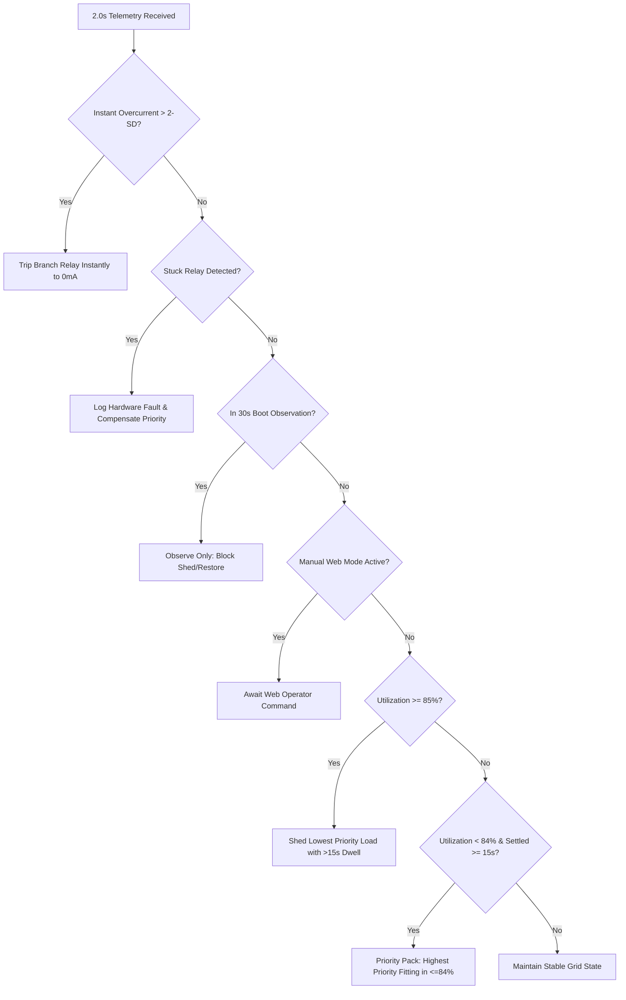

# Autonomous Smart Grid AI System: Inventory & Contract Mapping

**Document Version**: 1.0.0  
**Phase**: Phase 1 — System Inventory & Architecture Mapping  
**Workspace**: `DEVELOPMENT/experiment_001_baseline_verification/`  
**Reference Baseline**: `BACKUPS/baseline/` (Frozen 20260916_111850)

---

## 1. Hardware Architecture & Firmware Pinout

### 1.1 ESP32 Microcontroller GPIO Allocation

| Pin Category | GPIO | Component / Signal | Logic / Mode | Voltage / Spec |
| :--- | :--- | :--- | :--- | :--- |
| **Relay Actuation** | `GPIO4` | House Load Relay | Active LOW (`0` = ON, `1` = OFF) | 3.3V GPIO to Optocoupled Relay |
| | `GPIO26` | Industry Load Relay | Active LOW (`0` = ON, `1` = OFF) | 3.3V GPIO to Optocoupled Relay |
| | `GPIO13` | Street Light Relay | Active LOW (`0` = ON, `1` = OFF) | 3.3V GPIO to Optocoupled Relay |
| | `GPIO14` | Hospital Relay | Active LOW (`0` = ON, `1` = OFF) | 3.3V GPIO to Optocoupled Relay |
| **Primary I2C Bus** | `GPIO27` | SDA (Wire) | Hardware I2C (50ms timeout) | 3.3V pull-up |
| | `GPIO33` | SCL (Wire) | Hardware I2C (50ms timeout) | 3.3V pull-up |
| **Secondary I2C Bus**| `GPIO25` | SDA (I2C2 / Wire1) | Hardware I2C (50ms timeout) | Dedicated for Critical Load |
| | `GPIO32` | SCL (I2C2 / Wire1) | Hardware I2C (50ms timeout) | Dedicated for Critical Load |
| **Power Source Sense**| `GPIO34` | SMPS 1 Sense (Grid Main) | Digital INPUT (`1` = Active, `0` = Dead) | Optoisolated logic |
| | `GPIO35` | SMPS 2 Sense (Grid Auxiliary) | Digital INPUT (`1` = Active, `0` = Dead) | Optoisolated logic |
| | `GPIO39` | Battery Backup Sense | Digital INPUT (`1` = Active, `0` = Dead) | Optoisolated logic |
| **SPI OLED Display** | `GPIO23` | MOSI | SPI Master Out | 128x64 SSD1306 |
| | `GPIO18` | CLK | SPI Clock | 128x64 SSD1306 |
| | `GPIO21` | DC | Data / Command | 128x64 SSD1306 |
| | `GPIO19` | CS | Chip Select | 128x64 SSD1306 |
| | `GPIO22` | RESET | Display Reset | 128x64 SSD1306 |

### 1.2 INA219 Current & Voltage Sensor Mapping

| Sensor Target | I2C Bus | I2C Address | Shunt Resistor | Nominal Range | 2-SD Overcurrent Limit |
| :--- | :--- | :--- | :--- | :--- | :--- |
| **Critical Load** | `I2C2` (`GPIO25/32`) | `0x40` | $0.1\,\Omega$ | $12.0\,\text{V}$, $\approx 300\,\text{mA}$ | **$320.0\,\text{mA}$** |
| **Hospital Load** | `Wire` (`GPIO27/33`) | `0x45` | $0.1\,\Omega$ | $12.0\,\text{V}$, $\approx 256\,\text{mA}$ | **$272.0\,\text{mA}$** |
| **Street Light**  | `Wire` (`GPIO27/33`) | `0x44` | $0.1\,\Omega$ | $12.0\,\text{V}$, $\approx 394\,\text{mA}$ | **$405.0\,\text{mA}$** |
| **House Load**    | `Wire` (`GPIO27/33`) | `0x40` | $0.1\,\Omega$ | $12.0\,\text{V}$, $\approx 241\,\text{mA}$ | **$256.0\,\text{mA}$** |
| **Industry Load** | `Wire` (`GPIO27/33`) | `0x41` | $0.1\,\Omega$ | $12.0\,\text{V}$, $\approx 240\,\text{mA}$ | **$264.0\,\text{mA}$** |

---

## 2. Communication Contracts & Protocols

### 2.1 MQTT Broker Configuration
- **Broker Endpoint**: `78d11d43ac27466695cd0e4f5e7405c8.s1.eu.hivemq.cloud`
- **Port**: `8883` (MQTTS with TLS encryption)
- **Protocol**: MQTT 3.1.1 / 5.0 (Paho MQTT v2 Client API)
- **Sampling Interval**: **$2.0\,\text{seconds}$** ($0.5\,\text{Hz}$)
- **QoS Levels**: Telemetry `QoS 0`, Control Commands `QoS 1`

### 2.2 Telemetry Topic: `smartgrid/live`
Published by the ESP32 edge device every 2.0 seconds:
```json
{
  "timestamp": "2026-09-16 11:20:00",
  "device_id": "ESP32_SMARTGRID",
  "firmware": "2.0.0-closed-loop",
  "hardware": "ESP32",
  "location": "Lab",
  "group": "Group A",
  "wifi_rssi": -65,
  "uptime": 1420,
  "mode": "DUAL SMPS",
  "current_limit": 5000.0,
  "sources": {
    "smps1": true,
    "smps2": true,
    "battery": false
  },
  "critical": {
    "voltage": 12.04,
    "current": 298.5,
    "power": 3593.9
  },
  "loads": [
    {
      "name": "Hospital",
      "voltage": 12.02,
      "current": 252.1,
      "power": 3030.2,
      "relay": true,
      "priority": 4,
      "fault": 0,
      "nominal_current": 256.0
    },
    {
      "name": "Street",
      "voltage": 12.01,
      "current": 389.0,
      "power": 4671.9,
      "relay": true,
      "priority": 3,
      "fault": 0,
      "nominal_current": 394.0
    },
    {
      "name": "House",
      "voltage": 12.03,
      "current": 238.4,
      "power": 2867.9,
      "relay": true,
      "priority": 2,
      "fault": 0,
      "nominal_current": 241.0
    },
    {
      "name": "Industry",
      "voltage": 12.00,
      "current": 236.7,
      "power": 2840.4,
      "relay": true,
      "priority": 1,
      "fault": 0,
      "nominal_current": 240.0
    }
  ],
  "totals": {
    "current": 1414.7,
    "power": 17004.3
  }
}
```

### 2.3 Actuator Control Topic: `smartgrid/control`
Published by the backend AI engine or web operator override, subscribed by ESP32:
```json
{
  "cmd": "SHED | RESTORE | TRIP | MANUAL_OVERRIDE | MODE_CHANGE",
  "load": "industry | house | street | hospital",
  "state": 0,
  "reason": "OVERLOAD (86.2% >= 85%) | OVERCURRENT | HEADROOM_SAFE",
  "timestamp": "2026-09-16 11:20:02"
}
```

---

## 3. Database Schema (`live_smartgrid.db`)

### 3.1 Table `telemetry_logs`
Stores the continuous 2.0-second time series with sensor readings, AI predictions, and diagnostic classifications:

| Column | Type | Semantics |
| :--- | :--- | :--- |
| `id` | `INTEGER PRIMARY KEY AUTOINCREMENT` | Monotonic primary key |
| `timestamp` | `TEXT` | Format: `YYYY-MM-DD HH:MM:SS` (IST / local) |
| `mode` | `TEXT` | `DUAL SMPS`, `SINGLE SMPS`, or `BATTERY` |
| `current_limit` | `REAL` | Source current ceiling in $\text{mA}$ ($5000$, $1000$, or $800$) |
| `hospital_relay` | `INTEGER` | `1` (Energized) or `0` (Shed/De-energized) |
| `hospital_current` | `REAL` | Current in $\text{mA}$ measured by INA219 (`0x45`) |
| `street_relay` | `INTEGER` | `1` or `0` |
| `street_current` | `REAL` | Current in $\text{mA}$ measured by INA219 (`0x44`) |
| `house_relay` | `INTEGER` | `1` or `0` |
| `house_current` | `REAL` | Current in $\text{mA}$ measured by INA219 (`0x40`) |
| `industry_relay` | `INTEGER` | `1` or `0` |
| `industry_current` | `REAL` | Current in $\text{mA}$ measured by INA219 (`0x41`) |
| `critical_current` | `REAL` | Current in $\text{mA}$ measured on dedicated I2C2 (`0x40`) |
| `total_current` | `REAL` | Arithmetic sum of all 5 load currents ($\text{mA}$) |
| `total_power` | `REAL` | Total power consumption in $\text{mW}$ |
| `predicted_current` | `REAL` | AI load-aware forecasted current ($\text{mA}$) |
| `predicted_power` | `REAL` | AI load-aware forecasted power ($\text{W}$ or $\text{mW}$) |
| `fault_detected` | `INTEGER` | `0` = Healthy grid, `1` = Active anomaly/fault |
| `fault_load` | `TEXT` | Branch identifier (e.g. `INDUSTRY`, `HOUSE`, `NONE`) |
| `fault_type` | `TEXT` | `NORMAL`, `OVERCURRENT`, `STUCK_CLOSED`, `NO_CURRENT` |
| `severity` | `TEXT` | `NONE`, `MEDIUM`, `HIGH` |
| `warning_level` | `INTEGER` | `0` (Normal), `1` (70%), `2` (80%), `3` (85% / Fault) |
| `warning_message` | `TEXT` | Operational status description |

### 3.2 Table `grid_actuation_events`
Stores discrete supervisory control decisions and audit log events:

| Column | Type | Semantics |
| :--- | :--- | :--- |
| `id` | `INTEGER PRIMARY KEY AUTOINCREMENT` | Monotonic primary key |
| `timestamp` | `TEXT` | Event occurrence timestamp |
| `action_type` | `TEXT` | `TRIP`, `SHED`, `RESTORE`, `FAULT`, `MODE_CHANGE` |
| `load_name` | `TEXT` | `hospital`, `street`, `house`, `industry`, `critical` |
| `reason` | `TEXT` | Direct causal trigger (e.g. `OVERCURRENT`, `OVERLOAD_85`) |
| `current_mA` | `REAL` | Branch current at trigger moment |
| `limit_mA` | `REAL` | Source limit at trigger moment |
| `details` | `TEXT` | Extended context (e.g. projected utilization, bypassed loads) |

---

## 4. Machine Learning Model Registry

All 11 models located in `models/` verified healthy and compatible with scikit-learn 1.9.0 / joblib:

| Model Filename | Object Type | Features | Primary Function |
| :--- | :--- | :--- | :--- |
| `load_forecasting_current_model.pkl` | `RandomForestRegressor` | 36 features | Predicts aggregate future current demand ($\text{mA}$) |
| `load_forecasting_power_model.pkl` | `RandomForestRegressor` | 36 features | Predicts aggregate future power demand ($\text{mW}$) |
| `forecasting_features.pkl` | `list` (36 strings) | N/A | Feature column names for forecasting models |
| `fault_detection_model.pkl` | `RandomForestClassifier` | 37 features | Binary classification: Fault Present vs Normal |
| `fault_load_model.pkl` | `RandomForestClassifier` | 37 features | Multi-class localization: which branch has the fault |
| `fault_type_model.pkl` | `RandomForestClassifier` | 37 features | Fault classification: Overcurrent, Open Circuit, Stuck |
| `fault_severity_model.pkl` | `RandomForestClassifier` | 37 features | Severity assessment: Low, Medium, High |
| `fault_features.pkl` | `list` (37 strings) | N/A | Feature column names for fault diagnosis models |
| `model_hospital.pkl` | `dict` (model, features, classes) | 11 features | Hospital branch specific diagnostic classifier |
| `model_street.pkl` | `dict` (model, features, classes) | 11 features | Street branch specific diagnostic classifier |
| `model_house.pkl` | `dict` (model, features, classes) | 11 features | House branch specific diagnostic classifier |
| `model_industry.pkl` | `dict` (model, features, classes) | 11 features | Industry branch specific diagnostic classifier |

---

## 5. Control Engine & Safety Hierarchy



### 5.1 Deterministic Safety Constraints
1. **Critical Load Inviolability**: Critical load has no relay and is never shed.
2. **Local Edge Hardware Breaker**: ESP32 trips any branch exceeding its 2-SD threshold within 1.0s locally, even during total network disconnection.
3. **Anti-Chattering Dwell Time**: Any branch switched ON or OFF must remain in that state for at least **$15.0\,\text{seconds}$** before reverse actuation.
4. **Transition Stabilization**: Sudden power source drops (e.g. Dual SMPS $\to$ Single SMPS) enforce a $15.0\,\text{second}$ moratorium on restoration.
5. **Priority Packing Algorithm**: When restoring, loads are evaluated in descending priority: `Hospital (4)` $\to$ `Street (3)` $\to$ `House (2)` $\to$ `Industry (1)`. If a higher-priority load would cause utilization to exceed $84.0\%$, it is bypassed and lower-priority candidates that fit within $84.0\%$ are energized.
