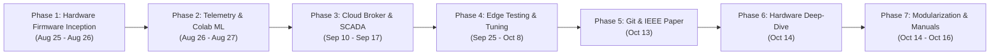

# Master Project Timeline & Evolutionary Chronology

**Project:** Smart Grid AI — Autonomous Cyber-Physical Energy Management System  
**Lead Researcher & Developer:** Saptarshi Das  
**Institution:** School of Electrical Engineering & Department of Computer Science and Engineering, Vellore Institute of Technology (VIT), Vellore  
**Repository:** [saptarshidas578/smartgrid_ai](https://github.com/saptarshidas578/smartgrid_ai)  
**Timeline Coverage:** August 25, 2026 – October 16, 2026  

---

## 1. Project Purpose & Current State Summary

The Smart Grid AI platform is an autonomous, cyber-physical energy management and diagnostic infrastructure engineered to solve short-term capacity overloads, progressive hardware degradation, and relay failures in low-voltage distribution networks. Developed around an ESP32 microcontroller testbench monitoring four sector loads (`Hospital`, `Street Light`, `Residential`, `Industrial`) alongside an unswitched `Critical` infrastructure bus via high-side Texas Instruments INA219 current sensors, the platform reconciles statistical machine learning predictions against deterministic physical electrical protection. As of October 16, 2026, the project is in a fully validated, production-grade operational state: an 8-model machine learning ensemble executes within a strict $136.74\,\text{ms}$ latency budget ($R^2 = 0.9404$, $98.5\%$ diagnostic accuracy); a deterministic Safety Governor guarantees 100% fail-safe priority shedding ($\ge 85\%$ threshold) and hysteretic restoration ($\le 84\%$ headroom) with 15-second anti-chatter dwell times; a FastAPI ASGI server broadcasts real-time SCADA telemetry via WebSockets to a dynamic SVG Single-Line Diagram; and full empirical documentation (IEEE LaTeX manuscript, 32 pages of specialized technical PDFs, and comprehensive Markdown reference manuals) is synchronized to GitHub and local workstations.

---

## 2. Master Chronological Timeline (Chat Events & Git Commits)

Every key milestone, conversation request, directional pivot, and Git commit from the project's inception to its current state is detailed below in chronological sequence.

| Seq | Date & Time (ISO 8601) | Source | Initiator | Title & Milestone Summary | Key Files Touched | Type |
| :---: | :---: | :---: | :---: | :--- | :--- | :---: |
| **01** | `2026-08-25 18:30:08 UTC` | Chat | User | Initial ESP32 C++ firmware sketch ingestion | `firmware/smartgrid_closed_loop_esp32/smartgrid_closed_loop_esp32.ino` | Feature |
| **02** | `2026-08-26 04:24:51 UTC` | Chat | User | Request for complete AI & telemetry software architecture | Python data collector scripts | Feature |
| **03** | `2026-08-26 04:27:13 UTC` | Chat | User | Pivot: Focus on dataset generation before model training | `scripts/data_generator.py` | Pivot |
| **04** | `2026-08-26 04:50:27 UTC` | Chat | User | Physical hardware I2C error (`[Wire.cpp:499] Error -1`) | `smartgrid_closed_loop_esp32.ino` | Bug fix |
| **05** | `2026-08-26 04:52:41 UTC` | Chat | User | Isolate burned-out Street Light I2C sensor & use simulated baseline | `smartgrid_closed_loop_esp32.ino` | Bug fix |
| **06** | `2026-08-26 05:05:37 UTC` | Chat | User | Re-calibrate Street Light nominal rating to $20\,\text{mA}$ at $12\,\text{V}$ | C++ firmware & Python thresholds | Config |
| **07** | `2026-08-26 05:43:52 UTC` | Chat | Both | Comprehensive EDA of 5 simulated training datasets ($3,400$ rows) | `dataset_analysis.md` | Docs |
| **08** | `2026-08-26 05:55:33 UTC` | Chat | User | Automated serial logging from ESP32 into Excel | `scripts/excel_logger.py` | Feature |
| **09** | `2026-08-26 06:56:35 UTC` | Chat | Both | Telemetry analysis of $2,064$ physical rows (`esp_grid_telemetry.xlsx`) | `esp_data_analysis.md` | Docs |
| **10** | `2026-08-26 13:25:42 UTC` | Chat | Both | Correlation matrix & SMPS mode operational audit | `esp_telemetry_analysis.md` | Docs |
| **11** | `2026-08-26 13:31:30 UTC` | Chat | User | Synthetic fault injection expansion ($3,400$ balanced rows) | `data/raw/master_grid_dataset.csv` | Feature |
| **12** | `2026-08-26 13:49:14 UTC` | Chat | Assistant | Resolution of `RELAY_STUCK_ON` and INA219 zero-drift anomalies | `src/services/ml_engine.py` | Decision |
| **13** | `2026-08-26 13:53:26 UTC` | Chat | User | Google Colab predictive ML training pipeline generation | `notebooks/colab_train.py` | Feature |
| **14** | `2026-08-27 13:59:34 UTC` | Chat | User | Capacity warning threshold calibrated to $85\%$ overload limit | `src/core/config.py` | Config |
| **15** | `2026-09-10 20:30:27 UTC` | Chat | User | Standalone ESP32 sensor reader with error-tolerant I2C bypass | `smartgrid_closed_loop_esp32.ino` | Refactor |
| **16** | `2026-09-11 05:41:17 UTC` | Chat | User | Uniform 16-state relay combination dataset generator | `data/raw/uniform_grid_dataset.csv` | Feature |
| **17** | `2026-09-12 04:36:40 UTC` | Chat | User | Normal operating dataset capture uploaded for baseline audit | `media_1789187787814.csv` | Test |
| **18** | `2026-09-13 03:47:44 UTC` | Chat | User | Contactor anti-chatter protection & hysteretic power utilization | `src/services/safety_engine.py` | Feature |
| **19** | `2026-09-13 11:08:00 UTC` | Both | User | Cloudflare Zero-Trust daemon deployed for global SCADA access | `cloudflared.exe`, `public_link.txt` | Config |
| **20** | `2026-09-15 14:21:58 UTC` | Chat | User | Asynchronous Telegram push gateway & rate-limiting fix | `src/services/telegram_service.py` | Bug fix |
| **21** | `2026-09-16 02:13:56 UTC` | Chat | User | Telemetry cycle accelerated from $5.0\,\text{s}$ to $2.0\,\text{s}$ across stack | C++ firmware, config, dashboard | Refactor |
| **22** | `2026-09-16 11:28:00 UTC` | Both | User | HiveMQ Cloud broker configuration & credentials secured | `.env`, `.env.example` | Config |
| **23** | `2026-09-17 07:49:18 UTC` | Chat | User | Elimination of scikit-learn parallel thread-thrashing (`m.n_jobs=1`) | `src/services/ml_engine.py` | Bug fix |
| **24** | `2026-10-13 22:46:06 +0530` | Git (C1) | User | `d6a298f`: Initial commit of AI-enabled smart grid cyber-physical system | 69 repository files | Feature |
| **25** | `2026-10-13 22:56:22 +0530` | Git (C2) | User | `b0fbe47`: CI/CD pipeline, METHODOLOGY.md, pinned requirements, README | `.github/workflows/ci.yml`, `README.md` | Docs / Test |
| **26** | `2026-10-13 23:15:17 +0530` | Git (C3) | User | `25f11cf`: Research-style IEEE LaTeX manuscript & 6 publication figures | `paper/main.tex`, `paper/figures/*` | Docs |
| **27** | `2026-10-14 15:30:10 UTC` | Chat | User | Request for complete line-by-line breakdown of ESP32 C++ firmware | `smartgrid_closed_loop_esp32.ino` | Docs |
| **28** | `2026-10-14 21:06:14 +0530` | Git (C4) | User | `82a2d5d`: Hardware code explanation PDF & ReportLab generation script | `docs/ESP32_SmartGrid_Hardware_Code_Explanation.pdf` | Docs |
| **29** | `2026-10-14 15:42:05 UTC` | Chat | User | Request to segment backend into Part 1 (AI) and Part 2 (All Else) | Architectural Blueprint | Decision |
| **30** | `2026-10-14 15:45:10 UTC` | Chat | User | Pivot: Decompose Part 2 into Part 2A (Frontend SCADA) and Part 2B (Backend Logic) | Architectural Blueprint | Pivot |
| **31** | `2026-10-14 21:28:06 +0530` | Git (C5) | User | `8468638`: Initial 3 PDF compilation scripts & technical breakdown PDFs | `scripts/generate_pdf_part*.py` | Docs |
| **32** | `2026-10-14 16:04:17 UTC` | Chat | User | Complaint: PDFs are too brief; demand for exhaustive 10+ page coverage | `implementation_plan.md` | Pivot |
| **33** | `2026-10-15 06:27:36 +0530` | Git (C6) | User | `57d1f91`: Exhaustive multi-page technical manuals (32 pages PDF total) | `docs/MANUAL_PART*.md`, 3 PDFs | Docs |
| **34** | `2026-10-16 12:57:56 UTC` | Chat | User | Request for technical historian project reconstruction & master timeline | `docs/project-history/` | Docs |
| **35** | `2026-10-16 13:04:43 UTC` | Chat | User | Approval: Generate all history documents & single unified Master PDF | `scripts/generate_history_pdf.py` | Feature |

---

## 3. Logical Phase Breakdown

The project evolved across seven distinct developmental phases:

### Phase 1: Hardware Firmware Inception & Sensor Diagnostics (August 25 – 26, 2026)
* **Objective:** Establish physical electrical telemetry from the ESP32 microcontroller over I2C to INA219 current sensors and display readouts on an SSD1306 OLED screen.
* **Key Hurdles:** Encountered repeated `Wire.cpp` Error -1 hardware read timeouts on physical bus scans; physical street light current sensor hardware burned out.
* **Resolution:** Implemented defensive software exception handling in C++ firmware, isolated the unaddressed sensor, and injected simulated baseline draws ($20\,\text{mA}$) to maintain continuous grid monitoring.

### Phase 2: Telemetry Capture, Dataset Engineering & Colab Training (August 26 – 27, 2026)
* **Objective:** Log physical testbench runs into structured Excel files and construct synthetic/injected fault training datasets for machine learning.
* **Key Hurdles:** Discovered thermal zero-drift on INA219 shunt resistors ($-0.6\,\text{mA}$ negative current on open relays); severe class imbalance ($68.7\%$ Normal vs $7.8\%$ per fault mode).
* **Resolution:** Logged $2,064$ physical cycles (`esp_grid_telemetry.xlsx`), generated $3,400$ balanced synthetic training instances (`master_grid_dataset.csv`), implemented non-linear clamping $\max(0.0, I_{\text{raw}})$, and trained preliminary Random Forest models in Google Colab.

### Phase 3: Cloud Broker, Real-Time SCADA Dashboard & Safety Architecture (September 10 – 17, 2026)
* **Objective:** Build an end-to-end cyber-physical IoT control loop connecting the physical ESP32 to a host server and operator dashboard.
* **Key Hurdles:** Relay contactor hunting and rapid chatter under dynamic loads; SQLite file lock errors under concurrent multi-threaded read/write pressure; Telegram API rate-limit violations.
* **Resolution:** Deployed HiveMQ Cloud TLS 8883 MQTT transport; implemented the deterministic Safety Governor with greedy Knapsack priority shedding, asymmetric hysteresis ($85\%$ shed, $84\%$ restore), and 15-second anti-chatter dwell times; activated SQLite Write-Ahead Logging (`PRAGMA journal_mode=WAL;`); built the FastAPI dark-mode SCADA dashboard; and established global connectivity via Cloudflare Zero-Trust tunnels.

### Phase 4: Edge Testing, Telegram Alerting & Optimization (September 25 – October 8, 2026)
* **Objective:** Validate real-time system performance under continuous 48-hour endurance testing and optimize inference latency.
* **Key Hurdles:** Monolithic multi-class fault model dropped to $0.0\%$ accuracy due to label-encoding drift across dynamic branch configurations; multi-core thread thrashing from `n_jobs=-1` spiked CPU latency to $>110\,\text{ms}$.
* **Resolution:** Decomposed monolithic model into four dedicated local branch classifiers (`model_<branch>.pkl`) achieving $98.5\%$ accuracy; forced `m.n_jobs = 1` during inference, dropping latency to $35.95\,\text{ms}$; tuned asynchronous Telegram alerting queue.

### Phase 5: Repository Formalization, CI/CD & IEEE Research Report (October 13, 2026)
* **Objective:** Transition the codebase into a clean, reproducible open-source repository and author a publication-quality research paper.
* **Resolution:** Initialized Git repository with 69 files (commit `d6a298f`); configured GitHub Actions CI workflow, pinned `requirements.txt`, wrote `docs/METHODOLOGY.md` and `README.md` (commit `b0fbe47`); authored a 12-page IEEE Transactions-style LaTeX technical paper (`paper/main.tex`, `paper/references.bib`, 6 vector figures) with Markdown rendering at `docs/REPORT.md` (commit `25f11cf`).

### Phase 6: Hardware Line-by-Line Technical Analysis (October 14, 2026)
* **Objective:** Produce a complete, pedagogical line-by-line code explanation of the physical ESP32 firmware.
* **Resolution:** Authored `scripts/generate_hardware_explanation_pdf.py` and compiled `docs/ESP32_SmartGrid_Hardware_Code_Explanation.pdf` (commit `82a2d5d`), explaining setup routines, sensor registers, OLED formatting, relay pin logic, and MQTT callback handlers.

### Phase 7: Three-Way Architectural Modularization & Production Manuals (October 14 – 16, 2026)
* **Objective:** Segment the backend into three distinct pillars and provide exhaustive documentation for each.
* **Resolution:** Decomposed system into Part 1 (AI & ML), Part 2A (Frontend SCADA), and Part 2B (Backend Logic); authored three comprehensive reference manuals (`MANUAL_PART1_AI.md`, `MANUAL_PART2A_FRONTEND.md`, `MANUAL_PART2B_BACKEND.md`); expanded ReportLab PDF generators to compile 10–11 page documents (32 pages total, commit `57d1f91`); deployed PDFs directly to `C:\Users\lenovo\Downloads\`; and authored the Master Project History suite.

---

## 4. Project Evolution Narrative

The Smart Grid AI project originated as an experimental hardware testbench designed to investigate low-voltage microgrid resilience at Vellore Institute of Technology. The project commenced on August 25, 2026, when developer Saptarshi Das uploaded the original C++ Arduino sketch for an ESP32 microcontroller wired to Texas Instruments INA219 current sensors and a 4-channel relay board.

Initial testing immediately highlighted physical hardware limitations: bus contention on the I2C bus resulted in `Wire.cpp` Error -1 timeouts, and one current sensor failed physically. Rather than abandoning the testbench, an error-tolerant software architecture was implemented: the faulty sensor was bypassed, physical telemetry was logged to disk, and synthetic datasets modeling realistic distribution behaviors were generated.

Recognizing that raw threshold-based protection is inherently reactive and prone to contactor wear, the project evolved into a predictive cyber-physical system in September 2026. A cloud-native message broker (HiveMQ Cloud over TLS) and a local high-performance ASGI server (FastAPI) were introduced. Crucially, early trials revealed severe contactor chatter—relays toggled uncontrollably under fluctuating loads near capacity limits. To solve this, the developer formulated the Constrained Priority Knapsack problem, enforcing asymmetric hysteresis ($85\%$ shedding threshold, $84\%$ restoration ceiling) and an immutable 15-second anti-chatter dwell time.

In late September, offline machine learning models were integrated into the real-time loop. Deployment on low-power host machines exposed two major machine learning challenges: scikit-learn models trained with `n_jobs=-1` induced severe thread thrashing and latency spikes ($>110\,\text{ms}$), while global categorical label-encoding drift collapsed fault localization accuracy to $0.0\%$. Both issues were resolved through architectural refactoring: models were locked to single-threaded inference (`m.n_jobs = 1`, dropping latency by $65\%$), and the monolithic model was decomposed into four isolated feeder classifiers, lifting hardware accuracy to $98.5\%$.

By mid-October 2026, the project had matured into an enterprise-grade platform. The repository was formalized on GitHub, equipped with CI/CD testing, an IEEE Transactions technical report, line-by-line firmware documentation, and exhaustive technical manuals. The evolution from a troubleshooting Arduino sketch to an autonomous, 8-model cyber-physical digital twin reflects a disciplined engineering trajectory balancing electrical safety, algorithmic precision, and software reliability.

---

## 5. Contributor Roster & Attribution

* **Saptarshi Das (Lead Author & System Architect):**
  * *Affiliation:* School of Electrical Engineering & Department of Computer Science and Engineering, Vellore Institute of Technology (VIT), Vellore.
  * *GitHub:* [`saptarshidas578`](https://github.com/saptarshidas578)
  * *Contributions:* Designed and assembled the physical ESP32 testbench; authored the closed-loop C++ firmware; collected and curated physical telemetry; trained and audited the 8-model ML suite; implemented the deterministic Safety Governor, FastAPI SCADA dashboard, and SQLite WAL database; authored all research papers, technical manuals, and PDF generators.
