# Comprehensive System Analysis & Cross-Cutting Reports

**Project:** Smart Grid AI — Autonomous Cyber-Physical Energy Management System  
**Lead Researcher & Developer:** Saptarshi Das (VIT Vellore)  
**Analysis Date:** October 16, 2026  
**Total Tracked Files Audited:** 94 Files  
**Total Commits Audited:** 6 Commits (`d6a298f` to `57d1f91`)  

---

## 1. Master File History Ledger (All 94 Tracked Files)

The table below catalogs every file currently tracked in the repository, documenting its creation commit, creation date, modification frequency, and core system responsibility.

| # | File Path | Inception Commit | Inception Date | Mod Count | Primary Architectural Role & Purpose |
| :---: | :--- | :---: | :---: | :---: | :--- |
| 1 | `.env.example` | `d6a298f` | 2026-10-13 | 1 | Environment template declaring MQTT, Telegram, and server configs. |
| 2 | `.github/workflows/ci.yml` | `b0fbe47` | 2026-10-13 | 1 | GitHub Actions CI/CD matrix runner (Ubuntu/Windows, Python 3.10/3.11). |
| 3 | `.gitignore` | `d6a298f` | 2026-10-13 | 1 | Git exclusion rules for virtualenvs, runtime DBs, and tunnel binaries. |
| 4 | `LICENSE` | `d6a298f` | 2026-10-13 | 1 | MIT Open-Source License declaration. |
| 5 | `README.md` | `d6a298f` | 2026-10-13 | 2 | Primary project landing page with badges, architecture diagrams, and quickstart. |
| 6 | `assets/screenshots/README.md` | `d6a298f` | 2026-10-13 | 1 | Visual assets directory documentation. |
| 7 | `assets/screenshots/chart_energy_pie.png` | `d6a298f` | 2026-10-13 | 1 | High-resolution pie chart showing sector energy consumption shares. |
| 8 | `assets/screenshots/chart_load_profile.png` | `d6a298f` | 2026-10-13 | 1 | Load profile timeline contrasting demand against capacity limits. |
| 9 | `assets/screenshots/chart_voltage_stability.png` | `d6a298f` | 2026-10-13 | 1 | Main distribution busbar voltage regulation stability curve. |
| 10 | `data/raw/README.md` | `d6a298f` | 2026-10-13 | 1 | Telemetry datasets documentation and provenance metadata. |
| 11 | `data/raw/esp_grid_telemetry.xlsx` | `d6a298f` | 2026-10-13 | 1 | Master Excel archive of 2,064 physical ESP32 hardware cycles. |
| 12 | `data/raw/fault_grid_dataset.csv` | `d6a298f` | 2026-10-13 | 1 | Raw injected fault dataset for diagnostic model training (3,265 rows). |
| 13 | `data/raw/fault_grid_dataset_labeled.csv` | `d6a298f` | 2026-10-13 | 1 | Calibrated and labeled multi-class fault dataset (3,201 rows). |
| 14 | `data/raw/master_grid_dataset.csv` | `d6a298f` | 2026-10-13 | 1 | Unified 6,310-row dataset combining normal operation and physical faults. |
| 15 | `data/raw/uniform_grid_dataset.csv` | `d6a298f` | 2026-10-13 | 1 | Balanced 16-state relay combination matrix dataset (3,110 rows). |
| 16 | `docs/BASELINE_MANIFEST.json` | `d6a298f` | 2026-10-13 | 1 | Cryptographic hash manifest of baseline models and datasets. |
| 17 | `docs/DATA_AUDIT_REPORT.json` | `d6a298f` | 2026-10-13 | 2 | Machine-readable statistical audit of empirical training data. |
| 18 | `docs/DATA_AUDIT_REPORT.md` | `d6a298f` | 2026-10-13 | 1 | Markdown summary of dataset distribution and sensor noise bounds. |
| 19 | `docs/ESP32_SmartGrid_Hardware_Code_Explanation.pdf` | `82a2d5d` | 2026-10-14 | 1 | 8-page compiled PDF explaining the physical ESP32 C++ firmware. |
| 20 | `docs/ESP32_SmartGrid_Part1_AI_Machine_Learning.pdf` | `8468638` | 2026-10-14 | 2 | 10-page compiled PDF technical manual for AI & ML Subsystem. |
| 21 | `docs/ESP32_SmartGrid_Part2A_Frontend_SCADA_Dashboard.pdf` | `8468638` | 2026-10-14 | 2 | 11-page compiled PDF technical manual for Frontend & SCADA Layer. |
| 22 | `docs/ESP32_SmartGrid_Part2B_Backend_Logic_Infrastructure.pdf` | `8468638` | 2026-10-14 | 2 | 11-page compiled PDF technical manual for Backend Logic & Safety. |
| 23 | `docs/MANUAL_PART1_AI.md` | `57d1f91` | 2026-10-15 | 1 | Comprehensive 442-line Markdown reference manual for Part 1 (AI). |
| 24 | `docs/MANUAL_PART2A_FRONTEND.md` | `57d1f91` | 2026-10-15 | 1 | Comprehensive 413-line Markdown reference manual for Part 2A (Frontend). |
| 25 | `docs/MANUAL_PART2B_BACKEND.md` | `57d1f91` | 2026-10-15 | 1 | Comprehensive 398-line Markdown reference manual for Part 2B (Backend). |
| 26 | `docs/METHODOLOGY.md` | `b0fbe47` | 2026-10-13 | 1 | Theoretical and mathematical methodology specification document. |
| 27 | `docs/MODEL_AUDIT_REPORT.md` | `d6a298f` | 2026-10-13 | 1 | Out-of-sample benchmark report for all 8 trained models. |
| 28 | `docs/MODEL_BENCHMARK_MATRIX.json` | `d6a298f` | 2026-10-13 | 2 | Machine-readable accuracy, latency, and memory footprint metrics. |
| 29 | `docs/REPORT.md` | `25f11cf` | 2026-10-13 | 1 | Research-grade technical paper in Markdown for GitHub rendering. |
| 30 | `docs/SMART_GRID_AI_FINAL_PROJECT_REPORT.docx` | `d6a298f` | 2026-10-13 | 1 | Formatted Microsoft Word project documentation report. |
| 31 | `docs/SMART_GRID_AI_FINAL_PROJECT_REPORT.md` | `d6a298f` | 2026-10-13 | 1 | Comprehensive 1,910-line engineering project documentation report. |
| 32 | `docs/SYSTEM_INVENTORY_AND_CONTRACTS.md` | `d6a298f` | 2026-10-13 | 1 | API interfaces, data schemas, and microservice contracts. |
| 33 | `docs/TEAM_HANDOVER_MANUAL.md` | `d6a298f` | 2026-10-13 | 1 | Operations guide for deployment, maintenance, and debugging. |
| 34 | `docs/alert_config.json` | `d6a298f` | 2026-10-13 | 1 | Threshold definitions for graduated alerting tiers. |
| 35 | `docs/figures/chart_energy_pie.png` | `d6a298f` | 2026-10-13 | 1 | Documentation figure: sector energy consumption pie chart. |
| 36 | `docs/figures/chart_load_profile.png` | `d6a298f` | 2026-10-13 | 1 | Documentation figure: load profile timeline. |
| 37 | `docs/figures/chart_voltage_stability.png` | `d6a298f` | 2026-10-13 | 1 | Documentation figure: bus voltage stability curve. |
| 38 | `firmware/smartgrid_closed_loop_esp32/smartgrid_closed_loop_esp32.ino` | `d6a298f` | 2026-10-13 | 1 | Physical ESP32 C++ firmware (sensors, OLED, relays, MQTT). |
| 39 | `models/fault_detection_model.pkl` | `d6a298f` | 2026-10-13 | 1 | Binary fault presence Random Forest classifier (100% accuracy). |
| 40 | `models/fault_features.pkl` | `d6a298f` | 2026-10-13 | 1 | Serialized feature name header list for fault classification. |
| 41 | `models/fault_load_model.pkl` | `d6a298f` | 2026-10-13 | 1 | Monolithic global fault localization classifier (retired in favor of local models). |
| 42 | `models/fault_severity_model.pkl` | `d6a298f` | 2026-10-13 | 1 | Fault severity tier Random Forest classifier (100% accuracy). |
| 43 | `models/fault_type_model.pkl` | `d6a298f` | 2026-10-13 | 1 | Multi-class failure mode classifier (98.5% accuracy). |
| 44 | `models/forecasting_features.pkl` | `d6a298f` | 2026-10-13 | 1 | Serialized feature name header list for STLF load regressors. |
| 45 | `models/load_forecasting_current_model.pkl` | `d6a298f` | 2026-10-13 | 1 | Random Forest STLF regressor for total current ($R^2 = 0.9404$). |
| 46 | `models/load_forecasting_power_model.pkl` | `d6a298f` | 2026-10-13 | 1 | Random Forest STLF regressor for active power ($R^2 = 0.9404$). |
| 47 | `models/model_hospital.pkl` | `d6a298f` | 2026-10-13 | 1 | Local branch diagnostic classifier for Hospital feeder (98.5%). |
| 48 | `models/model_house.pkl` | `d6a298f` | 2026-10-13 | 1 | Local branch diagnostic classifier for Residential feeder (98.5%). |
| 49 | `models/model_industry.pkl` | `d6a298f` | 2026-10-13 | 1 | Local branch diagnostic classifier for Industrial feeder (98.5%). |
| 50 | `models/model_street.pkl` | `d6a298f` | 2026-10-13 | 1 | Local branch diagnostic classifier for Street Light feeder (98.5%). |
| 51 | `paper/figures/fig1_cyber_physical_architecture.png` | `25f11cf` | 2026-10-13 | 1 | IEEE Paper Fig 1: End-to-end cyber-physical architecture diagram. |
| 52 | `paper/figures/fig2_eda_load_distributions.png` | `25f11cf` | 2026-10-13 | 1 | IEEE Paper Fig 2: Exploratory data analysis load distribution curves. |
| 53 | `paper/figures/fig3_predicted_vs_actual.png` | `25f11cf` | 2026-10-13 | 1 | IEEE Paper Fig 3: Predicted vs actual load demand regression plot. |
| 54 | `paper/figures/fig4_model_benchmark_comparison.png` | `25f11cf` | 2026-10-13 | 1 | IEEE Paper Fig 4: Model comparison bar chart (RF vs baselines). |
| 55 | `paper/figures/fig5_residual_error_distribution.png` | `25f11cf` | 2026-10-13 | 1 | IEEE Paper Fig 5: Residual error distribution & normality plot. |
| 56 | `paper/figures/fig6_voltage_stability_failover.png` | `25f11cf` | 2026-10-13 | 1 | IEEE Paper Fig 6: Dual-to-Single SMPS failover response curve. |
| 57 | `paper/main.tex` | `25f11cf` | 2026-10-13 | 1 | Complete 400-line IEEE Transactions LaTeX manuscript. |
| 58 | `paper/references.bib` | `25f11cf` | 2026-10-13 | 1 | BibTeX bibliography containing 25 verified academic citations. |
| 59 | `requirements.txt` | `d6a298f` | 2026-10-13 | 2 | Pinned Python dependencies for reproducible installation. |
| 60 | `results/chart_energy_pie.png` | `d6a298f` | 2026-10-13 | 1 | Headless analytics output: sector energy share pie chart. |
| 61 | `results/chart_load_profile.png` | `d6a298f` | 2026-10-13 | 1 | Headless analytics output: chronological load timeline. |
| 62 | `results/chart_voltage_stability.png` | `d6a298f` | 2026-10-13 | 1 | Headless analytics output: bus voltage stability histogram. |
| 63 | `results/smart_grid_analytics_report.pdf` | `d6a298f` | 2026-10-13 | 1 | Automated analytics PDF report generated from SQLite logs. |
| 64 | `results/smart_grid_summary.csv` | `d6a298f` | 2026-10-13 | 1 | Tabular mathematical energy and reliability summary. |
| 65 | `run_smart_grid_suite.py` | `d6a298f` | 2026-10-13 | 1 | Multi-process supervisor managing Dashboard, AI, Mock, and Tunnel. |
| 66 | `scripts/build_and_deploy_all_pdfs.py` | `8468638` | 2026-10-14 | 1 | Master automated compiler building and deploying all 3 PDFs. |
| 67 | `scripts/data_audit.py` | `d6a298f` | 2026-10-13 | 1 | Automated data validation script verifying sensor noise and bounds. |
| 68 | `scripts/generate_hardware_explanation_pdf.py` | `82a2d5d` | 2026-10-14 | 1 | ReportLab generator for firmware line-by-line documentation. |
| 69 | `scripts/generate_paper_figures.py` | `25f11cf` | 2026-10-13 | 1 | Matplotlib generator for the 6 IEEE publication figures. |
| 70 | `scripts/generate_pdf_part1_ai.py` | `8468638` | 2026-10-14 | 2 | ReportLab generator for Part 1 (AI & ML Subsystem) PDF. |
| 71 | `scripts/generate_pdf_part2a_frontend.py` | `8468638` | 2026-10-14 | 2 | ReportLab generator for Part 2A (Frontend & SCADA) PDF. |
| 72 | `scripts/generate_pdf_part2b_backend_logic.py` | `8468638` | 2026-10-14 | 2 | ReportLab generator for Part 2B (Backend Logic) PDF. |
| 73 | `scripts/grid_alerts.py` | `d6a298f` | 2026-10-13 | 1 | Standalone alert dispatcher for SMS and email escalation. |
| 74 | `scripts/model_audit.py` | `d6a298f` | 2026-10-13 | 1 | Verification script checking inference latency and accuracy bounds. |
| 75 | `scripts/train_local_models.py` | `d6a298f` | 2026-10-13 | 1 | Production training pipeline serializing the 4 local branch classifiers. |
| 76 | `src/__init__.py` | `d6a298f` | 2026-10-13 | 1 | Python package initializer. |
| 77 | `src/core/__init__.py` | `d6a298f` | 2026-10-13 | 1 | Core package initializer. |
| 78 | `src/core/config.py` | `d6a298f` | 2026-10-13 | 1 | Central configuration manager and zero-dependency `.env` parser. |
| 79 | `src/core/database.py` | `d6a298f` | 2026-10-13 | 1 | High-concurrency SQLite WAL persistence manager. |
| 80 | `src/core/mqtt_client.py` | `d6a298f` | 2026-10-13 | 1 | Resilient Paho MQTT client over TLS with thread-safe publish. |
| 81 | `src/dashboard/__init__.py` | `d6a298f` | 2026-10-13 | 1 | Dashboard package initializer. |
| 82 | `src/dashboard/grid_dashboard.py` | `d6a298f` | 2026-10-13 | 1 | FastAPI ASGI server, WebSockets, SVG Digital Twin, Chart.js (1,914 lines). |
| 83 | `src/services/__init__.py` | `d6a298f` | 2026-10-13 | 1 | Services package initializer. |
| 84 | `src/services/grid_analytics.py` | `d6a298f` | 2026-10-13 | 1 | Energy Riemann integration, utility tariff billing, SAIFI/SAIDI. |
| 85 | `src/services/ml_engine.py` | `d6a298f` | 2026-10-13 | 1 | 36-feature extractor, STLF predictor, branch classifiers (482 lines). |
| 86 | `src/services/mock_esp32.py` | `d6a298f` | 2026-10-13 | 1 | Hardware-in-the-loop physics and sensor noise simulator. |
| 87 | `src/services/safety_engine.py` | `d6a298f` | 2026-10-13 | 1 | Deterministic Safety Governor: priority shedding, 15s dwell, 2-SD trip. |
| 88 | `src/services/telegram_service.py` | `d6a298f` | 2026-10-13 | 1 | Non-blocking threaded Telegram push notification gateway. |
| 89 | `src/smart_grid_ai.py` | `d6a298f` | 2026-10-13 | 1 | Master closed-loop orchestrator and UTF-8 terminal SCADA console. |
| 90 | `tests/__init__.py` | `d6a298f` | 2026-10-13 | 1 | Tests package initializer. |
| 91 | `tests/test_e2e_integration.py` | `d6a298f` | 2026-10-13 | 1 | End-to-end integration tests (MQTT, Database, Safety, ML loop). |
| 92 | `tests/test_ml_pipeline.py` | `d6a298f` | 2026-10-13 | 1 | Unit tests for feature extraction and model inference consistency. |
| 93 | `tests/test_safety_engine.py` | `d6a298f` | 2026-10-13 | 1 | Unit tests for 85% overload shedding, priority order, and dwell times. |
| 94 | `tests/test_system_config.py` | `b0fbe47` | 2026-10-13 | 1 | Unit tests verifying configuration threshold consistency. |

---

## 2. Dependency & Tooling Changes

The platform transitioned across three distinct tooling generations:

| Tool / Dependency | Version | Category | Date Added / Changed | Technical Purpose & Evolutionary Rationale |
| :--- | :---: | :---: | :---: | :--- |
| **ESP32 Arduino Core** | `v2.0.14+` | Embedded C++ | Aug 25, 2026 | Microcontroller firmware runtime; manages dual-core ESP32 execution. |
| **Adafruit_INA219** | `v1.2.3` | Embedded Driver | Aug 25, 2026 | High-side DC voltage and current shunt sensing over I2C (`0x40`–`0x45`). |
| **Adafruit_SSD1306** | `v2.5.9` | Embedded Driver | Aug 25, 2026 | $128 \times 64$ monochrome OLED visual telemetry readout. |
| **paho-mqtt** | `2.0.0` | Python Networking | Sep 10, 2026 | Client library for HiveMQ Cloud; upgraded to handle v2/v1 API fallback. |
| **fastapi** | `0.110.0` | Web Framework | Sep 13, 2026 | High-throughput asynchronous ASGI web server for SCADA telemetry. |
| **uvicorn** | `0.28.0` | ASGI Server | Sep 13, 2026 | Production ASGI server running the FastAPI event loop. |
| **scikit-learn** | `1.4.1.post1` | Machine Learning | Aug 26, 2026 | Ensembles of Random Forest regressors and multi-class classifiers. |
| **pandas** | `2.2.1` | Data Analysis | Aug 26, 2026 | Tabular telemetry ingestion, chronological sorting, and Riemann integration. |
| **numpy** | `1.26.4` | Numerical Math | Aug 26, 2026 | Vectorized 36-feature matrix construction and lag calculations. |
| **reportlab** | `4.1.0` | PDF Generation | Oct 14, 2026 | Multi-page publication-quality vector PDF compiler. |
| **matplotlib** | `3.8.3` | Data Visualization | Sep 15, 2026 | Headless `Agg` backend rendering 300 DPI vector figures for papers and reports. |
| **cloudflared** | `2024.8.3` | Networking Tunnel | Sep 13, 2026 | Exposes local SCADA port 8000 via a secure global HTTPS URL. |
| **pytest** | `9.1.1` | Testing | Oct 13, 2026 | Automated test framework executing 12 unit and integration tests. |

---

## 3. Architecture Evolution

The platform underwent three profound architectural paradigm shifts:

```mermaid
flowchart TD
    subgraph Gen1["Generation 1: Monolithic Serial Logger (August 2026)"]
        G1_ESP["ESP32 Microcontroller"] -->|USB COM Serial| G1_PY["Local Python Script"]
        G1_PY --> G1_XLS["esp_grid_telemetry.xlsx"]
    end

    subgraph Gen2["Generation 2: IoT Control Loop & Safety Engine (September 2026)"]
        G2_ESP["ESP32 Microcontroller"] -->|TLS Port 8883| G2_MQTT["HiveMQ Cloud Broker"]
        G2_MQTT --> G2_ORCH["smart_grid_ai.py"]
        G2_ORCH --> G2_SAFE["Safety Governor (Knapsack 85%)"]
        G2_SAFE -->|Actuator QoS 1| G2_MQTT
        G2_ORCH --> G2_DB[("SQLite (Rollback Mode)")]
        G2_ORCH --> G2_WEB["FastAPI SCADA Dashboard"]
    end

    subgraph Gen3["Generation 3: Decoupled 3-Pillar Cyber-Physical Twin (October 2026)"]
        G3_ESP["ESP32 Testbench / Mock"] -->|TLS Port 8883| G3_MQTT["HiveMQ Cloud Broker"]
        G3_MQTT --> G3_P1["Part 1: AI & ML Engine (m.n_jobs=1, 8 Models)"]
        G3_P1 --> G3_P2B["Part 2B: Safety Governor & SQLite WAL (Zero Lock)"]
        G3_P2B -->|Closed-Loop Trip/Shed| G3_MQTT
        G3_P2B --> G3_P2A["Part 2A: SCADA Presentation (WebSockets, SVG, Telegram)"]
        G3_P2A --> G3_CLF["Cloudflare Global Tunnel"]
    end
```

* **Gen 1 (August 2026):** Monolithic serial polling. Telemetry was read from USB COM ports and dumped directly into Excel sheets. No closed-loop actuation or predictive intelligence existed.
* **Gen 2 (September 2026):** Cloud IoT architecture. ESP32 communicated with a Python host over HiveMQ Cloud. Introduced the priority shedding Safety Engine, SQLite storage, and the FastAPI dashboard. However, modules were tightly coupled, SQLite locked frequently under concurrent web queries, and models suffered from thread thrashing.
* **Gen 3 (October 2026):** Decoupled 3-pillar production architecture. Complete separation between:
  1. **Part 1 (AI & ML Subsystem):** Strictly advisory, 8 localized models, single-threaded inference ($35.95\,\text{ms}$).
  2. **Part 2A (Frontend & SCADA):** Asynchronous WebSockets, dynamic SVG Digital Twin, Web Audio API, Riemann energy integration, and Telegram alerts.
  3. **Part 2B (Backend Logic & Infrastructure):** Resilient TLS MQTT, deterministic Knapsack priority shedding, asymmetric hysteresis, 15s dwell timers, and SQLite Write-Ahead Logging (WAL mode).

---

## 4. Complete Bug & Fix Log (The 12 Major Engineering Problems)

| Bug ID | Problem Description & Symptom | Root Cause | Engineering Solution & Fix | Resolving Change |
| :---: | :--- | :--- | :--- | :---: |
| **BUG-01** | Microcontroller freezes inside `Wire.requestFrom()`. | Unacknowledged I2C read from damaged sensor hung the hardware bus. | Added `Wire.setTimeOut(50)` and defensive software fallback. | Milestone PG-01 |
| **BUG-02** | Street light sensor reports continuous I2C read timeouts. | Burned-out or unaddressed physical INA219 module on street feeder. | Software bypass injecting simulated $20.0\,\text{mA}$ baseline draw. | Milestone PG-01 |
| **BUG-03** | LED streetlights trigger false `ABNORMAL_LOAD` alarms. | Physical LEDs draw $30\text{--}42\,\text{mA}$, exceeding hardcoded $20\,\text{mA}$ limit. | Recalibrated nominal baseline threshold to $35\,\text{mA}$ across stack. | Session 2 (Aug 26) |
| **BUG-04** | Negative currents ($-0.6\,\text{mA}$) recorded on open contacts. | Operational amplifier thermal input offset drift on INA219 shunt. | Implemented non-linear clamping operator: $\max(0.0, I_{\text{raw}})$. | Milestone PG-02 |
| **BUG-05** | ML models biased toward predicting normal operational states. | Physical telemetry is $68.7\%$ Normal and only $7.8\%$ per failure mode. | Stratified chronological splitting and weighted $F_1$-score optimization. | Session 2 (Aug 26) |
| **BUG-06** | Global fault localization model drops to $0.0\%$ test accuracy. | Categorical label-encoding drift across variable field telemetry schemas. | Decomposed model into 4 dedicated local branch classifiers ($98.5\%$). | Commit `d6a298f` |
| **BUG-07** | Inference latency spikes to $>110\,\text{ms}$, CPU usage $>70\%$. | Scikit-learn models trained with `n_jobs=-1` spawned OpenMP threads every 1s. | Explicitly enforced `m.n_jobs = 1` during model loading ($35.95\,\text{ms}$). | Milestone PG-05 |
| **BUG-08** | Rapid relay contactor chatter under loads near $85\%$ capacity. | Symmetrical shedding and restoration thresholds caused infinite hunting. | Implemented asymmetric hysteresis ($85\%$ shed, $84\%$ restore) + 15s dwell. | Milestone PG-03 |
| **BUG-09** | `sqlite3.OperationalError: database is locked` on dashboard read. | Default rollback journal acquired exclusive lock during 1 Hz writes. | Activated SQLite Write-Ahead Logging (`PRAGMA journal_mode=WAL;`). | Milestone PG-04 |
| **BUG-10** | Power-up capacitor charging triggers instant 2-SD overcurrent trips. | Smoothing filter capacitors appear as instantaneous short circuits ($t < 1\text{s}$). | Implemented 30-second observation startup grace period. | Commit `d6a298f` |
| **BUG-11** | SCADA audio alert chimes fail to play in Chromium browsers. | Browser Web Audio API blocks programmatic sound until user interaction. | Added one-time user gesture listener to initialize `AudioContext`. | Commit `d6a298f` |
| **BUG-12** | Browser tab memory bloats to $>1.5\,\text{GB}$ during continuous operation. | Unconstrained Chart.js canvas time-series array accumulation over 48h. | Implemented strict 35-sample FIFO slice with `update('none')`. | Commit `d6a298f` |

---

## 5. Reverted & Abandoned Work

1. **Monolithic Multi-Class Fault Localization Classifier (`fault_load_model.pkl`):**  
   * *Built:* August 26, 2026.  
   * *Abandoned:* September 12, 2026.  
   * *Rationale:* Attempted to predict both the failing branch and the fault type in a single 37-feature classifier. Collapsed to $0.0\%$ test accuracy under real-world schema shifts. Replaced by four localized, isolated branch classifiers (`model_<branch>.pkl`).
2. **5.0-Second Slow Synchronization Interval:**  
   * *Built:* September 10, 2026.  
   * *Abandoned:* September 16, 2026.  
   * *Rationale:* Operator feedback indicated that a 5-second polling window was too sluggish to capture fast motor inrush events. Accelerated to $2.0\,\text{s}$ across all firmware, MQTT, database, and dashboard modules.
3. **Synchronous External Telegram REST Requests:**  
   * *Built:* September 13, 2026.  
   * *Abandoned:* September 15, 2026.  
   * *Rationale:* Synchronous HTTP calls to `api.telegram.org` introduced $500\text{--}2,000\,\text{ms}$ latency spikes into the safety loop. Replaced with an asynchronous background worker queue (`telegram_service.py`).
4. **All-in-One Backend PDF Compilation Script (`generate_all_backend_pdfs.py`):**  
   * *Built:* October 14, 2026.  
   * *Removed:* October 15, 2026.  
   * *Rationale:* Consolidated monolithic PDF script was brittle and violated modularity. Replaced by three specialized compilers coordinated by `scripts/build_and_deploy_all_pdfs.py`.

---

## 6. Requirements Evolution Timeline

Across the 165 user requests from August 25 to October 16, 2026, the user's vision expanded through four distinct evolutionary phases:
1. **The Experimental Phase (Aug 25–27):** Simple serial communication, basic sensor reading, Excel logging, and initial dataset generation.
2. **The IoT & Infrastructure Phase (Sep 10–17):** High-speed MQTT cloud networking, real-time web visualization, deterministic safety rules, and anti-chatter protection.
3. **The Academic & Formalization Phase (Oct 13):** Repository professionalization, CI/CD pipelines, formal mathematical modeling, and an IEEE Transactions LaTeX research manuscript.
4. **The Industrial Specification Phase (Oct 14–16):** Line-by-line firmware documentation, modular 3-pillar architectural manuals, dense 10+ page technical PDFs, and comprehensive project history reconstruction.

---

## 7. Open Items & Technical Debt

* **Physical Street Light Sensor Replacement:** The physical INA219 sensor on the street light branch is currently bypassed in C++ firmware with a simulated baseline ($20.0\,\text{mA}$). Soldering a replacement sensor module will restore physical sensing.
* **Cloud Database Replication:** SQLite WAL mode operates locally with zero locks, but lacks automated cloud replication. Future revisions could mirror WAL checkpoints to PostgreSQL or TimescaleDB for multi-region disaster recovery.
* **Three-Phase AC Expansion:** The current testbench operates on a 12V DC distribution rail. Scaling to 3-phase $415\,\text{V}$ AC will require adding zero-crossing detectors and solid-state triac switchgear.

---

## 8. Current State Snapshot (October 16, 2026)

* **What Works (100% Operational):**
  * Asynchronous MQTT telemetry ingestion at $0.5\,\text{Hz}$ over TLS Port 8883.
  * 8-model machine learning ensemble executing in $136.74\,\text{ms}$ ($R^2 = 0.9404$, $98.5\%$ diagnostic accuracy).
  * Deterministic Safety Governor enforcing Knapsack priority shedding, asymmetric hysteresis, and 15-second dwell times.
  * High-concurrency SQLite WAL storage supporting simultaneous reads and writes without table locks.
  * FastAPI SCADA dashboard with WebSockets, dynamic SVG Digital Twin, and Chart.js dual-axis plotting.
  * Asynchronous Telegram push gateway delivering 3-tier graduated warnings and actuation alerts.
  * Automated ReportLab PDF compilation and Downloads deployment.
  * Full pytest test suite (12 passed in 6.51s) and GitHub Actions CI workflow.
* **What Is Partial:**
  * Street light telemetry is simulated in firmware due to damaged physical sensor hardware.
* **What Is Missing / Out of Scope:**
  * High-voltage AC contactor hardware (deliberately scoped to a safe 12V DC educational testbench).
